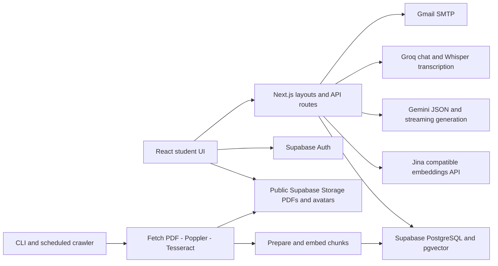
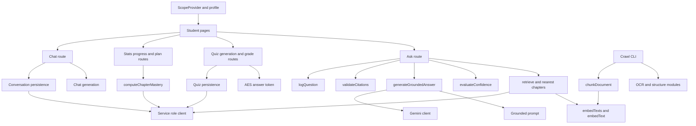
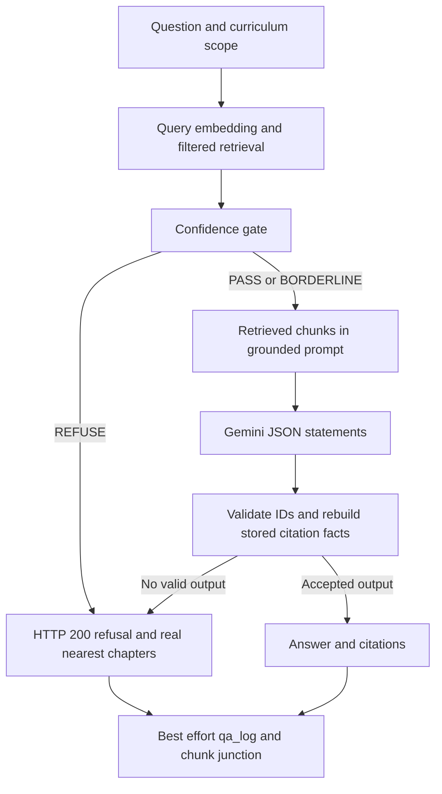
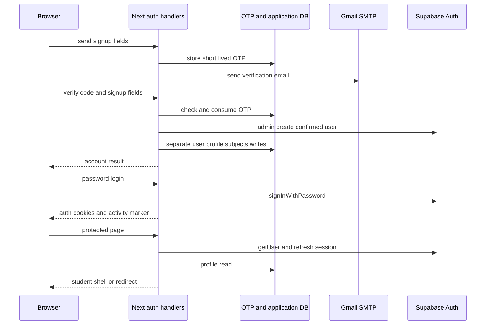
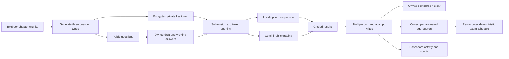
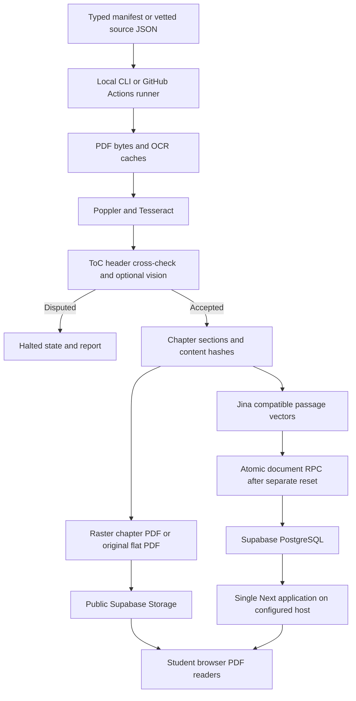

# Sabaq AI — implementation and operations reference

> Historical snapshot: this report describes the commit/date stated below. It predates the latest `triage-branch` update (`6a85545`) and has not been re-audited against that update. In particular, older planned/unimplemented Concept Lab or Quiz statements do not supersede the current code and `docs/project-status.md`.

This document describes the code at commit `c0f352d50e08d4a9687040b86686e9648226e53f`. It is a repository audit, not a certification of a deployed system or of answer accuracy. Code observations, local checks, historical documentation, and unverified live behavior are distinguished throughout. No application behavior was changed to produce it.

## 1. Project Overview

**Sabaq AI** is a study application for Pakistani board students. Its central Doubts feature searches a selected curriculum, evaluates retrieval confidence before generating an answer, and rebuilds citation metadata from retrieved content. A refusal is a normal result. The application also provides general AI Chat, chapter quizzes, quiz history and drafts, syllabus PDF readers, progress charts, deterministic exam plans, account management, and an animated subject explorer.

The current UI primarily offers FBISE classes 9–12 and nine subject codes, with class-specific exclusions for Islamiyat and Pakistan Studies. The database also seeds PCTB and classes 1–12. Those reference rows do not establish actual corpus coverage. `src/lib/subjects.ts` governs subjects offered in the application; the corpus APIs derive availability from stored content.

There are two distinct AI experiences. `/doubts` uses `/api/ask` and the retrieval/gate/citation pipeline. `/chat` is explicitly an open, ungrounded assistant and can use general model knowledge or a current-turn attachment. Chat has no retrieval confidence gate. Claims that every response in the whole application is textbook-grounded therefore exceed the implementation.

Implementation is substantially newer than several repository documents. Quizzes are persisted on submission, drafts are stored, Chat streams and persists conversations, voice transcription is implemented in Chat, and progress and plans have real handlers. Conversely, the evaluation route, evaluation page, evaluation library, and `npm run eval` described in older documentation are absent from this snapshot. A functioning live database, calibrated thresholds, model availability, deployed configuration, source rights, and actual answer quality were not established by this audit.

The product rules in `AGENTS.md` remain critical maintenance requirements: never call grounded generation after a REFUSE decision; fail closed; do not fabricate fallback answers; rebuild citation facts from stored rows; discard invalid references instead of reassigning them; filter retrieval by board/class/subject; avoid invented accuracy claims; and compute nearest chapters from real scores. Section 35 records places where source implementation needs further attention against those requirements.

## 2. Repository Snapshot and Analysis Scope

| Item | Observed value |
|---|---|
| Repository root | `C:\Users\hp\Documents\Projects\SabaqAI` |
| Origin | `https://github.com/TahaSohail-Goat/SabaqAI.git` |
| Initial branch | `gitignore-change-personal` |
| Initial HEAD | `e44bbb127c2ac3fc590df62b6ef69365dfd537d0` |
| Analyzed branch | `main` |
| Analyzed HEAD and fetched origin/main | `c0f352d50e08d4a9687040b86686e9648226e53f` |
| Commit subject | `Revise LICENSE with contributors and usage terms` |
| Audit date | October 10–11, 2026, Asia/Karachi |
| Submodules / worktrees | No submodules; one worktree observed |
| Synchronization | Fetch, forced checkout of main, hard reset, and equality checks completed before implementation analysis |

The user authorized discarding tracked local changes during synchronization. The staged `.gitignore` change was discarded by that operation. Untracked and ignored files were preserved; no clean command was used. Existing private files were neither published nor reproduced here. No commit or push was made.

The initial inventory found **30,139 files outside `.git`**, including **274 tracked files**. Major categories were `src/` 158, `scripts/` 52, `supabase/` 20, `docs/` 16, `public/` 3, and `data/` 516. Installed dependencies accounted for 27,526 files and `.next` for 1,823. Counts describe the initial inventory, before adding this document, and include local artifacts rather than only tracked source.

All 158 source files, all 52 scripts, all 19 SQL migrations, and the SQL test were inspected for implementation behavior. All repository documentation and application configuration were inspected. Some large files were read in successive ranges, and repetitive repair scripts were compared against inspected common bodies and then reviewed for differences. The detailed reference in section 31 accounts for every tracked path.

Lockfiles were inspected as dependency metadata rather than by reading every integrity string. The vendored PDF worker was inspected for license/version/usage, not by auditing its entire minified implementation. Both tracked PNG assets were visually inspected and measured. No third-party package internals were exhaustively audited. `.next`, dependency trees, PDF cache binaries, and OCR language model binaries were inventoried rather than reverse-engineered. Local source and OCR JSON were parsed for structure and coverage; every textbook sentence and every cached PDF page was not manually proofread. Secret-bearing local files were inspected only as safe configuration names or preservation hashes; private credential values were not read into this report.

Local-only data includes 201 source JSON files, 99 OCR cache JSON files, 207 PDF-cache files, and one tessdata file. Source JSON still includes historical `marking_scheme` records. Their presence does not mean that removed source type is supported by the current application or deployed schema. Local `.claude/scheduled_tasks.lock` is a process lock artifact, not an application scheduler. Generated `next-env.d.ts` and TypeScript build metadata are local build support files. The lint command refreshed the existing ignored `tsconfig.tsbuildinfo`; it is the sole detected hash difference among 516 pre-audit nontracked files outside generated dependency/build directories. The other 515 preservation hashes, including private configuration and local data, remained unchanged.

## 3. Executive Technical Summary

The application is one Next.js App Router project. React client pages live under a shared student layout; server route handlers under `src/app/api/` implement the backend. There is no Express service, ORM server, queue worker, or separate frontend build. Server-only integration modules use Supabase's service-role client, Gemini, Jina-compatible embeddings, Groq, and Gmail SMTP. The browser primarily calls same-origin APIs and Supabase Auth/Storage.

PostgreSQL provides identity-linked application tables, a normalized curriculum hierarchy, quiz records, conversation history, plans, drafts, and OTPs. pgvector stores 1024-dimensional embeddings. Retrieval invokes a SQL RPC using explicit curriculum filters and computes similarity as one minus cosine distance. Object storage contains public source PDFs and avatars. The ingestion RPC is atomic per submitted document; account/profile/quiz/log workflows consist of multiple API writes and do not inherit that transaction guarantee.

Doubts follows `retrieve → evaluateConfidence → generateGroundedAnswer → validateCitations → logQuestion`. Generation happens only after PASS or BORDERLINE. Model failures return an unanswerable empty result. Citation validation checks chunk identity and reconstructs provenance; it does not establish semantic entailment of each model statement.

Quiz generation reads a whole textbook chapter, constructs bounded contexts, and requests MCQ, short, and long questions. Answers are encrypted in an AES-GCM token. Submission grades MCQs locally and free text through Gemini, then attempts normalized persistence. Mastery derives from submitted attempt answers; plans are recomputed from current mastery without an LLM.

The repository points toward Vercel hosting through README links and Vercel instrumentation, but contains no deployment workflow or hosting configuration proving the active environment. A generic Node deployment with `next build` and `next start` is supported by scripts. The actual Next configuration does **not** set standalone output, despite a historical changelog claim.

## 4. Complete Technology Stack

Versions below come from `package-lock.json` unless explicitly identified as local tooling. They are an observed snapshot, not recommendations about current releases.

| Layer | Technology | Version | Purpose | Configuration/files |
|---|---|---|---|---|
| Runtime | Node.js | Local 24.18.0; CI 20 | Next server, scripts, crypto, subprocesses | `package.json`, CI workflows |
| Package manager | npm | Local 11.16.0 | Authoritative install/run workflow | `package-lock.json`, `AGENTS.md` |
| Framework | Next.js | 16.3.3 | App Router, RSC, route handlers, proxy, build | `next.config.mjs`, `src/app/`, `src/proxy.ts` |
| UI | React / React DOM | 19.2.8 | Components, hooks, context, portals | Pages and components |
| Language | TypeScript | 7.0.2 | Static checking and shared contracts | `tsconfig.json`; lint is `tsc --noEmit` |
| Styling | Tailwind CSS / Tailwind PostCSS plugin | 4.3.3 | Utility classes and CSS theme tokens | `globals.css`, `postcss.config.mjs` |
| CSS processing | PostCSS | 8.5.26 | Tailwind build integration | `postcss.config.mjs` |
| Icons | lucide-react | 1.34.0 | UI icons and status labels | React components |
| Class composition | clsx / tailwind-merge | 2.1.1 / 3.6.0 | Conditional and conflicting utility classes | UI helper usage |
| Validation | Zod | 4.5.4 in npm lock | Crawler manifest schema | `crawler/manifest/schema.ts` |
| Database/Auth/Storage | Supabase JS | 2.112.4 | PostgREST, auth admin, storage | `lib/supabase/`, routes |
| Cookie auth | @supabase/ssr | 0.12.5 | Browser/server clients and session refresh | `server.ts`, `client.ts`, proxy |
| Database | PostgreSQL + pgvector | Engine/extension versions not established | Constraints, RLS, cosine search, HNSW | SQL migrations |
| Generation | @google/genai | 2.19.0 | Gemini JSON and streaming requests | `lib/gemini.ts`, AI and quiz modules |
| Email | Nodemailer | 9.1.1 lock; local 9.0.6 | Gmail SMTP OTP delivery | `email/mailer.ts` |
| PDF browser rendering | pdfjs-dist | 6.3.289 | Canvas page readers | Three reader implementations; matching public worker |
| PDF rebuilding | pdf-lib | 1.17.1 | Embed rasterized pages into chapter PDFs | `crawler/pdf-rebuild.ts` |
| PDF parsing dependency | pdf-parse | 2.4.5 | Present in manifest; current pipeline uses Poppler | `package.json`; no current source import observed |
| Raster processing | sharp | 0.35.4 | Cached/rendered image processing and repair tooling | Crawler/repair scripts |
| OCR/native PDF tools | Tesseract, Poppler | Versions not recorded | OCR, PDF text, page rasterization | Workflow apt install; CLI modules |
| 3D | three / three-stdlib | 0.185.1 / 2.36.1 | Procedural scene meshes/materials | `components/explore/` |
| React 3D | @react-three/fiber / drei | 9.7.0 / 10.7.8 | Canvas lifecycle, helpers and stars | Explore scene |
| Effects | @react-three/postprocessing | 3.1.1 | Bloom and vignette | Explore canvas root |
| Animation | GSAP | 3.15.0 | Camera flight and cover opening | `useExploreFlight.ts` |
| Noise | simplex-noise | 4.0.3 | Procedural planet/cover textures | Explore assets |
| Telemetry | @vercel/analytics / speed-insights | 2.0.1 / 2.0.0 | Root page instrumentation | `src/app/layout.tsx` |
| Script execution | tsx | 4.23.12 | TypeScript command-line tasks | npm scripts and verifier scripts |
| Type declarations | @types/node/react/react-dom | 26.3.0 / 19.2.18 / 19.2.5 | Compile-time declarations | dev dependencies |
| Type declarations | @types/nodemailer/pdf-parse | 8.0.1 / 1.1.5 | Compile-time support | nodemailer types in dependencies; PDF types in dev dependencies |

The installed Zod package was 4.4.3 while the npm lock records 4.5.4 and the manifest requests a newer range. The old Bun lock describes a smaller dependency set. No installation or upgrade was performed during the audit. Type checking used the existing installation; a fresh npm installation remains a separate reproducibility check.

## 5. Repository Structure

```text
SabaqAI/
├── .env.example                    variable-name/template documentation
├── .github/
│   ├── workflows/ci.yml            install → type check → production build
│   ├── workflows/weekly-crawl.yml  scheduled/manual content pipeline
│   └── PULL_REQUEST_TEMPLATE.md    contributor checklist
├── AGENTS.md                       product invariants and development rules
├── package.json / package-lock.json authoritative npm scripts/dependencies
├── bun.lock                        older alternative lock; not prescribed workflow
├── next.config.mjs                 security headers and /ask redirect
├── postcss.config.mjs / tsconfig.json
├── metadata.json                   external project metadata, not route logic
├── src/
│   ├── app/
│   │   ├── layout.tsx / globals.css / icon.svg
│   │   ├── page.tsx                redirect to dashboard
│   │   ├── login/ signup/ forgot-password/ reset-password/ onboarding/
│   │   ├── auth/callback/          Supabase OAuth code exchange
│   │   ├── (app)/                  shared shell; group does not alter URLs
│   │   │   ├── dashboard/          stats, progress, exam plans
│   │   │   ├── doubts/ chat/ quiz/ syllabus/ explore/ settings/
│   │   │   └── quiz/history/[id]/  attempt detail, asynchronous route params
│   │   └── api/                    35 route files, 40 HTTP methods
│   ├── components/                 authentication widgets and theme/logo
│   │   ├── app/                    shell, readers, quiz/mastery/chat widgets
│   │   └── explore/                WebGL scene, procedural assets, fallback reader
│   ├── lib/
│   │   ├── ai/                     retrieval, gate, generation, citation, chat, STT
│   │   ├── auth/ email/ supabase/  identity, activity marker, OTP, provider clients
│   │   ├── ingest/ crawler/        chunk preparation and PDF/OCR pipeline
│   │   ├── quiz/                   encryption, persistence, draft API, feedback
│   │   ├── storage/ persist/       source PDFs and account-scoped browser state
│   │   ├── explore/                orbital math and procedural visuals/icons
│   │   └── mastery.ts types.ts subjects.ts qa-log.ts syllabus-data.ts tts.ts
│   ├── prompts/                    grounded-answer and general-chat prompts
│   └── proxy.ts                    Next request/session route protection
├── scripts/
│   ├── ingest.ts crawl.ts backfill-pdf-storage.ts
│   ├── dev-db-sql.mjs verify-embeddings.mjs
│   └── crawler-verify/             lint, regression, reset and repair tools
├── supabase/
│   ├── migrations/                19 files; duplicate 0010 prefixes
│   └── tests/001_schema_torture.sql self-rolling-back database assertions
├── data/
│   ├── crawl-manifest/             active and historical manifest categories
│   ├── crawl-sources.json          legacy baseline manifest
│   ├── .crawl-state.json           tracked success/failure bookkeeping
│   ├── source/                    ignored generated source JSON + tracked README
│   ├── .pdf-cache/ .ocr-cache/ .tessdata/ local pipeline artifacts
├── public/                         auth illustrations and PDF.js worker
├── docs/                           specifications and historical status material
└── explanation.md                  this reference; uncommitted audit output
```

There are no repository-owned Python/Java/Go services, Dockerfiles, Kubernetes manifests, infrastructure-as-code definitions, dedicated ORM models, or localization catalogs. PowerShell is the local command shell; project scripts are TypeScript and JavaScript. SQL defines database behavior directly. SVG, CSS, JSON, YAML, and Markdown provide assets, configuration, and documentation.

## 6. High-Level System Architecture



The separation is modular within one deployable application. Route handlers act as controllers; `src/lib/` contains provider clients and business helpers. A cached service-role client bypasses RLS intentionally. Consequently, an API handler must enforce ownership and curriculum filters itself; database client selection alone does not authorize a user.

Public corpus browsing and optional-auth Ask/quiz handlers differ from protected account/history/chat handlers. Proxy redirects are a browser navigation convenience and session policy, not API authorization. API routes are excluded from proxy matching and implement their own checks.

## 7. Application Bootstrapping and Execution Lifecycle

`npm run dev` starts `next dev -p 3000 -H localhost`. `npm run build` invokes `next build`; `npm start` invokes `next start`. The root layout imports global CSS, initializes font variables with `next/font/google`, inserts an early theme script, and mounts Vercel Analytics and Speed Insights. Body typography remains a system font; Fraunces is scoped to authentication display text and Bricolage Grotesque to the dashboard greeting.

The inline theme initializer reads browser local storage and sets `data-theme` before hydration to reduce flashing. Light is the default, irrespective of operating-system dark preference. Root `/` is a server redirect to `/dashboard`. The `(app)` server layout calls `getCurrentUserAndProfile`, redirects a signed-in user without a profile to onboarding, and passes initial identity/profile to `ScopeProvider` and the client shell. The shell composes Sidebar, Topbar, mobile navigation state, and IdleLogoutWatcher.

`src/proxy.ts` creates an SSR Supabase client and refreshes auth cookies for matched page requests. It redirects anonymous or inactive sessions away from protected routes, and signed-in users away from login/signup. Missing Supabase configuration allows the demonstration path. API requests do not run through this proxy; `getCurrentUserAndProfile` validates auth and the activity cookie inside handlers that use it.

Clients are created lazily. Supabase admin and Gemini modules cache their process-local clients; missing configuration returns null. That cache is not a cross-instance store and should not be used for durable student state. OTPs, conversations, plans, drafts, and submitted attempts use PostgreSQL. A missing `QUIZ_SECRET` still creates a per-process ephemeral key, which makes cross-instance grading unreliable.

There is no application bootstrap migration runner, auth-user trigger, background queue registration, webhook registration, or health endpoint. Schema initialization and content ingestion are explicit operations. The scheduled crawler is a separate CLI execution in GitHub Actions, not a long-running service inside Next.

## 8. Frontend Architecture

### Composition, state, and network access

Most interactive pages are client components. Server components establish the root and student layout; dynamic detail routes use App Router params. Fetch calls use the native browser `fetch` API, generally same-origin JSON or multipart forms. There is no React Query/SWR/Redux/Zustand layer, generated API client, or general query cache. Loading, error, and selection state are owned by each page with hooks.

`ScopeContext` provides board, class, subject, language, profile, and identity-related helpers. A signed-in server profile takes precedence over previously saved anonymous scope. Defaults are FBISE, class 10, Physics, English. The selected subject is a context value; retrieval remains single-subject. Language changes attempt a profile API update, but the current Settings UI does not expose a complete interface-language switch. UI copy is English rather than an externalized translation catalog.

`lib/persist/page-progress.ts` stores JSON browser progress under account- and scope-qualified keys. Doubts and Quiz can survive a local reload; Chat retains working draft/current conversation state. This is distinct from server history. Sidebar logout clears browser progress; Settings logout and account deletion do not follow that same cleanup path. A stored quiz working set omits its server draft ID, so restoring it does not restore server autosave linkage.

Selectors separate subjects, source categories, and units. Corpus-dependent controls call `/api/ask/options`; quiz setup calls `/api/quiz/scope`. Source titles for model/past papers are derived from source type, year-shaped chapter number, and subject, rather than trusting a shared `chapters.chapter_title` that another paper source may overwrite.

### Actual theme values

`globals.css` defines Tailwind v4 `@theme` tokens and explicit dark overrides. These implementation values supersede older palette examples.

| Token/role | Light | Dark |
|---|---|---|
| Page | `#DCEEE3` | `#0A1310` |
| Elevated chrome | `#A5D3B2` | `#1A2C23` |
| Card surface | `#FFFFFF` | `#17281F` |
| Hover / active | `#F1F9F4` / `#E1F1E8` | `#1E332A` / `#254335` |
| Inset surface | `#EEF7F1` | `#0D1916` |
| Primary text | `#102A3A` | `#F4F9F6` |
| Secondary text | `#294454` | `#C7DAD0` |
| Supporting / muted text | `#45606B` / `#647880` | `#96AFA2` / `#66806F` |
| Border / strong border | `#A9D3BA` / `#6FAE87` | `#253F33` / `#35604D` |
| Brand / brand hover | `#237A57` / `#185C43` | `#2FAE79` / `#1F8C5E` |
| AI accent | `#2A8C82` | Same accent; darker supporting surfaces |
| Quiz / warning | `#C58A35` | Same accent; darker supporting surfaces |
| Error | `#C65353` | Same accent; `#3A1E1E` background |
| Card radius | `0.75rem` | Same |

Physics purple, Chemistry teal, Biology green, Mathematics blue, Computer Science indigo, English orange, Urdu rose, Islamiyat blue-teal, and Pakistan Studies brown identify subjects. Semantic aliases such as background/accent/text-primary point to the underlying tokens. Selected controls use a solid brand fill in light mode and a quieter accent surface in dark mode; active sidebar navigation uses a strong inverted text/background pair in dark mode.

Tailwind spacing is applied at call sites. Desktop sidebar is expanded or collapsed, persisted in local storage; mobile navigation is an overlay drawer. Responsive grids and sticky headers exist, but older desktop-first design prose conflicts with the mobile-first instructions in AGENTS. No measured mobile performance or accessibility certification was performed.

### Readers, accessibility, and rendering

`AskDocumentReader` pages through PDFs and translates an absolute source citation page into a local chapter PDF page by subtracting the source offset. It cancels prior render tasks on changes. If no PDF URL exists it renders stored sections/chunks and can highlight the cited chunk. `SyllabusPdfReader` renders all pages in a continuous scroll column, supports zoom and fullscreen via a portal, and preserves an approximate scroll anchor while zooming. Explore has a third, paginated PDF reader in `BookReaderOverlay`.

PDF.js uses the vendored same-version worker at `/pdfjs/pdf.worker.min.mjs`. Canvas pages do not include a PDF text layer. Modals support Escape/close/backdrop in several places, but focus trapping and full keyboard interaction are not consistently implemented. Conversation rows use clickable container elements rather than a complete keyboard navigation model. SVG activity-chart tooltips depend on pointer interaction. Confidence/mastery widgets include labels and icons; Urdu answer/excerpt blocks have explicit RTL treatment in grounded surfaces. General Chat has less language-specific presentation.

Animations include fade/step entry, OTP digit pops/shake, mastery indicators, GSAP scene transitions, and procedural WebGL motion. Several CSS animations disable themselves for reduced motion. Explore detects WebGL and motion preference and can use a plain subject grid. That does not mean all UI motion is universally disabled.

## 9. Complete Page and Route Reference

| URL | Protection and entry | Behavior, components, and backend dependencies |
|---|---|---|
| `/` | Server redirect | Immediately redirects to `/dashboard`; no independent landing page. |
| `/login` | Public; proxy redirects signed-in users | Email/password form, Google OAuth button, error state, signup/reset links; POST login, then navigate to `next` or dashboard. The `next` value is not constrained locally. |
| `/signup` | Public | Username/email/password/confirmation/class form followed by six-digit OTP entry; POST send-otp, verify-otp, then login. Paste/autofocus, auto submission and resend cooldown are implemented. |
| `/forgot-password` | Public | Send a reset OTP to an existing email; POST forgot-password, then navigate to reset-password with email. Unknown email receives a distinct not-found response. |
| `/reset-password` | Public | OTP verification step followed by new password; verify-reset-otp peeks, reset-password consumes. Expiration during the second step can require another code. |
| `/onboarding` | Not in proxy protected-prefix list; handler requires auth when configured | Five-step username, board, class, subjects, optional exam date; POST onboarding writes profile/subjects. UI offers FBISE classes 9–12. |
| `/auth/callback` | Public server route | Exchanges Supabase OAuth code, sets activity marker, redirects to requested next path or dashboard; errors redirect to login. |
| `/dashboard` | Proxy protected | Greeting/scope, stored question and quiz counts, 14-day activity, mastery distribution, subject accuracy, action links. Uses stats and progress APIs. Recent activity remains an empty-state surface. |
| `/dashboard/progress` | Protected by dashboard prefix | Fetch progress, select subject, list chapter mastery rows/cards, explain low-data/unstarted states. No LLM involved. |
| `/dashboard/plan` | Protected | List/create/view/delete exam plans. Subject/range presets, custom dates and buffer choice, horizontally scrollable day timeline, practice links and matching drafts. APIs plan list/detail, quiz scope, drafts. Detail is page state rather than a dynamic URL. |
| `/doubts` | Proxy protected | Subject/source/unit selection, question entry, answer/refusal, confidence/citations, source reader and local restoration. POST `/api/ask`, options/document APIs. Grounded answer is JSON, not streamed. |
| `/ask` | Config redirect | Permanent redirect to `/doubts`; backend route remains `/api/ask`. |
| `/chat` | Proxy protected and API auth enforced | Model selector, conversation sidebar, streamed messages, stop generation, current attachment, recorder/STT, browser speech playback. Chat/transcribe/conversation APIs. General knowledge is allowed. |
| `/quiz` | Proxy protected; generation/grade APIs allow optional auth | Select subject/chapter, generate chapter practice, answer three types, autosave server draft when linked, submit, view feedback/results. Accepts `?subject=…&chapter=…` and `?draft=…`; chapter deep links trigger generation instead of looking for an existing draft. |
| `/quiz/history` | Proxy protected and API auth enforced | Lists latest completed attempts and separately resumable drafts; grade percentage, subject/chapter, date; links detail or draft-resume page. |
| `/quiz/history/[id]` | Protected and owner checked | `id` is an attempt ID. Displays submitted answers, correct options, model answers/rubrics and feedback after ownership check. |
| `/syllabus` | Proxy protected; corpus APIs public | Subject rail, recent documents, available source types, unit list, continuous-scroll PDF reader and fullscreen. Recent choices are browser-local. |
| `/explore` | Not in proxy protected-prefix list | Subject overview with orbiting books/planet, procedural effects, click flight/open/reveal, reader overlay; accessible fallback grid if WebGL is unavailable. Uses overview and options APIs. Anonymous use can reach this surface. |
| `/settings` | Proxy protected; mutation APIs check auth | Profile username/class/avatar, theme, password change, OTP-confirmed account deletion and logout. It does not currently offer the subject/exam-date editing promised by onboarding copy. |

No `/eval`, `/api/eval`, `/dashboard/history`, teacher portal, parent portal, billing page, or administrative content-management page exists in the current route tree. `(app)` is a route group, not an additional URL segment. No custom application `error.tsx`, not-found page, or loading route convention was found; pages handle their own loading/error states.

## 10. Backend Architecture

There are 35 API route modules and 40 exported HTTP handlers, plus the OAuth callback handler. JSON parsing and validation are mostly handwritten. Zod is used in the crawler, not as a shared API validation middleware. There is no dependency-injection container; modules import their collaborators directly and use cached provider client factories.

Common responsibilities are separated into `supabase/` client creation, `auth/` identity/profile/activity handling, `ai/` model/retrieval logic, `quiz/` token/persistence/feedback, `mastery.ts` aggregation, `storage/` source documents, and `email/` OTP delivery/state. Some important types are exported from route files and imported as type-only references by clients; shared API shape definitions are not all centralized in `types.ts` despite the original convention.

Handlers that need student ownership call `getCurrentUserAndProfile`, then constrain service-role reads/writes by `user.id`. Conversation helpers enforce owner checks before retrieving history or deleting. Quiz history detail checks the attempt owner before reading answer keys/rubrics. Corpus browsing intentionally does not require student ownership. Ask and quiz generation/grade only use identity for logging/persistence, so the page guard does not make those APIs authenticated.

Multipart uploads are processed in Node memory. Chat and transcription convert file bytes to buffers; Gemini receives base64 attachment data and Groq receives multipart audio. Source ingestion and OCR run through CLI modules and native subprocesses, not through student upload endpoints. No webhook or payment integration was found.

The default failure style is a route-specific JSON envelope with 4xx/5xx. Grounded refusals are 200. Chat changes from JSON pre-stream errors to raw text once a streaming response begins; provider errors after that point cannot change its HTTP status. Several best-effort helpers log and swallow persistence errors, which protects the interaction but can overstate saved state or hide failures in empty data responses.

## 11. Complete API Reference

### Conventions and shared shapes

All paths below are same-origin. Unless stated otherwise, successful JSON responses use HTTP 200 and generic exceptions use 500. There is no API version prefix, global CORS middleware, rate-limiter, CSRF-token middleware, pagination standard, or uniform error schema. Most errors use `{error: string}`; AI Chat/STT use `{status:'error',message}`. Authentication means a valid Supabase user plus a fresh application activity marker where `getCurrentUserAndProfile` is used. Proxy does not protect `/api/*`.

Scope query keys are `board`, `classLevel`, and `subject`. Most corpus/scope handlers default to FBISE/class 10/Physics; Explore overview defaults class 9. These are handler defaults rather than a guarantee of profile enforcement. `sourceType` is one of `textbook`, `past_paper`, `model_paper`. A flat paper's `chapterNo` is its year-shaped identifier, not a textbook unit number.

### Grounded Q&A and corpus

| Method and path | Access/request | Response and status behavior | Execution/persistence |
|---|---|---|---|
| POST `/api/ask` | Optional auth. JSON `question` required nonempty string; `board`, `classLevel`, `subject`, `language`, `sourceType`, `chapterNo` provide scope/output selection. | 200 answered/refused union described below; 400 missing question; 500 on unexpected processing errors, with a refusal-shaped body. | `ask/route.ts`: retrieves, gates, generates only if allowed, validates citations, best-effort qa log. Jina + Supabase RPC + Gemini. |
| GET `/api/ask/options` | Public; scope query keys. | `{board,classLevel,subject,sources:[{sourceType,units:[{chapterNo,chapterTitle,pdfUrl,pageFrom}]}]}`. All three source categories remain in response, including empty arrays. Missing admin/query errors yield 200 empty categories. | Joins chapters → sources → sections; creates public storage URLs; deduplicates units and derives flat titles. |
| GET `/api/ask/document` | Public; scope plus `sourceType`, `chapterNo`. | `{chapterNo,chapterTitle,sourceType,sections:[{sectionLabel,pageFrom,pageTo,chunks:[{id,content}]}]}`. 400 malformed required selection; 404 no rows; 500 missing configuration/query failure. | Reads expanded content view, orders sections/chunks, groups the document. Numeric missing parameters become zero through `Number(null)`, a validation limitation. |
| GET `/api/syllabus` | Public; scope keys. | `{board,classLevel,subject,source,totalChunks,chapters,chunks}`; chunks include id/chapter/title/section/pages/sourceType/language/excerpt/contentLength; 500 configured query error. Missing admin returns the fixed PCTB/class 10/Physics corpus, rather than echoing requested curriculum. | Service-role expanded view; each content excerpt capped at 200 characters. Legacy fallback is not live corpus proof. |
| GET `/api/explore/overview` | Public; board/classLevel, defaults FBISE/9. | `{board,classLevel,subjects:[{subjectCode,chapterCount,hasTextbook,hasModelPaper}]}`. Missing admin/query error returns zero coverage for offered subjects. | One joined corpus query; distinct textbook chapter count; no past-paper coverage flag. |

Answered Ask responses contain `status:'answered'`, `confidence:{band:'high'|'medium',top1,support}`, `language`, validated `statements:[{text,chunkIds}]`, rebuilt `citations`, and `notCovered`. Refusals contain `status:'refused'`, `reason` (`no_candidates`, `low_similarity`, `ungrounded_output`), `message`, `nearestChapters:[{chapterNo,chapterTitle,score}]`, and `suggestion`. Refusal nearest chapters use the actual retrieved set; the unexpected-error path returns an empty nearest array. Confidence is a threshold band, not a calibrated probability.

### Registration, sessions, and account APIs

| Method and path | Request and access | Response / errors | Implementation and effects |
|---|---|---|---|
| POST `/api/auth/send-otp` | Public JSON `email,password,full_name,class_level`. Checks email format, username pattern, classes 9–12, password length ≥8 and collisions. | `{success:true,emailSent:boolean}` reports delivery; missing SMTP returns false. 400 invalid inputs; 409 existing email/name; 429 cooldown; 500 exception. | Finds email in Auth and username in users; stores signup OTP; sends Gmail mail; may log code when email not sent. Does not create account yet. |
| POST `/api/auth/verify-otp` | Public `email,otp,password,full_name,class_level,board`. Validates required fields/class and OTP. | Account helper result: success/user/configuration/profile signals or `{error}`. 400 invalid/expired; 429 attempt exhaustion; 500 exception. | Consumes signup OTP then `createAccount`; client subsequently logs in. The validated signup form is not durably bound to the OTP row. |
| POST `/api/auth/signup` | Public legacy endpoint; `email,password,full_name`, default `class_level=10`, `board='FBISE'`. | Account helper result; 400 absent email/password/helper error; 500 exception. | Calls `createAccount` directly without OTP verification. This remains a bypass of the main signup UI's email-verification step. |
| POST `/api/auth/login` | Public `email,password`; presence checks. | `{success:true,user:{id,email,metadata},isDemo:…}` according to configuration; 400 bad inputs/auth failure; 500 exception. | SSR password sign-in writes Supabase cookies and activity marker. Missing public Supabase configuration fabricates demo-user-101 success, not a real session. |
| POST `/api/auth/logout` | No explicit user requirement. | `{success:true}`; 500 thrown error. | Signs out if client exists; deletes activity marker. Browser storage cleanup is handled differently by different callers. |
| GET `/api/auth/user` | Public identity probe. | `CurrentUserResult` = `{user,profile,configured}`; absent/invalid user returns nulls; 500 error with `configured:false`. | Validates Supabase user and activity; fetches users/profile/subjects through admin client. |
| POST `/api/auth/onboarding` | Configured auth required. `username,board,classLevel,subjects,examDate`. Username pattern; board/class presence; nonempty subjects and class offerings. | `{success:true}` or demo success when unconfigured; 400 validation; 401 auth; 409 name collision; 500 write errors. | Upserts users/profile, deletes then inserts subjects in separate writes. Saves optional profile exam date. Not transactional. |
| POST `/api/auth/profile` | Auth required. Optional `username,classLevel,subjects,language`; no board/exam-date field. | `{success:true}`; 400 invalid username/class/subject/language; 401; 409 name conflict; 500 writes. | Updates users/profile; replaces subjects through delete + insert. Class only 9–12; language en/ur. Empty object can succeed without changing anything. |
| POST `/api/auth/avatar` | Auth; multipart `file`, JPEG/PNG/WebP, ≤2 MiB. | `{avatarUrl}`; 400 missing/type/signature mismatch; 401; 413 too large; 500 configuration/upload/profile failure. | Checks magic bytes, uploads deterministic avatars path with upsert, writes timestamp-busted public URL to users. |
| POST `/api/auth/change-password` | Auth; `currentPassword,newPassword`, minimum new length 8. | `{success:true}`; 400 missing/short/wrong current password; 401; 500 configuration/update. | Separate Supabase password sign-in verifies current secret; admin updateUserById changes password. |
| POST `/api/auth/forgot-password` | Public `email`; nonempty string. | `{success:true}`, demo variant if unconfigured; 400 input; 404 unknown account; 429 cooldown; 500 exception. | `reset:<email>` OTP; findUserByEmail; store and send reset mail. Distinct unknown-account response allows enumeration. |
| POST `/api/auth/verify-reset-otp` | Public `email,otp`. | `{success:true}`; 400 missing/expired/wrong code; 429 attempts; 500 exception. | `peekOtp`, leaves valid code available for the later password update. Does not mint a separate reset authorization token. |
| POST `/api/auth/reset-password` | Public `email,otp,password`, length ≥8. | `{success:true}`; 400 input/code/expiry; 429 attempts; 503 missing admin; 404 unknown email; 500 update. | Consumes reset OTP, finds Auth user, admin-updates password. No application session is established by this operation. |
| POST `/api/auth/delete-account/send-otp` | Auth; no body needed. | `{success:true,emailSent}`; 401; 429 cooldown; 500 exception. | `delete:<email>` OTP, stored code, account-deletion mail; failed delivery can be logged. |
| POST `/api/auth/delete-account` | Auth; JSON `otp`. | `{success:true}`; 400 missing/wrong/expired; 429 attempts; 401; 500 delete/configuration. | Consumes deletion OTP, admin deletes Auth user, signs out and clears marker. SQL cascades remove owned rows; qa_log user references become null. Storage objects are not deleted. |

`GET /auth/callback` is outside the API folder but is an implemented HTTP handler. It accepts Supabase OAuth `code` and optional `next`, exchanges the code for a session, writes activity state, and redirects. Provider enablement/redirect allowlists live in the Supabase project and were not inspected.

### General Chat and transcription

| Method and path | Request/access | Response/status | Dependencies and side effects |
|---|---|---|---|
| POST `/api/chat` | Auth/admin required. Multipart `message` nonempty, optional `modelId`, `conversationId`, `board`, `classLevel`, `file`. Supported file MIME JPEG/PNG/WebP/PDF, ≤10 MiB, only multimodal models. | Success is streamed `text/plain`, `X-Conversation-Id` header. 400 input/attachment; 401 auth/config; 404 nonowned/missing conversation; 500 start/unexpected failure. Once streaming starts provider errors are text in a 200 stream. | Loads owned server history, builds profile prompt, creates conversation if needed, streams Gemini or Groq, then best-effort appends user/model messages including partial output. No RAG/citation validation. |
| GET `/api/chat/conversations` | Auth required. | `{conversations:[{id,title,updatedAt},…]}`; 401. Helper may return empty list on storage failure. | Lists user's conversations through `lib/chat/persist.ts`, ordered by update time. |
| GET `/api/chat/conversations/[id]` | Auth plus conversation ownership. | Owned conversation and ordered `messages`/turns; 401; 404 nonowned/missing. | Reads conversation and messages using service role. Attachment metadata survives; bytes do not. |
| DELETE `/api/chat/conversations/[id]` | Auth/owner. | `{success:true}`; 401; 404 deletion failure or missing/nonowned row. | Deletes owned conversation; messages cascade. |
| POST `/api/chat/transcribe` | Auth. Multipart `audio` must be nonempty File ≤20 MiB. | `{status:'ok',text}`; 400 missing/empty/large; 401; 422 empty transcript; 502 provider/config failure. | Sends audio to Groq Whisper via `transcribeAudio`; no audio storage or source retrieval. |

Model resolution accepts only the code's allowlist; unknown IDs use its default. Client history fields are not trusted as authoritative conversation history. Board/class form fields are prompt context fallbacks, not retrieval filters. A current-turn attachment is not uploaded to Supabase or retained as bytes.

### Quiz generation, grading, drafts, and history

| Method and path | Request/access | Response/status | Effects |
|---|---|---|---|
| GET `/api/quiz/scope` | Public scope query. | `{board,classLevel,subject,chapters:[{chapterNo,chapterTitle}]}`; missing admin → empty; 500 configured query error. | Distinct textbook chapters in expanded view. Current quiz picker uses this instead of legacy syllabus endpoint. |
| POST `/api/quiz` | Optional auth; JSON scope, `chapterNo` default 14, subject Physics, board FBISE, class 10. | `{questions,quizToken,draftId,chapterNo,subject,partial,requestedCounts,effectiveCounts}` with browser-safe question fields; 404 absent/too little chapter text; 503 unavailable or unsuccessful generation; 500 exception. | Loads full textbook chapter; sizes three question batches; validates chunk IDs; encrypts private grading data; best-effort upserts owned draft. Does not create a completed attempt. |
| POST `/api/quiz/grade` | Optional auth; `quizToken`, `answers` object keyed by question ID, optional `draftId`. | `{score,total,answered,results,saved,quizId}`. 400 absent/invalid/tampered/expired token or bad answers shape; 500 unexpected failure. | Opens AES token, matches MCQ indices, asks Gemini to grade text, attempts quiz/attempt persistence for signed-in user and deletes draft. Results expose answer material only on submission. |
| GET `/api/quiz/drafts` | Auth/admin required. | `{drafts:[…]}` summary includes scope, chapter, times, question/answered counts; 401; 500 query. | Lists owned drafts by update time; expired drafts can remain stored. |
| GET `/api/quiz/drafts/[id]` | Auth/owner. | Draft detail with id, subject, chapterNo/title, public questions, quizToken, index-keyed answers, isPartial/effectiveCounts/generatedAt and `expired`; 401; 404; 500. | Uses `ownedDraft`; expiration is reported rather than repaired or automatically deleted. |
| PATCH `/api/quiz/drafts/[id]` | Auth/owner; `{answers}` must be a nonarray object. | `{ok:true}`; 400 shape; 401; 404; 500 write. | Replaces answers and update timestamp. Keys and individual value types are not comprehensively checked. |
| DELETE `/api/quiz/drafts/[id]` | Auth/owner. | `{ok:true}`; 401; 404; 500. | Discards owned working set, not submitted attempt history. |
| GET `/api/quiz/history` | Auth/admin. | `{attempts:[…]}` with attempt ID, subject/chapter/topic, score/total/answered, scorePct and submission time; 401; 500. | Latest 50 owned attempts, joined to quiz/chapter. No cursor pagination. |
| GET `/api/quiz/history/[id]` | Auth/attempt owner. | `QuizAttemptDetail`, containing summary and graded question results; 401; 404; 500. | Reads owned attempt, questions/options/private keys or rubrics/answers, then rebuilds page/section metadata from chunks where still present. |

Generation's public question shape omits `correctIndex`, `explanation`, `modelAnswer`, and `rubric`; it includes identifiers, stem/type/options where relevant, validated chunk/page/section facts, and available max-score information. Grade result correctness is a count of passing questions, while feedback can also show awarded/possible points. These are different aggregates.

### Dashboard, mastery, and plans

| Method and path | Request/access | Response/status | Query/algorithm |
|---|---|---|---|
| GET `/api/dashboard/stats` | Uses optional identity result. | `{questionsAsked,quizzesTaken,dailyActivity}`; anonymous/missing admin → zeros and empty activity; caught exception → same shape at 500. | Exact owned qa_log/attempt counts and date rows, bucketed across 14 days. Chat messages are not included. |
| GET `/api/dashboard/progress` | Uses identity/profile/admin; missing prerequisites returns empty. | `{subjects:SubjectMastery[]}`; 500 aggregation failure. | `computeChapterMastery` for current board/class/enrolled offered subjects, textbook chapters, historical submitted answers. |
| GET `/api/dashboard/plan` | Identity/admin; absent → `{plans:[]}`. | Owned PlanSummary list; 500 query. | Reads exam_plans, derives subject labels/days remaining. |
| POST `/api/dashboard/plan` | Auth/profile/admin; `subject,fromChapterNo,toChapterNo,examDate,reserveBufferDay`. Positive ordered integer range; date-pattern/future check. | `{id}`; 400 invalid; 401 missing prerequisites; 404 no textbook chapters in range; 500 query/write. | Uses profile board/class; confirms at least one matching chapter, then inserts plan scope. Subject enrollment/full-range coverage is not enforced. |
| GET `/api/dashboard/plan/[id]` | Auth/admin, plan owner. | `PlanDetail` with scope, dates, expired flag, chapter mastery, computed days/items, and attempts since creation; 401; 404; 500. | Recomputes deterministic schedule from current mastery in saved plan scope. No LLM. |
| DELETE `/api/dashboard/plan/[id]` | Auth/admin, delete constrained by owner. | `{success:true}`; 401; 500. | Deletes matching row; no affected-row check, so nonexistent/nonowned ID can return success without deleting anything. |

### Exact supplementary response DTOs

These declarations are copied from inspected source with comments omitted. They supplement the endpoint tables; route-exported types are not a generated OpenAPI validation layer. PublicQuizQuestion omits the private fields of QuizQuestionData as stated above; generated responses use `partial`, while draft details use `isPartial`. Missing option fields apply to free-text questions.

From `src/app/api/quiz/drafts/route.ts`:

```ts
export interface QuizDraftRow {
  id: string;
  boardCode: string;
  classLevel: number;
  subjectCode: string;
  chapterNo: number;
  chapterTitle: string | null;
  answeredCount: number;
  totalQuestions: number;
  generatedAt: string;
  updatedAt: string;
  expired: boolean;
}
```

From `src/app/api/quiz/drafts/[id]/route.ts`:

```ts
export interface QuizDraftDetail {
  id: string;
  subject: string;
  chapterNo: number;
  chapterTitle: string | null;
  questions: unknown[];
  answers: Record<string, number | string>;
  quizToken: string;
  isPartial: boolean;
  effectiveCounts: { mcq: number; short: number; long: number } | null;
  generatedAt: string;
  expired: boolean;
}
```

From `src/app/api/quiz/history/route.ts`:

```ts
export interface QuizHistoryRow {
  id: string;
  submittedAt: string;
  score: number;
  total: number;
  answered: number;
  scorePct: number;
  subjectCode: string | null;
  chapterNo: number | null;
  chapterTitle: string | null;
  topicLabel: string | null;
}
```

From `src/app/api/quiz/history/[id]/route.ts`:

```ts
export interface QuizAttemptDetail {
  attempt: {
    id: string;
    submittedAt: string;
    score: number;
    total: number;
    answered: number;
    subjectCode: string | null;
    chapterNo: number | null;
    chapterTitle: string | null;
    topicLabel: string | null;
  };
  questions: GradedQuestionView[];
  summary: ReturnType<typeof summarizeAttempt>;
}
```

From `src/app/api/quiz/route.ts`:

```ts
export interface QuizQuestionData {
  id: string;
  position: number;
  stem: string;
  questionType: QuestionType;
  chunkId: string;
  chapterNo: number;
  page: number;
  section: string;
  options?: string[];
  correctIndex?: number;
  explanation?: string;
  modelAnswer?: string;
  rubric?: string;
  maxScore?: number;
}
```

From `src/app/api/quiz/grade/route.ts`:

```ts
export interface GradedQuestion {
  questionId: string;
  questionType: 'mcq' | 'short' | 'long';
  selectedIndex: number | null;
  answerText: string | null;
  correctIndex: number | null;
  correct: boolean;
  explanation: string | null;
  pointsAwarded: number | null;
  pointsPossible: number | null;
  feedback: string | null;
}
```

From `src/app/api/dashboard/stats/route.ts`:

```ts
export interface DailyActivity {
  date: string;
  questions: number;
  quizzes: number;
}

export interface DashboardStats {
  questionsAsked: number;
  quizzesTaken: number;
  dailyActivity: DailyActivity[];
}
```

From `src/app/api/dashboard/plan/route.ts`:

```ts
export interface PlanSummary {
  id: string;
  subject: string;
  fromChapterNo: number;
  toChapterNo: number;
  examDate: string;
  daysRemaining: number;
  reserveBufferDay: boolean;
}
```

From `src/app/api/dashboard/plan/[id]/route.ts`:

```ts
export interface PlanItem {
  chapterNo: number;
  chapterTitle: string | null;
  action: PlanAction;
  band: MasteryBand;
  accuracy: number | null;
  rationale: string;
}

export interface PlanDay {
  date: string;
  isBufferDay: boolean;
  isExamDay: boolean;
  items: PlanItem[];
}

export interface PlanQuizAttempt {
  id: string;
  chapterNo: number;
  chapterTitle: string | null;
  score: number;
  total: number;
  answered: number;
  submittedAt: string;
}

export interface PlanDetail {
  id: string;
  board: string;
  classLevel: number;
  subject: string;
  fromChapterNo: number;
  toChapterNo: number;
  examDate: string;
  daysRemaining: number;
  reserveBufferDay: boolean;
  expired: boolean;
  days: PlanDay[];
  skipped: { chapterNo: number; chapterTitle: string | null; reason: string }[];
  quizAttempts: PlanQuizAttempt[];
}
```

From `src/lib/quiz/feedback.ts`:

```ts
export interface AttemptItem {
  questionType: QuestionType;
  section: string | null;
  page: number | null;
  correct: boolean;
  pointsAwarded: number;
  pointsPossible: number;
  answered: boolean;
}

export interface SectionStat {
  section: string;
  page: number | null;
  correct: number;
  total: number;
  pct: number;
}

export interface TypeStat {
  correct: number;
  total: number;
  pct: number | null;
}

export interface AttemptSummary {
  scorePct: number;
  pointsAwarded: number;
  pointsPossible: number;
  passedCount: number;
  totalCount: number;
  answeredCount: number;
  byType: Record<QuestionType, TypeStat>;
  weakestSections: SectionStat[];
  strongestSections: SectionStat[];
  recommendation: string;
}
```


## 12. Database Architecture

The repository defines 31 application tables in `public`, one expanded corpus view, and ingestion/retrieval functions. Supabase-managed `auth.users`, `storage.buckets`, and `storage.objects` are integration dependencies, not application-defined table schemas. No ORM migrations or schema-generation tool exists; SQL files are the source of schema intent.

Curriculum content is normalized as `chapters → chapter_sources → sections → content_chunks`. A chapter carries curriculum identity; a source carries source type/language and later storage path; a section carries order/page range; a chunk carries content/hash/vector. `content_chunks_expanded` derives the flattened read shape and runs with `security_invoker=true`, preserving underlying RLS behavior for ordinary clients.

The service-role application client deliberately bypasses RLS for retrieval, ingestion, and route-mediated operations. This avoids zero-row results for accounts missing profiles, but makes explicit API authorization essential. The browser Supabase client uses the public anon key and session. RLS enables public reads of reference data and owner/profile-scoped reads of student/curriculum data. Keys, rubrics, OTPs, and chat tables have no ordinary-client policy.

The SQL ingestion RPC wraps chapter/source/section/chunk writes in one database function execution. Crawler reset, PDF upload, embedding calls, and storage-path update are outside that transaction. Quiz/account/log writes are separate PostgREST requests. “All multi-row writes are atomic” in the schema proposal is not true of current application workflows.

The schema can be reconstructed from migrations, but migration application history and the live schema were not queried. Two migration files begin with `0010`; fresh deployment ordering and migration-tool acceptance need explicit reconciliation. No `supabase/config.toml` or automated migration execution is present.

## 13. Database Schema Reference

### Reading the schema

Below, the schema catalog gives each table's responsibility and access path. Exact column declarations follow, extracted from inspected migration definitions. `NOT NULL`, defaults, checks, primary/foreign/unique keys, and deletion clauses in those declarations are authoritative source intent. Later alterations listed after the catalog apply to the original definitions. No statement here asserts that every migration successfully executed in a live project.

| Table | Responsibility | Access and application consumers |
|---|---|---|
| `boards` | Board codes/names/time, curriculum scope reference | Chapters/profiles/plans/drafts; public reference select |
| `class_levels` | Smallint class domain1–12 and display label | Curriculum/profile/plans/drafts; public reference select |
| `subjects` | Canonical subject code/name | Enrollment/chapters/logs/plans/drafts; public reference select |
| `languages` | Language/input-mode code/name | User preference/source/log; public reference select |
| `source_types` | Corpus category code/description | Chapter sources; public reference select; marking_scheme later removed |
| `user_roles` | Role code/description; no current role UI enforcement | Users; public reference select |
| `gate_decisions` | PASS/BORDERLINE/REFUSE codes | qa_log; public reference select |
| `refusal_reasons` | no_candidates/low_similarity/ungrounded_output codes | qa_log; public reference select |
| `quiz_difficulties` | easy/medium/hard domain | Quizzes; public reference select |
| `users` | Application identity/name/language/time, later avatar | Auth UUID cascade; account/profile routes; owner all |
| `student_profiles` | One profile per user; board/class/optional exam date/time | Owner all; auth/scope/mastery/plan |
| `student_subjects` | User-profile/subject many-to-many enrollment composite key | Owner all; auth/scope/curriculum RLS |
| `chapters` | Unique board/class/subject/chapter identity and title/time | Corpus hierarchy, quiz scope; profile/enrollment select |
| `chapter_sources` | Unique chapter/type/language document; later storage_path | Corpus/Storage, resets; profile/enrollment select |
| `sections` | Document order/label/page interval with nullable pages | Citation metadata/chunker; profile/enrollment select |
| `content_chunks` | Content/scoped hash/vector/index/time | 1024vector/HNSW, retrieval/quiz/mastery; profile/enrollment select |
| `qa_log` | Optional student/subject/language, gate/score/support/reason/latency/time | Owner all; user delete SET NULL; no question/answer text |
| `qa_log_chunks` | Log/chunk many-to-many with rank/score/cited flag | Owner all through log; chunk deletion cascades |
| `quizzes` | Owned chapter/difficulty/time, later topic_label | Owner all; grade persistence/history/mastery |
| `quiz_questions` | Ordered stem/nullable chunk provenance, later question_type | Owned quiz select; corpus chunk delete SET NULL |
| `quiz_options` | Zero-based question option rows | Owned quiz select; no correct flag here |
| `quiz_answer_keys` | Private correct option/explanation, composite option FK | No ordinary RLS policy; service role grade/history |
| `quiz_attempts` | Owned submission quiz/score/total/answered/time | Owner all; progress/stats/history/plans |
| `quiz_attempt_answers` | Attempt/question answers/correctness, later text/points/feedback | Owned attempt select; no same-quiz FK enforcement |
| `chat_conversations` | Owned title/create/update timestamps | Deny ordinary clients; service-role owner-checked chat helpers |
| `chat_messages` | Conversation role/text/attachment metadata/time | Deny ordinary clients; bytes not stored; conversation cascade |
| `quiz_question_types` | mcq/short/long domain | Public reference select; question FK |
| `quiz_answer_rubrics` | Private model answer/rubric/positive max score | No ordinary policy; service role text grading/history |
| `exam_plans` | Owned saved board/class/subject/range/date/buffer/time intent | Owner all; schedule not stored; plan handlers |
| `quiz_drafts` | Owned chapter scope/token/questions/answers/partial/counts/times | Owner all, unique user/scope/chapter; generation/resume/autosave |
| `auth_otps` | Namespaced key/plain code/expiry/attempts/time | Deny ordinary clients; service role mail/auth; no user FK |

### Exact table column and constraint declarations

These are original CREATE TABLE bodies from the migration sources, with comments omitted for readability. Additive columns/domain changes are listed below; they are not a live database export. SQL built-in default nullability applies where NOT NULL is absent (primary keys are implicitly nonnull). The declaration includes every original column and declared table constraint.

#### `boards`

Defined in `supabase/migrations/0001_init.sql`. Board codes/names/time, curriculum scope reference.

```sql
CREATE TABLE boards (
  board_code text primary key,
  board_name text not null,
  created_at timestamptz not null default now()
);
```

#### `class_levels`

Defined in `supabase/migrations/0001_init.sql`. Smallint class domain1–12 and display label.

```sql
CREATE TABLE class_levels (
  class_level smallint primary key check (class_level between 1 and 12),
  label       text not null
);
```

#### `subjects`

Defined in `supabase/migrations/0001_init.sql`. Canonical subject code/name.

```sql
CREATE TABLE subjects (
  subject_code text primary key,
  subject_name text not null
);
```

#### `languages`

Defined in `supabase/migrations/0001_init.sql`. Language/input-mode code/name.

```sql
CREATE TABLE languages (
  language_code text primary key,
  language_name text not null
);
```

#### `source_types`

Defined in `supabase/migrations/0001_init.sql`. Corpus category code/description.

```sql
CREATE TABLE source_types (
  source_type text primary key,
  description text not null default ''
);
```

#### `user_roles`

Defined in `supabase/migrations/0001_init.sql`. Role code/description; no current role UI enforcement.

```sql
CREATE TABLE user_roles (
  role_code   text primary key,
  description text not null default ''
);
```

#### `gate_decisions`

Defined in `supabase/migrations/0001_init.sql`. PASS/BORDERLINE/REFUSE codes.

```sql
CREATE TABLE gate_decisions (
  decision text primary key
);
```

#### `refusal_reasons`

Defined in `supabase/migrations/0001_init.sql`. no_candidates/low_similarity/ungrounded_output codes.

```sql
CREATE TABLE refusal_reasons (
  reason_code text primary key
);
```

#### `quiz_difficulties`

Defined in `supabase/migrations/0001_init.sql`. easy/medium/hard domain.

```sql
CREATE TABLE quiz_difficulties (
  difficulty text primary key
);
```

#### `users`

Defined in `supabase/migrations/0001_init.sql`. Application identity/name/language/time, later avatar.

```sql
CREATE TABLE users (
  id                 uuid primary key references auth.users(id) on delete cascade,
  role_code          text not null default 'student' references user_roles(role_code),
  display_name       text not null default '',
  preferred_language text not null default 'en' references languages(language_code),
  created_at         timestamptz not null default now()
);
```

#### `student_profiles`

Defined in `supabase/migrations/0001_init.sql`. One profile per user; board/class/optional exam date/time.

```sql
CREATE TABLE student_profiles (
  user_id     uuid primary key references users(id) on delete cascade,
  board_code  text not null references boards(board_code),
  class_level smallint not null references class_levels(class_level),
  exam_date   date,
  created_at  timestamptz not null default now()
);
```

#### `student_subjects`

Defined in `supabase/migrations/0001_init.sql`. User-profile/subject many-to-many enrollment composite key.

```sql
CREATE TABLE student_subjects (
  user_id      uuid not null references student_profiles(user_id) on delete cascade,
  subject_code text not null references subjects(subject_code),
  primary key (user_id, subject_code)
);
```

#### `chapters`

Defined in `supabase/migrations/0001_init.sql`. Unique board/class/subject/chapter identity and title/time.

```sql
CREATE TABLE chapters (
  id            uuid primary key default gen_random_uuid(),
  board_code    text not null references boards(board_code),
  class_level   smallint not null references class_levels(class_level),
  subject_code  text not null references subjects(subject_code),
  chapter_no    int not null check (chapter_no > 0),
  chapter_title text not null,
  created_at    timestamptz not null default now(),
  unique (board_code, class_level, subject_code, chapter_no)
);
```

#### `chapter_sources`

Defined in `supabase/migrations/0001_init.sql`. Unique chapter/type/language document; later storage_path.

```sql
CREATE TABLE chapter_sources (
  id            uuid primary key default gen_random_uuid(),
  chapter_id    uuid not null references chapters(id) on delete cascade,
  source_type   text not null references source_types(source_type),
  language_code text not null references languages(language_code),
  created_at    timestamptz not null default now(),
  unique (chapter_id, source_type, language_code)
);
```

#### `sections`

Defined in `supabase/migrations/0001_init.sql`. Document order/label/page interval with nullable pages.

```sql
CREATE TABLE sections (
  id            uuid primary key default gen_random_uuid(),
  source_id     uuid not null references chapter_sources(id) on delete cascade,
  section_label text not null,
  position      smallint not null check (position > 0),
  page_from     int,
  page_to       int,
  check (page_from is null or page_to is null or page_from <= page_to),
  unique (source_id, section_label)
);
```

#### `content_chunks`

Defined in `supabase/migrations/0001_init.sql`. Content/scoped hash/vector/index/time.

```sql
CREATE TABLE content_chunks (
  id          uuid primary key default gen_random_uuid(),
  section_id  uuid not null references sections(id) on delete cascade,
  chunk_index smallint not null check (chunk_index > 0),
  content     text not null check (length(btrim(content)) > 0),
  -- sha256 of normalised content + curriculum identity; makes ingestion idempotent.
  content_hash text not null unique,
  -- Must match EMBEDDING_DIM and the embedding model. Change all three together and re-embed
  -- everything — a mismatch fails inserts with an error that never mentions the model.
  embedding   vector(1024) not null,
  created_at  timestamptz not null default now(),
  unique (section_id, chunk_index)
);
```

#### `qa_log`

Defined in `supabase/migrations/0001_init.sql`. Optional student/subject/language, gate/score/support/reason/latency/time.

```sql
CREATE TABLE qa_log (
  id                uuid primary key default gen_random_uuid(),
  -- SET NULL, not CASCADE: a deleted student's metrics must survive for evaluation.
  user_id           uuid references users(id) on delete set null,
  subject_code      text references subjects(subject_code),
  question_language text references languages(language_code),
  top1_score        real check (top1_score between -1 and 1),
  support_count     int check (support_count >= 0),
  gate_decision     text references gate_decisions(decision),
  refusal_reason    text references refusal_reasons(reason_code),
  latency_total_ms  int check (latency_total_ms >= 0),
  created_at        timestamptz not null default now()
);
```

#### `qa_log_chunks`

Defined in `supabase/migrations/0001_init.sql`. Log/chunk many-to-many with rank/score/cited flag.

```sql
CREATE TABLE qa_log_chunks (
  qa_log_id uuid not null references qa_log(id) on delete cascade,
  chunk_id  uuid not null references content_chunks(id) on delete cascade,
  rank      smallint not null check (rank > 0),
  score     real not null check (score between -1 and 1),
  was_cited boolean not null default false,
  primary key (qa_log_id, chunk_id)
);
```

#### `quizzes`

Defined in `supabase/migrations/0001_init.sql`. Owned chapter/difficulty/time, later topic_label.

```sql
CREATE TABLE quizzes (
  id         uuid primary key default gen_random_uuid(),
  user_id    uuid not null references users(id) on delete cascade,
  chapter_id uuid not null references chapters(id),
  difficulty text not null default 'medium' references quiz_difficulties(difficulty),
  created_at timestamptz not null default now()
);
```

#### `quiz_questions`

Defined in `supabase/migrations/0001_init.sql`. Ordered stem/nullable chunk provenance, later question_type.

```sql
CREATE TABLE quiz_questions (
  id          uuid primary key default gen_random_uuid(),
  quiz_id     uuid not null references quizzes(id) on delete cascade,
  position    smallint not null check (position > 0),
  stem        text not null,
  -- SET NULL: deleting a corpus chunk must not cascade-delete a student's quiz history.
  chunk_id    uuid references content_chunks(id) on delete set null,
  unique (quiz_id, position)
);
```

#### `quiz_options`

Defined in `supabase/migrations/0001_init.sql`. Zero-based question option rows.

```sql
CREATE TABLE quiz_options (
  question_id  uuid not null references quiz_questions(id) on delete cascade,
  option_index smallint not null check (option_index >= 0),
  option_text  text not null check (length(btrim(option_text)) > 0),
  primary key (question_id, option_index)
);
```

#### `quiz_answer_keys`

Defined in `supabase/migrations/0001_init.sql`. Private correct option/explanation, composite option FK.

```sql
CREATE TABLE quiz_answer_keys (
  question_id          uuid primary key references quiz_questions(id) on delete cascade,
  correct_option_index smallint not null check (correct_option_index >= 0),
  explanation          text not null default '',
  foreign key (question_id, correct_option_index)
    references quiz_options (question_id, option_index) on delete cascade
);
```

#### `quiz_attempts`

Defined in `supabase/migrations/0001_init.sql`. Owned submission quiz/score/total/answered/time.

```sql
CREATE TABLE quiz_attempts (
  id           uuid primary key default gen_random_uuid(),
  quiz_id      uuid not null references quizzes(id) on delete cascade,
  user_id      uuid not null references users(id) on delete cascade,
  score        int not null check (score >= 0),
  total        int not null check (total > 0),
  answered     int not null check (answered >= 0),
  submitted_at timestamptz not null default now(),
  check (score <= total and answered <= total)
);
```

#### `quiz_attempt_answers`

Defined in `supabase/migrations/0001_init.sql`. Attempt/question answers/correctness, later text/points/feedback.

```sql
CREATE TABLE quiz_attempt_answers (
  attempt_id            uuid not null references quiz_attempts(id) on delete cascade,
  question_id           uuid not null references quiz_questions(id) on delete cascade,
  selected_option_index smallint check (selected_option_index >= 0),  -- null = unanswered
  is_correct            boolean not null,
  primary key (attempt_id, question_id)
);
```

#### `chat_conversations`

Defined in `supabase/migrations/0008_chat_persistence.sql`. Owned title/create/update timestamps.

```sql
CREATE TABLE chat_conversations (
  id         uuid primary key default gen_random_uuid(),
  user_id    uuid not null references users(id) on delete cascade,
  title      text not null default 'New chat',
  created_at timestamptz not null default now(),
  updated_at timestamptz not null default now()
);
```

#### `chat_messages`

Defined in `supabase/migrations/0008_chat_persistence.sql`. Conversation role/text/attachment metadata/time.

```sql
CREATE TABLE chat_messages (
  id                   uuid primary key default gen_random_uuid(),
  conversation_id      uuid not null references chat_conversations(id) on delete cascade,
  role                 text not null check (role in ('user', 'model')),
  content              text not null,
  attachment_name      text,
  attachment_mime_type text,
  created_at           timestamptz not null default now()
);
```

#### `quiz_question_types`

Defined in `supabase/migrations/0012_quiz_question_types.sql`. mcq/short/long domain.

```sql
CREATE TABLE quiz_question_types (
  question_type text primary key
);
```

#### `quiz_answer_rubrics`

Defined in `supabase/migrations/0012_quiz_question_types.sql`. Private model answer/rubric/positive max score.

```sql
CREATE TABLE quiz_answer_rubrics (
  question_id  uuid primary key references quiz_questions(id) on delete cascade,
  model_answer text not null,
  rubric       text not null default '',
  max_score    smallint not null default 1 check (max_score > 0)
);
```

#### `exam_plans`

Defined in `supabase/migrations/0014_exam_plans.sql`. Owned saved board/class/subject/range/date/buffer/time intent.

```sql
CREATE TABLE exam_plans (
  id                  uuid primary key default gen_random_uuid(),
  user_id             uuid not null references users(id) on delete cascade,
  board_code          text not null references boards(board_code),
  class_level         smallint not null references class_levels(class_level),
  subject_code        text not null references subjects(subject_code),
  from_chapter_no      int not null check (from_chapter_no > 0),
  to_chapter_no        int not null check (to_chapter_no >= from_chapter_no),
  -- Postgres check constraints must be immutable; current_date is stable, not immutable, so
  -- "exam_date must be in the future" is validated in the API instead, not here.
  exam_date           date not null,
  reserve_buffer_day  boolean not null default true,
  created_at          timestamptz not null default now()
);
```

#### `quiz_drafts`

Defined in `supabase/migrations/0015_quiz_drafts.sql`. Owned chapter scope/token/questions/answers/partial/counts/times.

```sql
CREATE TABLE quiz_drafts (
  id            uuid primary key default gen_random_uuid(),
  user_id       uuid not null references users(id) on delete cascade,
  board_code    text not null references boards(board_code),
  class_level   smallint not null references class_levels(class_level),
  subject_code  text not null references subjects(subject_code),
  chapter_no    smallint not null check (chapter_no > 0),
  chapter_title text not null default '',
  -- The sealed AES-256-GCM token /api/quiz already mints (src/lib/quiz/answer-key.ts).
  -- Server-minted and already encrypted — storing it is not a secrets leak. Carries the
  -- answer key needed to grade the quiz when it's resumed.
  quiz_token    text not null,
  -- Serialized client working-set, deliberately not normalized into per-question rows:
  --   * `questions` is the browser-safe list (no correct_index / explanation / model_answer /
  --     rubric — the exact shape /api/quiz already returns), written once, never mutated.
  --   * `answers` is { "<question_index>": <option_index | free_text> }, replaced wholesale
  --     on each autosave.
  -- The row's lifespan is one sitting and it's queried only as a whole; splitting it into
  -- child tables would add write amplification and cascade complexity for no query benefit.
  -- (exam_plans in 0014 and qa_log set the precedent for pragmatic non-normalized columns.)
  questions        jsonb not null,
  answers          jsonb not null default '{}'::jsonb,
  is_partial       boolean not null default false,
  effective_counts jsonb,
  generated_at  timestamptz not null default now(),
  updated_at    timestamptz not null default now(),
  -- One draft per student per chapter scope — regenerating the same chapter replaces it.
  unique (user_id, board_code, class_level, subject_code, chapter_no)
);
```

#### `auth_otps`

Defined in `supabase/migrations/0017_auth_otps.sql`. Namespaced key/plain code/expiry/attempts/time.

```sql
CREATE TABLE auth_otps (
  key        text primary key,
  code       text not null,
  expires_at timestamptz not null,
  attempts   smallint not null default 0,
  -- Doubles as the resend cooldown clock: the three send routes used to keep a separate
  -- in-memory `lastSent` Map (same multi-instance bug), and now derive "how long until another
  -- code may be requested" from this column instead. One table serves both jobs.
  created_at timestamptz not null default now()
);
```


### Later columns and domain changes

`users.avatar_url text` is added by `0010_avatar_url.sql`. `quizzes.topic_label text`, `quiz_questions.question_type text NOT NULL DEFAULT 'mcq' REFERENCES quiz_question_types(question_type)`, and nullable `quiz_attempt_answers.answer_text text`, `points_awarded numeric(4,2)`, `points_possible numeric(4,2)`, `feedback text` are added by `0012`. `chapter_sources.storage_path text` is added by `0011`. `model_paper` enters source_types in `0007`; `marking_scheme` source rows and reference code are removed in `0016`. `computer_science`, `islamiyat`, and `pakistan_studies` are seeded in `0009`. `0013` fills missing subject enrollment rows for existing profiles. The role domain includes student/guardian/admin, but there is no role-specific application administration feature.

### Indexes, relationships, and deletion semantics

Primary keys and natural/composite unique constraints create their own indexes. Explicit indexes include HNSW cosine on chunk embeddings; chunk section, section source and source chapter lookups; qa_log owner/time and qa_log_chunks chunk lookups; quizzes owner and owner+chapter; questions quiz; attempts quiz/owner; chat owner+updated time and message conversation+created time; exam plans owner; drafts owner; OTP expiration; and the unique case-insensitive nonempty display-name index added in `0006`.

Deleting an Auth user cascades to `users`, profiles/enrollment, quizzes and their questions/options/keys/rubrics/attempts/answers, chat conversations/messages, plans, and drafts. qa_log remains with `user_id=NULL`; it is not erased. Deleting corpus sources cascades through sections/chunks and qa_log_chunks, but quiz question `chunk_id` becomes null so attempts survive. Deleting a chapter referenced by quizzes is constrained by the quizzes chapter FK, which does not declare cascade. Avatar/PDF storage objects are not part of these relational cascades.

The database does not enforce that every question has exactly one grading mechanism, that an attempt answer belongs to the same quiz as the attempt, or that a submitted selected index references an option. The MCQ answer key itself has a composite FK to an existing option. Free-text points lack a declared nonnegative/upper-bound check. Draft JSON shape and immutability are maintained by application convention rather than column-specific RLS.

### Exact explicit index declarations

Natural key/PK indexes are already visible in table declarations. These additional statements include the corpus and student-query access paths; later migrations are included.

```sql
create index if not exists content_chunks_embedding_idx
  on content_chunks using hnsw (embedding vector_cosine_ops);
create index if not exists content_chunks_section_idx on content_chunks (section_id);
create index if not exists sections_source_idx on sections (source_id);
create index if not exists chapter_sources_chapter_idx on chapter_sources (chapter_id);
create index if not exists qa_log_user_idx on qa_log (user_id);
create index if not exists qa_log_created_idx on qa_log (created_at desc);
create index if not exists qa_log_chunks_chunk_idx on qa_log_chunks (chunk_id);
create index if not exists quiz_questions_quiz_idx on quiz_questions (quiz_id);
create index if not exists quizzes_user_idx on quizzes (user_id);
create index if not exists quiz_attempts_quiz_idx on quiz_attempts (quiz_id);
create index if not exists quiz_attempts_user_idx on quiz_attempts (user_id);
create unique index if not exists users_display_name_lower_unique
  on users (lower(display_name))
  where display_name <> '';
create index if not exists chat_conversations_user_idx on chat_conversations (user_id, updated_at desc);
create index if not exists chat_messages_conversation_idx on chat_messages (conversation_id, created_at);
create index if not exists quizzes_user_chapter_idx on quizzes (user_id, chapter_id);
create index if not exists exam_plans_user_idx on exam_plans (user_id);
create index if not exists quiz_drafts_user_idx on quiz_drafts (user_id);
create index if not exists auth_otps_expires_idx on auth_otps (expires_at);
```

### Policy declaration reference

Policies below are migration-source declarations rather than a live privilege dump. The avatar policy statements retain their invalid IF NOT EXISTS syntax to make that finding traceable; do not execute this reference as a corrected migration. Service-role bypass remains separate from ordinary-client policies.

```sql
create policy ref_read on boards            for select using (true);

create policy ref_read on class_levels      for select using (true);

create policy ref_read on subjects          for select using (true);

create policy ref_read on languages         for select using (true);

create policy ref_read on source_types      for select using (true);

create policy ref_read on user_roles        for select using (true);

create policy ref_read on gate_decisions    for select using (true);

create policy ref_read on refusal_reasons   for select using (true);

create policy ref_read on quiz_difficulties for select using (true);

create policy users_self on users
  for all using (id = auth.uid()) with check (id = auth.uid());

create policy profiles_self on student_profiles
  for all using (user_id = auth.uid()) with check (user_id = auth.uid());

create policy student_subjects_self on student_subjects
  for all using (user_id = auth.uid()) with check (user_id = auth.uid());

create policy chapters_match_profile on chapters for select using (
  exists (
    select 1
    from student_profiles p
    join student_subjects ss on ss.user_id = p.user_id
                            and ss.subject_code = chapters.subject_code
    where p.user_id = auth.uid()
      and p.board_code = chapters.board_code
      and p.class_level = chapters.class_level
  )
);

create policy chapter_sources_match_profile on chapter_sources for select using (
  exists (
    select 1
    from chapters ch
    join student_profiles p  on p.board_code = ch.board_code
                            and p.class_level = ch.class_level
    join student_subjects ss on ss.user_id = p.user_id
                            and ss.subject_code = ch.subject_code
    where ch.id = chapter_sources.chapter_id
      and p.user_id = auth.uid()
  )
);

create policy sections_match_profile on sections for select using (
  exists (
    select 1
    from chapter_sources cs
    join chapters ch          on ch.id = cs.chapter_id
    join student_profiles p   on p.board_code = ch.board_code
                             and p.class_level = ch.class_level
    join student_subjects ss  on ss.user_id = p.user_id
                             and ss.subject_code = ch.subject_code
    where cs.id = sections.source_id
      and p.user_id = auth.uid()
  )
);

create policy chunks_match_profile on content_chunks for select using (
  exists (
    select 1
    from sections s
    join chapter_sources cs   on cs.id = s.source_id
    join chapters ch          on ch.id = cs.chapter_id
    join student_profiles p   on p.board_code = ch.board_code
                             and p.class_level = ch.class_level
    join student_subjects ss  on ss.user_id = p.user_id
                             and ss.subject_code = ch.subject_code
    where s.id = content_chunks.section_id
      and p.user_id = auth.uid()
  )
);

create policy qa_log_own on qa_log
  for all using (user_id = auth.uid()) with check (user_id = auth.uid());

create policy qa_log_chunks_own on qa_log_chunks
  for all using (
    exists (select 1 from qa_log l where l.id = qa_log_chunks.qa_log_id and l.user_id = auth.uid())
  ) with check (
    exists (select 1 from qa_log l where l.id = qa_log_chunks.qa_log_id and l.user_id = auth.uid())
  );

create policy quizzes_own on quizzes
  for all using (user_id = auth.uid()) with check (user_id = auth.uid());

create policy quiz_questions_own on quiz_questions for select using (
  exists (select 1 from quizzes q where q.id = quiz_questions.quiz_id and q.user_id = auth.uid())
);

create policy quiz_options_own on quiz_options for select using (
  exists (
    select 1 from quiz_questions qq
    join quizzes q on q.id = qq.quiz_id
    where qq.id = quiz_options.question_id and q.user_id = auth.uid()
  )
);

create policy quiz_attempts_own on quiz_attempts
  for all using (user_id = auth.uid()) with check (user_id = auth.uid());

create policy quiz_attempt_answers_own on quiz_attempt_answers for select using (
  exists (
    select 1 from quiz_attempts a
    where a.id = quiz_attempt_answers.attempt_id and a.user_id = auth.uid()
  )
);

create policy if not exists "Users can upload their own avatar"
  on storage.objects for insert
  to authenticated
  with check (bucket_id = 'avatars' and (storage.foldername(name))[1] = auth.uid()::text);

create policy if not exists "Users can update their own avatar"
  on storage.objects for update
  to authenticated
  using (bucket_id = 'avatars' and (storage.foldername(name))[1] = auth.uid()::text);

create policy if not exists "Avatars are publicly readable"
  on storage.objects for select
  to public
  using (bucket_id = 'avatars');

create policy ref_read on quiz_question_types for select using (true);

create policy exam_plans_own on exam_plans
  for all using (user_id = auth.uid()) with check (user_id = auth.uid());

create policy quiz_drafts_own on quiz_drafts
  for all using (user_id = auth.uid()) with check (user_id = auth.uid());
```


### Views and functions

`content_chunks_expanded` exposes id, board, class_level, subject, chapter_no/title, section, page_from/to, source_type, language, chunk_index, content, content_hash and created_at. It does not expose embedding. Consumers include corpus APIs, quiz generation/history, mastery and repair baseline tooling.

`match_content_chunks` begins as a five-argument SQL stable function in `0002`; `0010_ask_source_filter.sql` drops it and defines a seven-argument version: query vector, board, class, subject, count (default 20), optional source type, optional chapter. It joins the corpus chain, compares lowercase board/subject, applies all supplied filters, orders cosine distance, and returns chunk metadata/content plus `score=1-distance`. It is invoker security, not a SECURITY DEFINER bypass. Service role receives execution rights. `0004` revokes inherited PUBLIC execution for the original functions, and `0018` does so for the newer seven-argument search.

`0005` pins `search_path=public,extensions` for the then-existing RPCs. The later replacement in `0010` does **not** retain that setting. A fresh reconstructed search function therefore loses the pinned extension path; actual live behavior depends on extension placement and any manual database corrections. The older hardening migration does not automatically apply to a newly created function.

`ingest_document(payload jsonb, p_force boolean default false)` in `0003` accepts a PreparedDocument payload with embedded chunk arrays, upserts chapter/source/sections, and inserts chunks or updates on hash conflict when forced. It returns `{chapterId,chunksReceived,chunksWritten}`. A thrown error aborts that function's writes. It does not remove chunks absent from a newly supplied document, manage storage objects, or encompass a preceding crawler reset.

### RLS and storage policies

| Domain | Ordinary client policy |
|---|---|
| Reference tables, including question types | SELECT true; service role writes |
| users/profiles/student_subjects | Owner `FOR ALL`, with owner checks |
| chapters/sources/sections/chunks | SELECT where user's profile board/class and enrolled subject match |
| qa_log and junction rows | Owner `FOR ALL` through user/join |
| quizzes and attempts | Owner `FOR ALL` |
| questions/options/attempt answers | SELECT through owned parent quiz/attempt |
| answer keys and rubrics | No anon/authenticated policy; service role only |
| chat conversations/messages | No anon/authenticated policy; API-mediated service role |
| exam plans and quiz drafts | Owner `FOR ALL` |
| auth_otps | No anon/authenticated policy; service role only |

`0010_avatar_url.sql` creates a public avatars bucket and folder-based owner insert/update policies plus public read. It uses `CREATE POLICY IF NOT EXISTS`, which is not valid PostgreSQL policy syntax; the file requires correction before relying on a fresh execution. No avatar delete policy is defined. Source PDFs use a public `source-pdfs` bucket created/checked by `lib/storage/source-pdfs.ts`, not a full standalone bucket migration; its configured upload ceiling is 50 MB (50,000,000 bytes) and PDF MIME. Existing bucket settings are only partly reconciled by that helper.

## 14. Authentication and Authorization

Supabase Auth handles passwords and OAuth sessions. The application does not hash passwords locally or implement its own JWT verification. SSR clients bind Supabase session cookies to Next's cookie store; the proxy forwards cookie refresh changes to the response. The browser client initiates OAuth. `getCurrentUserAndProfile` uses `auth.getUser()` rather than trusting an unvalidated cached identity, then loads application rows through the admin client.

Signup UI sends a verification code before creating an account. `createAccount` uses admin `createUser` with `email_confirm:true`, then upserts `users`, `student_profiles`, and all nine seeded `student_subjects`; the profile reader filters class offerings. These are separate writes; an Auth account can be left behind on later failure. The legacy signup endpoint does not require an OTP, so email verification is a UI-flow property rather than a universal registration requirement. The account helper exposes whether a profile was created. No database trigger repairs incomplete application profiles automatically.

Google OAuth is displayed in the current login/signup pages. `SocialAuthButtons` also implements Facebook, but provider enablement is external and was not verified. OAuth callbacks exchange the code server-side and establish the activity cookie. An OAuth identity lacking a profile is redirected by the student layout to onboarding.

The app adds `sabaqai-active`, an HTTP-only, path-wide, SameSite=Lax cookie, Secure in production, without a persistent max-age. Its value is a timestamp and freshness window is 30 minutes. The proxy and identity helper reject stale/missing markers even if Supabase still has a valid session. The client IdleLogoutWatcher watches local activity and starts a logout timer; local mouse/key events do not themselves refresh the server marker. Browser-close behavior follows the session cookie, subject to browser session restoration. The freshness helper accepts future timestamps because it lacks a nonnegative-age check.

OTP state is durable in `auth_otps`, keyed as signup email, `reset:<email>` or `delete:<email>`. Codes are six-digit crypto-random values, expire after two minutes, cap incorrect attempts at five, and use a 60-second resend cooldown. Valid verification consumes the row, while reset peeking preserves it for password submission. Expiration sweeps happen on store calls. Read/check/increment/delete are separate requests, so races can weaken attempt/single-use behavior. OTPs are stored plaintext behind deny-by-default RLS. Missing store configuration fails verification closed, but writes return void and can be logged as failed without preventing a sender success response.

| Capability | Anonymous | Signed-in student | Guardian/admin role rows | Service role |
|---|---|---|---|---|
| Corpus APIs / Ask / quiz generation and grade | API permits access | Permitted | No separate code path | Full server access |
| Protected workspace pages | Redirected when configured | Permitted with fresh marker | Same session behavior | Not a browser role |
| Chat, transcription | Denied | Own conversations | No special UI/privilege | Provider/database calls |
| History/drafts/plans | Denied or empty list depending endpoint | Own records | No cross-student view | Full table access with handler filtering |
| Profile/password/avatar/delete | Denied | Own account | Same account behavior | Admin mutations invoked by routes |
| Direct answer keys/rubrics/OTPs/chat rows | RLS denies | RLS denies | RLS denies without service role | Allowed |
| Content ingestion | No student endpoint | No student endpoint | No implemented role UI | CLI/RPC writes |

Roles are seeded reference values, not an implemented role-based permission system. The owner `users` policy permits owners to update their own role column unless restricted outside the supplied SQL; current route authorization does not use that column. This is a future privilege-design concern, not evidence of a present admin-feature exploit.

## 15. Security Architecture

Security headers are returned for all paths by `next.config.mjs`: CSP, nosniff, DENY framing, strict-origin-when-cross-origin referrer policy, a microphone-only permissions policy, and two-year HSTS with subdomains on HTTPS. CSP defaults to self, permits Supabase connections/images/frames, forbids objects and embedding ancestors, restricts form actions/base URI, and allows inline scripts/styles. Development additionally permits unsafe-eval, Vercel debug scripts and local websocket endpoints. Inline script permission is a documented defense-in-depth limitation. AI/student output is rendered as React text rather than injected HTML/Markdown.

Provider secrets are read on the server. Only Supabase URL/anon key have public prefixes. The admin module does not import a framework `server-only` sentinel; current consumers are server code, so future accidental client imports require care. Service-role routes must not rely on RLS as an owner filter.

Avatar upload validates MIME, size, and JPEG/PNG/WebP signatures. Chat attachment validation checks declared MIME and size but not equivalent magic-byte checks. Audio only checks presence/size. No antivirus processing, student source upload API, global upload quota, general body length limit, per-user AI quota, IP limiter, or application billing control was found.

SameSite cookies and same-origin UI requests exist, but there is no explicit CSRF token or Origin validation in mutation handlers. That is an absent control requiring a deployment-specific threat assessment, not a demonstrated cross-site exploit. Several endpoints reveal raw exception messages. Login's `next` navigation and OAuth redirect construction should be constrained to allowed internal paths; current source does not establish such a rule.

Quiz answer encryption protects confidentiality and integrity, but the token carries no user binding or single-use nonce. A valid token can be replayed within its two-hour TTL. Server drafts store only public questions and ciphertext; completed history exposes keys only after an owned submitted attempt. Store policies and optional-auth grade access need to be considered together when extending this design.

Grounded prompt delimiters treat retrieved text as untrusted data and forbid using it as instructions. Citation validation rejects unknown chunk IDs and never substitutes an unrelated chunk. It does not prove a claim is supported by its valid chunk, and the route does not use `answerable:false` as an explicit refusal if valid-looking statements are also returned. Threshold inputs and candidate scores also lack comprehensive numeric/curriculum validation. These are direct source limitations, detailed in section 35.

## 16. External Services and Integrations

| Integration | Purpose / sent data | Modules / calls | Configuration and failure behavior |
|---|---|---|---|
| Supabase Auth | Email/password, OAuth code/session, account creation/update/delete | SSR/browser clients; signInWithPassword, signInWithOAuth, exchangeCodeForSession, getUser, admin methods | Public URL/anon key and service key for admin; missing public config enables selected demo responses, not persistent identity. |
| Supabase PostgREST | Curriculum, profile, conversations, quizzes, logs, OTPs, plans | Service-role `.from`, `.rpc`; explicit ownership/scope predicates | Service-role secret; failures handled differently per route/helper. Live project schema not queried. |
| Supabase Storage | Public PDFs and profile images | upload/getPublicUrl/createBucket/updateBucket | Server admin uploads, browser downloads; source uploads ≤50 MB (50,000,000 bytes), avatar ≤2 MiB. Relational deletion does not delete objects. |
| Jina-compatible embeddings | Text chunks and normalized query → float vectors | `embedTexts`, POST `${base}/embeddings` with bearer token | Default Jina v1/jina-embeddings-v3/1024. Alternative compatible endpoint possible. No key throws; HTTP/dimension/count errors throw; opt-in 429 retry. |
| Gemini | Retrieved context/question → grounded JSON; chapter text → quiz; answers/rubrics → grades; chat history/attachment → stream; ambiguous header image → vision verdict | `GoogleGenAI`, generateContent/generateContentStream | GEMINI_API_KEY or AI_API_KEY; CHAT_MODEL for grounded/quiz/grade; separate allowlist for Chat; CRAWLER_VISION_MODEL for OCR verification. No live model call in audit. |
| Groq | Text chat SSE and voice audio transcription | Native fetch to OpenAI-compatible chat completions/audio transcriptions | GROQ_API_KEY, STT_MODEL. Chat API streams; STT errors return 502 with text-input fallback. |
| Gmail SMTP | Signup/reset/deletion codes to user email | Nodemailer cached transport, sendMail | SMTP_EMAIL and SMTP_APP_PASSWORD. Missing config returns not sent; some callers log OTPs. No SMS integration. |
| FBISE / Taleem360 PDF sources | Curriculum/document downloads | Ordered manifest candidate URLs, fetch/cache | No app credentials; network/format/timeouts cause failed/halted state. URL accessibility and content rights unverified. |
| Google Fonts | Fraunces and Bricolage Grotesque font acquisition at build | `next/font/google` | No API key; build can depend on external font access. Served local font assets after build. |
| Vercel instrumentation | Page analytics and performance telemetry | Root Analytics and SpeedInsights components | Repository mounts them, but deployed collection/retention configuration was not inspected. |

No payments, SMS, maps, realtime subscription listeners, external task queue, or error-monitoring SaaS integration was found. Supabase SDK presence alone does not mean realtime is used. No external service was modified or called for audit validation beyond the required Git synchronization.

## 17. AI/ML/OCR/RAG Architecture

### Grounded retrieval and refusal

`retrieve` normalizes selected Roman Urdu vocabulary into English retrieval terms, embeds one query with task `retrieval.query`, and calls `match_content_chunks` with board/class/subject and optional source/chapter. It maps SQL snake-case metadata into `RetrievedChunk`, derives flat-paper titles, rounds scores to three decimals, and retains the configured context limit (default six) from the top-K result (default 20). Rounding occurs before the gate.

With no service-role configuration, retrieval uses the ten fixed PCTB/class 10/Physics chunks in `syllabus-data.ts`, filtered to the requested scope, with a keyword heuristic and a warning. Those are not embedding scores. A configured Supabase/embedding error throws instead of falling back silently. This distinction matters when debugging refusal: empty scope, missing infrastructure, and low real similarity are different conditions.

`evaluateConfidence` assumes candidates are sorted and takes the first score as top1. Defaults in source are PASS_TOP1 0.55, BORDERLINE_TOP1 0.45, SUPPORT_SCORE 0.50; `.env.example` uses different starting values for the first two. PASS requires top1 above threshold and at least two supporting chunks. Otherwise a top1 above the borderline threshold is BORDERLINE; below it is REFUSE. Empty candidates refuse with no_candidates; exceptions refuse with low_similarity. There is no switch to bypass the gate. Numeric configuration and curriculum fields are not independently validated inside the gate.

The route returns early on REFUSE before `generateGroundedAnswer`. PASS/BORDERLINE supply selected chunks and a prompt that demands a JSON object containing `answerable`, language, statements with chunk IDs, and optional notCovered. Gemini uses temperature 0.1 and configured/default `gemini-3.5-flash-lite`. Model errors, missing key, invalid JSON or minimal shape failure return `answerable:false,statements:[]`; there is no synthetic chunk-sentence answer fallback.

`validateCitations` filters each statement's IDs against the retrieved map, drops statements with no valid IDs, and rebuilds citation chapter/title/section/pages/source/excerpt from stored metadata. Excerpts are capped at 400 characters. It refuses when no statement survives or more than half the original statements are discarded; exactly half discarded is allowed. It checks provenance identity rather than textual support. A statement containing both valid and invalid IDs can survive with only its valid IDs. The route currently bases its result on citation validation, not an additional answerable flag check.

`getNearestChapters` groups the actual candidates by chapter, keeps the best score/title for each, orders by score and returns up to three. With no candidates the result is empty. The API returns this honest suggestion data; the current Doubts UI does not provide the full nearest-chapter navigation experience described in older docs.

### Quiz generation and grading

Quiz generation does not use the retrieval gate. It queries all textbook chunks for a selected chapter. Missing admin uses a legacy chunk fallback that checks subject/chapter but omits board/class, unlike normal retrieval. Configured corpus failures do not provide a handwritten question bank. Less than 1,250 characters yields an insufficient-content result; a full target requires about 18,500 characters. Full targets are 50 MCQs, ten short and two long questions. Smaller chapters receive scaled counts with a minimum MCQ floor.

MCQs are requested in batches of at most 25 with bounded contexts around 16,000 characters; short/long contexts use approximately 12,000. Context assembly shuffles chunks and can exceed the nominal cap by the final included chunk. Batches run concurrently, use Gemini temperature 0.35/JSON, and retry once for an empty/missing result. Recent stored question stems help discourage repetitions, but generated questions are not comprehensively deduplicated within the current batch. Questions must cite a chunk from the supplied generation context; unknown references are discarded, never reassigned. Page/section labels are reconstructed from that chunk.

The private questions are sealed in a two-hour AES-256-GCM token. `QUIZ_SECRET` is SHA-256-derived to a 32-byte key, with fresh 12-byte IV and 16-byte authentication tag. The base64url payload is ciphertext, not a readable signed JSON answer bank. `openQuizToken` returns null on tamper/expiry/basic shape failure. It does not bind to identity or prevent reuse. Generation may create a server draft, but normalized quiz/question/key/rubric rows are created on submission.

Grade accepts answers keyed by question ID. MCQs use integer option equality. Short/long answer entries, including blank submissions, are sent together to Gemini with the private model answers/rubrics; points are clamped to 0…maxScore and a half-max threshold sets question correctness. Model unavailability/error yields zero text grades rather than a distinct ungraded state, which can be persisted as wrong answers. The returned score counts correct questions; feedback points can convey partial credit separately.

`persistQuiz` inserts quiz, question, options and private grading rows in multiple calls, without a database transaction. `persistAttempt` writes attempt and answers and swallows errors after logging. Consequently, `saved:true` can overstate persistence when the latter fails. A successful signed-in flow deletes the matching draft; replaying a still-valid token can create another completed quiz/attempt. History reconstructs results from normalized rows and remaining chunk metadata.

### General chat, speech, and history

The allowlist in `lib/chat/models.ts` contains Gemini `gemini-3.5-flash-lite`, Groq `openai/gpt-oss-120b`, and Gemini `gemini-3.6-flash`. Those identifiers are configuration facts, not a verification that the providers currently serve them. The Groq option is text-only; Gemini options accept a current image/PDF attachment.

The Chat prompt uses profile context, instructs a student-friendly assistant, and permits ordinary model knowledge. Owned conversation history comes from PostgreSQL; client-supplied history is discarded. Only the current attachment's bytes are sent. Previous attachments survive as name/MIME metadata, so follow-up turns cannot automatically inspect an old image/PDF again.

Gemini streams through its SDK with temperature 0.6 and abort support. Groq native fetch parses SSE `data` records and `[DONE]`. The route emits text chunks through a ReadableStream, catches provider failure as stream text, and preserves partial output when stopped. New conversations can be created before generation succeeds; appending messages/update time is best effort and nontransactional. There is no explicit output-token quota, history truncation window, or conversation pagination strategy.

MediaRecorder captures a browser microphone stream. The page sends an audio File to `/api/chat/transcribe`, Groq Whisper autodetects language using default `whisper-large-v3`, and the page automatically submits the transcript combined with a typed draft. This differs from the old planned editable-before-submit voice feature in Doubts. Text remains visible; it is disabled during transcription. Browser speech synthesis reads assistant responses using an English voice preference, pitch 0.92 and rate 0.93; it does not invoke a server TTS service.

### Chunk preparation and source identity

`lib/ingest/chunker.ts` is a pure transformation from SourceDocument to PreparedDocument. It normalizes line endings/spacing and splits recursively on paragraphs, lines, sentence separators, Urdu punctuation, spaces, then characters. Default maximum is 2,400 characters with 240-character overlap. Size is characters, not model tokens. Page metadata remains section-level; chunks cannot claim a more precise page than their source section provides.

Content hashes include normalized content and curriculum identity including board/class/subject/chapter/source type/language. Section label is not part of the hash. Repeated identical text in the same document therefore keeps the first occurrence's metadata when deduplicated. PreparedDocument carries normalized chapter/source/section/chunk data; scripts append embeddings before calling ingest_document. The ordinary ingestion script sends retrieval.passage task; the crawler adapter currently omits that task, so provider-specific behavior can differ.

### Crawler pipeline, caches, and structure checks

`scripts/crawl.ts` reads the new typed manifests through `manifest/loader.ts`: 33 textbooks, 33 model papers, 83 past papers, zero bundles. It does not load the 61-entry historical marking-schemes manifest. The 38-row `crawl-sources.json` remains a legacy baseline input for other scripts. Subject aliases canonicalize known names and explicitly reject out-of-scope subjects rather than silently guessing.

The crawler tracks ok/failed/halted_disputed entries in `.crawl-state.json`, skips entries already marked ok unless forced, fetches ordered candidate URLs, caches bytes by URL hash, and computes document checksums. Because ok entries are skipped before refetching and cached URL bytes can be reused even with force, this is not a reliable “detect every changed PDF” system. Failures and structural disputes can write state even in dry mode; crawler dry-run still performs network/OCR/cache work. It is different from the inspected ingestion dry run that performs no API calls/writes.

Poppler `pdftotext` tries direct extraction; flat documents with little direct text use OCR. Textbooks use per-page OCR and retain physical page numbers. `pdftoppm` rasterizes pages; Tesseract uses English/Urdu at different DPI defaults. Native calls are synchronous with timeouts, blank page failures are tolerated, and cached OCR is keyed by document checksum rather than language/settings version. Windows Tesseract/tessdata discovery and local Urdu data support are implemented. Normal OCR does not automatically apply orientation detection; a repair sampler does.

ToC detection searches the first 15 pages for numbered titles and trailing page numbers. Header detection uses uppercase/letter-position heuristics or running Unit numbers, filters early/front matter, and assigns resulting chapter numbers. Cross-checking compares ToC count/titles and header structure; ambiguous cases may ask Gemini vision to inspect a chapter header image. Missing/uncertain vision evidence halts a disputed book. A missing ToC alone is not an unconditional failure. Noise filtering removes recurrent ASCII watermark phrases, then sections paragraphs with approximate size bounds.

Per-chapter PDFs are rebuilt by rasterizing original pages and embedding compressed JPEG images into a new PDF using pdf-lib; they are visual reproductions, not original text-layer-preserving splits. Crawler writes local chapter SourceDocument JSON, uploads the rebuilt PDF, resets prior source rows, embeds, calls atomic ingest_document, and updates the source storage path. Reset happens before embedding succeeds, so failure can leave a chapter temporarily empty. Storage and database updates are not atomic together.

Flat documents use year as chapterNo, join extracted text into sections with unknown page metadata, and upload the original whole PDF. Model and past papers for the same year share a chapter row; displayChapterTitle handles their title collision. Bundle subject boundary detection exists with cached-OCR checks, but the active bundle manifest is empty and repair extraction scripts use different hardcoded ranges from some detector results. This needs source review before treating bundle coverage as correct.

## 18. File Upload, Processing, and Storage Architecture

| File class | Entry and limits | Processing | Persistence/lifecycle |
|---|---|---|---|
| Profile avatar | Settings → multipart avatar API; JPEG/PNG/WebP ≤2 MiB | Client resize to 512-pixel JPEG; server checks signatures/type/size | Public `avatars/<user-id>/avatar.<extension>`, upsert and timestamp URL in users. Changing extension can orphan old object; account deletion does not remove it. |
| Current chat attachment | Chat form; supported image/PDF ≤10 MiB | MIME/size checks; buffer → Gemini base64; text-only model rejects | Bytes exist only for request; message stores name/MIME, not file. No syllabus ingestion. |
| Voice recording | Chat recorder; ≤20 MiB server check | Browser MediaRecorder → multipart audio → Groq transcription | No audio object/table persisted; transcript becomes a chat message if sent. |
| Curriculum PDF | Manifest CLI / repair scripts | Fetch/cache; direct text or OCR; structure/noise checks; chapter raster rebuild | Local cache/source JSON plus public `source-pdfs`; vector corpus in SQL. |
| Source JSON | `data/source/*.json` → ingest CLI | Validate required shape, prepare sections/chunks/hash, embed if not dry | Atomic document RPC; source JSON is ignored local input, not packaged browser content. |

`source-pdfs.ts` builds lowercased, scope-qualified paths and rejects unsafe path traversal forms. The public URL is derived with the Supabase storage API. Source bucket creation expects PDF MIME and a 50 MB (50,000,000 bytes) ceiling; already-existing bucket metadata is not comprehensively repaired. Rebuilt textbook PDFs map local page 1 to absolute original pageFrom. Citation readers must rebase, clamp, and still display the stored original page label. They must not replace stored page facts with arbitrary PDF canvas indices.

The student UI cannot upload a book into the retrieval corpus. Chat file analysis does not make an attachment part of the curriculum and does not create reusable embeddings. There are no signed-download URLs, retention jobs for uploaded objects, or transactional object/database deletion helpers in this snapshot.

## 19. Complete Feature Inventory

| Feature | Entry / implementation / entities | Current code status and limitations |
|---|---|---|
| Email account creation | Signup UI → OTP endpoints → createAccount → Auth/users/profile/subjects | Implemented; legacy signup bypasses verification, writes are not transactional. |
| OAuth sign-in | SocialAuthButtons → Supabase → callback → student layout | Google presented; Facebook supported by component; provider setup unverified. |
| Profile onboarding | Five-step page → onboarding API → users/profile/subjects | Implemented including optional exam date; restricted UI offerings, incomplete later editing. |
| Password reset/change | Forgot/reset forms and Settings → OTP/Auth APIs | Implemented; reset uses short-lived code directly; unknown-account distinction. |
| Avatar / account deletion | Settings → upload/delete OTP APIs → Storage/Auth/cascades | Implemented; storage cleanup absent. |
| Idle session policy | Proxy/current-user helper/activity cookie + IdleLogoutWatcher | Implemented; local-only activity does not refresh server timestamp. |
| Theme / responsive shell | ThemeToggle, semantic CSS, Sidebar, Topbar, AppShell | Implemented light/dark, collapsed rail and mobile drawer; no system-theme mode in current behavior. |
| Grounded Doubts | Doubts → ask → retrieval/gate/generation/citation/log | Implemented; live calibration and entailment unverified; current limitations documented. |
| Citation document inspection | Citation chips → AskDocumentReader → PDF/document API | Implemented stored provenance, page rebasing, chunk fallback. |
| General AI Chat | Chat → authenticated stream → Gemini/Groq → chat tables | Implemented open knowledge, model switching, persistence and stopping; no grounding gate. |
| Chat image/PDF attachments | Multipart current-turn file → Gemini | Implemented; attachment bytes not reusable in subsequent history. |
| Voice input / speech playback | MediaRecorder → Groq Whisper; browser speech synthesis | Implemented in Chat, autosubmits transcript; not the planned Doubts editable transcript flow. |
| Chapter practice | Quiz → scope/generation → encrypted answer token | Implemented MCQ/short/long; count scaling and validated IDs; no handwritten fallback bank. |
| Server-side grading | Grade route → MCQ equality / Gemini rubric → results | Implemented; model text-grading errors become zero credit. |
| Draft autosave/resume | Quiz draft API + owned JSON working sets | Implemented; local restoration loses server draft link, expiry still limits grading. |
| Completed quiz history | Owned attempt list/detail → private keys after submit | Implemented latest-50 list; normalized writes can partially fail. |
| Dashboard | Stats/progress → cards and SVG charts | Computed data; recent activity text feed remains empty; includes Q&A/quiz, not Chat. |
| Mastery | computeChapterMastery → submitted answer counts → band widgets | Implemented all-history question correctness, not a calibrated learning diagnosis. |
| Exam plans | Plan metadata → current mastery → deterministic schedule | Implemented multiple plans, buffer/exam day, practice links; no stored completion checklist. |
| Syllabus library | Options → units/PDFs → continuous reader + recent selection | Implemented availability-driven controls; corpus coverage must come from real DB. |
| Animated Explore | Overview → procedural WebGL scene → book reader/fallback | Implemented; CPU/GPU-heavy on low-end devices; no measured performance claim. |
| Curriculum ingestion | SourceDocument → chunker/embedding → ingest_document | Implemented RPC path and local dry run; stale-source removal and task consistency concerns. |
| Automated crawling | Typed manifests → fetch/OCR/check/rebuild/embed/upload | Implemented CLI/workflow; ok-state/cache semantics can miss upstream changes. |
| Repair/verification utilities | crawler-verify scripts and SQL assertions | Implemented mix of read-only checks and destructive/live tools; not interchangeable. |
| Evaluation dashboard/CLI | Historical docs only | Not present in this commit; no accuracy number can be established from it. |
| Saved grounded answers / parent-teacher view / payments | Specifications only | Not implemented; no corresponding schema/routes/UI. |

### Mastery and deterministic planning details

`computeChapterMastery` creates the chapter universe from current textbook content for board/class/subjects, then reads the student's submitted attempts. It checks each attempt chapter's curriculum and counts an answer if an option index exists or text is nonempty. Correctness is the stored boolean from grading. It can retain an attempted real textbook chapter even when no current chunks remain. No points weighting, decay, recency window, topic subdivision, or per-question difficulty normalization is applied.

`bandFor(answered,correct)` yields not_started with null accuracy at zero; insufficient_data below five answered; strong at accuracy ≥0.8; getting_there at ≥0.5; otherwise needs_work. These are classification rules, not claims about measured product accuracy. A subject aggregate in a chart combines counts, rather than averaging chapter percentages blindly.

Plans persist scope, chapter range, date and buffer preference only. Each read sorts chapters by tier: needs_work, not_started, insufficient_data, getting_there, strong, then chapter number. Needs-work/unstarted chapters receive study + quiz + quiz sessions; insufficient-data study + quiz; getting-there quiz + quiz; strong review. Sessions are interleaved round-by-round across chapters, then assigned across remaining days with a floor-based distribution. At least four days are needed to reserve the optional buffer; the exam day itself has no assigned study task. Past dates return expired with no schedule; exam-today cases can return skipped chapters because no effective study days remain.

The plan's attempts list filters submission time ≥plan creation and saved board/class/subject/range. Attempts do not reference a plan FK and can appear in multiple matching plans. Matching resumable drafts in the UI are filtered by scope/range, not plan creation timestamp. Schedule rationale text sometimes refers to a last attempt even though mastery uses all attempts; that copy is not an alternative scoring algorithm.

## 20. End-to-End User Workflows

### New email student

1. Signup collects username, email, password/confirmation and class. Local checks precede POST send-otp. The server checks collision/format and stores a two-minute code keyed by email.
2. Gmail delivery is attempted; the client transitions to six-digit input, supports paste and resend. OTP store/delivery failures can diverge from the sender's success response.
3. Verify-otp consumes the code and calls createAccount. Auth user creation is followed by application user/profile/subjects writes. The returned account is not itself an SSR login session.
4. The client calls login, receives auth cookies/activity marker, and navigates into the workspace. The server layout redirects to onboarding if a signed-in user lacks a profile. Because createAccount already provisions a profile, not every email registration necessarily visits onboarding automatically.
5. Onboarding replaces profile/subject selection and writes optional exam date. ScopeProvider hydrates the resulting profile on later server loads.

### Grounded question and citation

1. Doubts loads scope-dependent options. Changing subject/source/unit changes the selected content universe and reader state.
2. Submit sends question plus scope to ask. The handler uses identity only to associate a log when available.
3. Retrieval embeds the normalized query and obtains filtered similarity rows. The confidence gate decides before Gemini is called.
4. REFUSE returns a calm normal response and actual nearest candidates. PASS/BORDERLINE generate JSON; citation validation removes unsupported IDs and rebuilds metadata.
5. The handler best-effort logs gate/score/rank/citation metadata; no question/answer text is stored in qa_log. The client displays statements and prominent citation chips, sets RTL for Urdu blocks, and saves local working progress.
6. Clicking a citation selects the matching document/chunk/page. A chapter PDF rebases absolute pages to its local page sequence; a text fallback scrolls to the stored chunk. PDF URL availability does not prove extracted OCR text is faithful.

### Practice, grading, history, and mastery

1. Quiz loads textbook chapter scope, sends selected chapter to generation, and receives public questions plus ciphertext and optional draft ID.
2. A signed-in generated set may upsert one server draft per curriculum chapter and prune old drafts. Working answers are locally stored and, while linked, debounced to server every 1.5 seconds using question indices.
3. Submit transforms answers to question-ID keys and sends token/answers/draft ID. The UI requires at least one answer; the API permits an empty answers object.
4. Grade decrypts the key, checks MCQs, grades text through Gemini, returns correct MCQ indices/explanations, free-text feedback and partial points, and attempts normalized persistence.
5. Completed history reads persisted attempts, not local result state. Mastery and dashboard counts also read those rows, so a failed persistence operation can make UI results differ from history/progress.
6. A valid submitted token may be replayed before expiry. Regenerating a chapter replaces its draft, not prior completed history. Resuming an expired draft does not refresh its token.

### Chat and voice

1. Chat requires a valid fresh session. A selected existing conversation is owner-checked and replayed from stored messages; a new conversation title is taken from the first 50 message characters.
2. Typed text/current attachment/model ID are sent as multipart. A text-only model rejects files. The route uses profile context and general assistant instructions, not retrieved textbook chunks.
3. The response header supplies conversation ID and text chunks update an optimistic assistant message. Stop aborts generation and preserves available partial text.
4. The route appends user/model messages and touches conversation update time. Stored message history includes attachment labels, not bytes.
5. Voice recording sends audio to transcription and then automatically sends the transcript with the current draft. Browser speech synthesis can read the response; later unmount cleanup has a stale-state limitation described in section 35.

### Exam preparation and corpus operations

A student creates a plan from a subject/range/future date; the API uses profile scope and confirms matching textbook content. Viewing the plan computes current mastery and redistributes remaining sessions. Practice links can generate a fresh quiz for the chapter. Submitted attempts affect future plan reads; a plan does not store day completion itself.

An operator runs ingestion from vetted SourceDocument JSON or crawler manifests. Crawl downloads/caches/OCRs, verifies structure, rebuilds PDFs, resets/replaces document rows and uploads objects. The ordinary ingest script skips known hashes and embeds passages before a document RPC. None of these tools are authorized by visiting a student page. Operators must inspect which repair scripts reset live sources before executing them.

## 21. State Management and Data Flow

| State | Authority / lifetime | Writers and readers |
|---|---|---|
| Supabase identity/session | Auth service + session cookies | Login/OAuth/proxy/server client/browser client |
| Activity marker | Server timestamp session cookie, 30-minute window | Login/callback/proxy/current-user helper; logout/deletion clear |
| Student profile/enrollment | PostgreSQL | Account/onboarding/profile APIs → ScopeProvider and server handlers |
| Active subject/source/unit | React state/context | Selectors/pages; some scope/progress is browser-local |
| Theme/sidebar preference | Browser local storage + DOM/CSS | Theme initializer/ThemeToggle/Sidebar |
| Doubts working answer | Page/local storage | Ask API result → UI; not persistent answer history |
| Chat draft/current conversation | Browser local state plus authoritative DB messages | Chat page/API/conversation helpers |
| Quiz private grading data | Encrypted token; completed private DB rows after submission | Generation/grade/history server code |
| Quiz working answers | React/local storage and owned draft JSON | Quiz page → PATCH; grade payload uses IDs |
| Submitted performance | quiz_attempts/answers | Grade persistence → history/mastery/stats/plans |
| Plan schedule | Derived each GET, not stored | Plan metadata + current mastery + current date |
| Corpus facts | Normalized SQL rows + source objects | CLI ingestion → retrieval/options/document/readers |
| Crawl progress/cache | Local tracked state and ignored cache files | CLI/workflow; not student application state |

There is no browser store synchronized by realtime events. Scope changes can require clearing/refetching page-local state, and manual effects are responsible for avoiding stale results. Local-storage read/write exceptions are swallowed so private browsing/storage-full conditions do not crash pages. These helpers do not validate every restored nested value. Persisted JSON is a working convenience, not trusted grading authority; the encrypted token is the grading source.

## 22. Internal Module Dependencies



Shared types connect retrieval/generation/citation/Ask and corpus readers. Quiz public/private types reside in the quiz route, persist module and answer-key module, and route-exported types support history/detail UI. Mastery is correctly shared between progress and plans; scoring should not be reimplemented independently in charts or routes.

Important duplication remains: three PDF reader implementations with different render cancellation/error behavior, large page-local fetch/form/state orchestration, and many near-identical one-off ingestion scripts with manual boundaries. Those scripts preserve repair knowledge but do not constitute a reusable all-subject chapter detector. Filename similarity is not evidence that each script can run safely against another book.

`syllabus-data.ts` remains a development fallback dependency for retrieval, syllabus and quiz. It is not the active manifest or live corpus. `prompts/chat.ts` and `prompts/grounded-answer.ts` have different policies; merging them would change product behavior. `metadata.json` describes external project capability and is not a runtime feature registry.

## 23. Configuration and Environment Variables

Values from private local files are deliberately omitted. Defaults listed elsewhere describe source code or a public template, not the audited machine's secrets. Next automatically loads its normal environment files; CLI behavior differs.

| Variable | Purpose | Required | Used by |
|---|---|---|---|
| NEXT_PUBLIC_SUPABASE_URL | Project URL and CSP origin | Real Auth/database/storage | All three Supabase clients, proxy, password verification, Next headers |
| NEXT_PUBLIC_SUPABASE_ANON_KEY | Public browser/SSR Auth credential | Real sessions/OAuth | Browser/server client, proxy, password verification |
| SUPABASE_SERVICE_ROLE_KEY | Privileged database/storage/Auth admin | Real backend persistence/retrieval | admin factory and all its callers |
| SUPABASE_DB_HOST | Direct SQL endpoint | Only direct database tools | dev-db-sql manual env parser |
| SUPABASE_DB_USER | Direct SQL username | Direct SQL | Same |
| SUPABASE_DB_PASSWORD | Direct SQL secret | Direct SQL | Same |
| SUPABASE_DB_CA_CERT | Optional CA file path for verified TLS | Optional direct SQL | Same |
| EMBEDDING_API_KEY | Embedding bearer credential | Live ingestion/retrieval | embeddings module and probe/script environment |
| EMBEDDING_BASE_URL | Compatible embedding API base | Optional default Jina | embeddings module |
| EMBEDDING_MODEL | Embedding model identifier | Optional default jina-embeddings-v3 | embeddings module |
| EMBEDDING_DIM | Expected vector length | Must agree with SQL/model; default 1024 | embeddings module |
| GEMINI_API_KEY | Gemini API credential | Grounded generation/quiz/text grade/Gemini Chat/vision | getGeminiClient |
| AI_API_KEY | Alternate Gemini credential | Optional fallback | getGeminiClient |
| CHAT_MODEL | Model for grounded answers, quizzes and text grading | Optional source default | generation.ts and quiz routes; not Chat selector |
| GROQ_API_KEY | Groq bearer credential | Groq Chat and voice transcription | chat-generation.ts, transcription.ts |
| STT_MODEL | Whisper transcription model | Optional whisper-large-v3 | transcription.ts |
| QUIZ_SECRET | Stable encryption secret across server processes | Operationally required for reliable quiz grading | quiz/answer-key.ts |
| TOP_K | Search candidate count | Optional 20 | retrieval.ts |
| CONTEXT_MAX_CHUNKS | Retained generation/gate candidate cap | Optional 6 | retrieval.ts |
| PASS_TOP1 | PASS top-score threshold | Optional source 0.55 | guardrail.ts |
| BORDERLINE_TOP1 | BORDERLINE top-score threshold | Optional source 0.45 | guardrail.ts |
| SUPPORT_SCORE | Supporting candidate cutoff | Optional 0.50 | guardrail.ts |
| SMTP_EMAIL | Gmail sender/login | Actual OTP delivery | email/mailer.ts |
| SMTP_APP_PASSWORD | Gmail application password | Actual OTP delivery | email/mailer.ts |
| CRAWLER_VISION_MODEL | Ambiguous chapter-header vision model | Optional source gemini-2.5-pro | crawler/structure/vision-verify.ts |
| NODE_ENV | Secure cookies and development CSP differences | Runtime-managed | activity cookie/next.config.mjs |
| TEMP | Windows temporary directory fallback | Operating-system setting | direct SQL helper dependency fallback |
| LOCALAPPDATA | Windows Tesseract/tessdata discovery | Operating-system setting | crawler/ocr.ts |


Workflow-local environment names are also identifiable:

| Name | Meaning / consumer |
|---|---|
| SUPABASE_URL | Actions secret mapped to NEXT_PUBLIC_SUPABASE_URL; not directly read by the Next backend. |
| DRY_RUN_INPUT | Manual input passed as an opaque env string to the flags shell step. |
| FORCE_INPUT | Manual force input used to append --force. |
| LIMIT_INPUT | Manual numeric/intended source-limit input used to append --limit; not spliced into shell source. |
| CRAWL_FLAGS | Flags output passed through env to the crawl invocation; shell word splitting still forms CLI arguments. |
| GITHUB_OUTPUT | Runner-provided output-file path used by the flags step. |
| GITHUB_TOKEN | Default Actions token referenced in checkout security comments; persisted checkout credentials explicitly disabled. |

GitHub Actions secret names include `SUPABASE_URL`, `SUPABASE_SERVICE_ROLE_KEY`, and `EMBEDDING_API_KEY`; the workflow maps the first to `NEXT_PUBLIC_SUPABASE_URL`. `GITHUB_*` and runner contexts are workflow metadata, not additional application credential names. No unlisted database URL, payment key, or session signing secret is inferred.

`scripts/ingest.ts` manually loads `.env`, not `.env.local`. The direct SQL runner reads `.env.local` then `.env` through its own parser and does not simply inherit all process env values. Other crawler/repair/probe scripts load local files according to their source. This inconsistency can make Next work while a CLI sees missing credentials. Configure the execution path actually being used; do not assume every script follows Next's env-loading rules.

The weekly crawler supplies only URL/service-role/embedding key, omitting embedding base/model/dim overrides and Gemini vision configuration. Its defaults therefore matter. Empty/malformed numeric env values are converted with Number without a centralized startup validation step. Thresholds remain starting settings, not evidence of calibration.

## 24. Build and Development Workflow

The prescribed package manager is npm and Node 20+. CI specifically selects Node 20. Local audit tooling used existing Node 24.18.0/npm 11.16.0. On this Windows host, `npm.ps1` is blocked by execution policy, so commands used `npm.cmd`; changing policy is unnecessary.

```sh
npm install
npm run dev
npm run lint
npm run build
npm start
npm run ingest -- --dry-run
npm run ingest
npm run crawl:dry
npm run crawl
```

Lint is TypeScript compilation only, not ESLint. There is no npm test/eval/format script. `crawl:dry` and `ingest -- --dry-run` have different effects: ingestion dry-run transforms local JSON without API calls/writes; crawler dry-run can download PDFs, OCR, populate caches, and write failure bookkeeping. Do not treat it as a harmless local-only equivalent.

`tsconfig.json` configures strict checking, modern module resolution, Next plugin, and `@/*` mapping to `src/*`; Next-generated types are included. The project has no custom lint/configured formatter suite. Tailwind is configured via CSS theme and PostCSS, with no tailwind.config.js. Source imports and Next 16 request APIs use asynchronous cookies/params where required. Before implementation changes, read the installed Next documentation as required by AGENTS rather than assuming older APIs.

Database initialization uses SQL files, commonly through the Supabase editor/manual runner; no single reliable fresh-install migration command is supplied. First reconcile the duplicate migration prefixes and policy/function issues described here. Native crawler prerequisites are Poppler and Tesseract with English/Urdu data; repair scripts can additionally assume specific Windows paths and cached files. No Docker environment standardizes those tools.

The source README describes SourceDocument input. Prepare a vetted board/class/subject/chapter/source/language identity and sections with real text/page metadata. Run the ingestion dry-run to inspect resulting chunk counts before considering live embedding/insertion. A force ingest is not a full source replacement; current RPC behavior can retain obsolete chunks unless the caller deliberately removes them through a separately authorized operation.

## 25. Deployment and Infrastructure Architecture

The only verified deployable unit in source is the Next application. Supabase is an external managed dependency for Auth, PostgreSQL/PostgREST and Storage. Gemini, Jina-compatible embeddings, Groq and SMTP are external network dependencies. Browser source PDF reads hit public Supabase Storage directly. Native OCR belongs in the pipeline runner environment, not normal student request handling.

README links and Vercel Analytics/Speed Insights suggest Vercel deployment. `CHANGELOG.md` refers to deployment work, but no Vercel project settings, active deployment state, provisioned secrets, domains, service regions, function limits or deployed logs were inspected. CI does not deploy. No Docker/Kubernetes/Terraform/server provisioning file exists. `next.config.mjs` does not set `output:'standalone'`, so do not document a standalone build as an enabled setting.

A generic deployment runs npm install/build/start and supplies credentials. Stable QUIZ_SECRET is essential across instances. OTPs/chat/drafts/plans now use a database so they survive process replacement, but process caches for clients and ephemeral encryption fallback do not. Long AI requests/streams and local in-memory file buffers must fit the chosen host's duration/memory limits; no measured capacity or host-specific limits are asserted here.

OAuth provider enablement, allowed redirect origins, SMTP delivery/account settings, extension placement, database grants and storage bucket policies are external prerequisites. There is no health probe route, migration-on-start hook, automatic backup setup, monitoring dashboard, rollback pipeline, or documented infrastructure secret rotation implementation.

## 26. CI/CD and Automation

`.github/workflows/ci.yml` runs on pushes to main and pull requests using Ubuntu and Node 20. Checkout disables persisted credentials, then npm install, npm run lint, npm run build execute in order. It does not run schema assertions, crawler lint tools, AI evaluation, an npm test suite, or deployment. `npm install` rather than npm ci means CI's install behavior differs from the crawler workflow and can resolve allowed ranges.

`weekly-crawl.yml` runs Monday at 02:00 UTC, which is 07:00 Asia/Karachi, and supports manual dry/force/limit inputs. It uses Ubuntu, Node 20, npm ci, installs Poppler/Tesseract/Urdu OCR data through apt, and allows up to 240 minutes. It restores the crawl-state file from an Actions cache, runs crawl with configured flags, saves state even on failure, and uploads that state artifact retained for 30 days. The workflow does not restore PDF/OCR caches or upload a separate report file. `.crawl-state.json` is also tracked, despite comments that describe purely local state; cache restoration and repository state can interact.

The workflow's secrets do not include the vision model credential/settings or all embedding overrides. A disputed textbook may therefore halt rather than be automatically verified. Checksum deduplication cannot detect a changed upstream document that is never refetched. Scheduled availability is code configuration, not evidence of successful historical runs.

Scripts in `crawler-verify/` span very different risk classes:

| Class | Tools and effects |
|---|---|
| Local read-only checks | subject-map-lint, manifest-lint, paper-boundaries-lint; inspect mappings/JSON/cached OCR |
| Local cached detector report | _test-math9-detection; prints structure from an existing cached source |
| Live read baselines | capture-modelpaper-baseline, capture-textbook-baseline, compare-modelpaper-regression; query database and write/compare local reports |
| Live write assertion | content-hash-identity; embeds a fixture, resets/writes temporary curriculum and cleans it up |
| Destructive reset | full-reset; requires --yes-really-reset-fbise for deletion, but still queries live data before that guard |
| Content repair | _ingest-*, _fix-*, _backfill-*, _urgent-*, _finish-*; hardcoded chapter boundaries, uploads/resets/embeds/writes |
| Bundle reconstruction | _phase3-bundle-extract-*; hardcoded page ranges, past-paper JSON and live ingestion |
| OCR sampler | _phase3-sample-bundle-ocr; native OCR/orientation/raster work and cache writes, Windows-path assumptions |

Do not execute a script solely because its folder is named verify. The SQL test rolls back relational writes, but still requires an explicitly chosen live/test database and was not run here. The embedding probe consumes provider quota. No automatic approvals or commit/push behavior was added during this task.

## 27. Testing and Quality Assurance

The repository lacks a configured unit/integration/E2E framework, browser test suite, coverage tooling, or dedicated mocked provider harness. Existing quality tools are tsc, next build in CI, local crawler checks, live baseline scripts and a 22-assertion self-rolling-back SQL torture file. Older evaluation documentation refers to a missing implementation.

| Command / check | Audit result | Scope of evidence |
|---|---|---|
| Git fetch/switch/reset and branch/hash/diff checks | Passed after approved sandbox escalation | main equals fetched origin/main; tracked source clean before documentation |
| `npm.cmd run lint` | Passed | Whole-project TypeScript compilation with installed dependencies |
| `tsx.cmd scripts/crawler-verify/subject-map-lint.ts` | Passed | 21 known aliases and five out-of-scope rejection cases |
| `tsx.cmd scripts/crawler-verify/manifest-lint.ts` | Passed | Four active manifest categories, IDs/tuples/schema; 33/33/83/0 entries |
| `tsx.cmd scripts/crawler-verify/paper-boundaries-lint.ts` | Passed, all four cached cases present | Existing cached OCR boundary expectations, including a known broad Class 10 Islamiyat interval |
| `npm.cmd run ingest -- --dry-run` | Passed; total 2,785 chunks | 201 local JSON inputs prepared without embedding calls/database writes |
| `npm run build` | Not run for documentation-only change | No src/app file changed; no claim of a fresh successful production build |
| SQL torture / reset / content-hash fixture / baselines | Not run | Would access live database and some mutate it |
| Embedding probe / retrieval / Gemini / Groq / SMTP | Not run | Would consume quota or exercise external production configuration |
| Browser user journeys / deployed smoke tests | Not run | No functional UX/accessibility/performance certification |

The initial sandbox launches of tsx-based checks/dry ingestion failed before application execution with Node `uv_os_get_passwd` / ENOMEM. Reviewed read-only retries outside that sandbox succeeded. PowerShell's npm script shim was blocked by execution policy; npm.cmd avoided that shim. These tooling failures are not application test failures. No packages were installed to bypass them.

The boundary check demonstrates consistency with stored expectations, not that every detected paper boundary is academically correct. The ingestion dry-run accepts historical marking-scheme JSON because its runtime required-field validation is permissive; successful local chunking does not mean those documents would satisfy the current database source-type FK. Type checking does not validate migration SQL, service availability, cryptographic replay policy, semantic grounding, or complete data persistence.

## 28. Error Handling, Logging, and Observability

The Ask route distinguishes normal confidence/citation refusals from exceptional 500 failures. Generation errors are transformed into unanswerable empty results, preventing fabricated cited answers. Retrieval configuration/query errors throw. Logging is best effort so a failed qa_log insert cannot turn an answer into a request exception; its second junction insert can fail independently of the parent log.

Chat can report validation/auth errors as JSON before opening the stream. Once opened, model failures become assistant text and may be saved as partial/error output. Safe enqueue/abort handling attempts to avoid writing into a closed stream. Persistence failures log to console rather than retroactively failing streamed responses. Empty conversations can remain after provider failure.

OTP writes and delivery can fail without a consistent end-user failure status. Conversation list helpers and corpus options/overview can return honest-shaped empty data on database failure, which makes “no content” and “failed to load content” indistinguishable to callers. Some list pages also convert fetch failures into empty lists. Quiz attempt persistence swallowing errors is more serious because the response can still claim saved state.

Logs are console-based, with tagged embedding/retrieval/crawler diagnostics and exception messages. qa_log stores gate decision, top score/support count/refusal reason/latency and chunk rank/score/cited flags, but no question or answer text. Logs can survive account deletion anonymously; chunk reset can remove junction details. No distributed trace/request ID standard, error aggregation SaaS, AI usage ledger, alert rule, or metrics endpoint was found. Vercel instrumentation measures browser usage/performance if enabled in deployment; it is not a ground-truth retrieval evaluator.

Errors may contain provider response snippets or raw exception text. OTP fallback logging can expose active codes in server logs. The audit did not reproduce any private credentials. A future logging change should distinguish operational diagnostics from student text, tokens, codes, or provider secrets.

## 29. Performance, Scalability, and Caching

Precomputed corpus vectors reduce live Ask embedding work to one query embedding rather than re-embedding the corpus. HNSW supports cosine nearest-neighbor ordering; the SQL joins apply curriculum/source filters. Query planning/index effectiveness under real corpus sizes was not measured. Default top-K 20/context cap six limits the generation context but not every large non-RAG path.

Quiz context budgets and parallel batches bound individual prompts while increasing simultaneous provider requests. Embedding batches are sequential groups of ten; opt-in exponential retry handles only HTTP 429. Cached clients reduce repeated object construction, not remote requests. There is no application result cache for model answers, query embeddings, mastery, API corpus reads, or full conversation history.

Mastery queries all owned attempts and nested answers, then aggregates in JavaScript. Stats fetch date rows for a window and counts. Chat reads all messages in a conversation. Quiz history is capped at 50 without paging, while several other lists lack limits. As student histories grow, memory/latency costs increase; no benchmark or scaling limit is known. Plan generation allocates a bucket for each day until an unrestricted future date, so extreme dates can create large arrays.

PDF readers differ materially: Syllabus renders every page/canvas and can be expensive for large documents/zoom; Doubts/Explore render one page at a time. Chapter PDFs use compressed raster pages, trading selectable text and original fidelity for rendering/storage practicality. File buffers and base64 conversion duplicate memory during attachment requests.

Explore uses R3F Canvas DPR 1–1.5, high-performance preference, Stars and postprocessing. Reduced motion removes scene rotation and expensive effects; WebGL absence yields the subject grid. Cached procedural textures/geometries avoid regeneration but are module-lived and have no comprehensive explicit disposal. Several textures are generated on the CPU at 512-pixel dimensions. Orbiting books use deterministic layout parameters and procedural icons rather than image downloads. No low-end Android FPS, bundle size, time-to-interactive, or memory measurement was performed.

Crawler URL-byte cache and checksum-OCR cache reduce repeated downloads/OCR. They can also preserve stale bytes/settings, and ok-state skipping prevents change discovery. Temporary native PDF render directories are cleaned by their helpers, but persistent caches require separate lifecycle decisions. A weekly crawler is sequential content work with native timeouts, not a distributed ingestion queue.

## 30. Dependency Analysis

Supabase JS/SSR and Google GenAI are used directly across critical routes. Native fetch avoids an OpenAI SDK dependency for Jina/Groq compatibility. React hooks/context avoid an additional global state framework. Tailwind/semantic tokens/lucide provide the UI vocabulary; there is no introduced component library. PDF.js supplies browser rendering while Poppler/Tesseract serve offline processing, and pdf-lib assembles raster chapter files. Three/R3F/drei/postprocessing/GSAP/simplex are isolated primarily to Explore.

`pdf-parse` and its older type declaration package remain installed, but no active project source import was observed; current extraction is Poppler-based. It is a potential cleanup candidate after checking external/untracked tooling, not proof it can safely be removed during this documentation task. `bun.lock` is stale relative to the current npm manifest and omits later feature dependencies. `pg` is used by the direct SQL runner through a resolution fallback but is not declared as a normal package dependency, making that tool nonreproducible from npm install alone.

The npm lock contains 304 package entries including the root, optional platform packages and transitive dependencies. It was inspected for direct versions and metadata, not audited for every transitive vulnerability or license. Installed nodemailer/Zod differ from lock records; local lint success therefore does not prove an npm-ci build against the locked tree. No dependency-security recommendation is inferred without an actual audit.

## 31. Detailed Source-File Reference

This catalog covers all 274 tracked paths from the synchronized snapshot. Responsibilities are based on inspected implementations; exported symbols and import edges are extracted from actual source to aid navigation. For API files the detailed request/response/error contract is in section 11. For SQL files the exact declarations and lifecycle are in section 13. A filename is not a safety guarantee: repair/reset tools can perform external destructive writes.

### Root and automation

| Relative path | Responsibility and implementation | Symbols / dependencies / consumers |
|---|---|---|
| `.env.example` | Public configuration template for Supabase, direct SQL, embeddings, generation, voice, quiz encryption, thresholds and SMTP; no actual credentials. | Configuration/data/convention consumers described in responsibility. |
| `.github/PULL_REQUEST_TEMPLATE.md` | Contributor review checklist for scope, tests, guardrails and deployment/doc implications. | Configuration/data/convention consumers described in responsibility. |
| `.github/workflows/ci.yml` | Ubuntu/Node20 push-main and PR install/type-check/build workflow; no deployment or behavioral tests. | Configuration/data/convention consumers described in responsibility. |
| `.github/workflows/weekly-crawl.yml` | Weekly/manual native-OCR ingestion runner, flags/secrets/cache/artifacts; can write external corpus. | Configuration/data/convention consumers described in responsibility. |
| `.gitignore` | Excludes dependencies/build/env/local source/cache artifacts; existing local private files must be preserved. | Configuration/data/convention consumers described in responsibility. |
| `AGENTS.md` | Coding rules, product invariants and required lint/build checks; subsystem/status details include historical drift. | Configuration/data/convention consumers described in responsibility. |
| `CHANGELOG.md` | Change history and deployment narrative; claims must be reconciled with current config, including standalone output. | Configuration/data/convention consumers described in responsibility. |
| `CONTRIBUTING.md` | Contributor setup/workflow, style and grounding rules; npm workflow rather than alternate package-manager locks. | Configuration/data/convention consumers described in responsibility. |
| `LICENSE` | Current restrictive contributor/usage terms; differs from README MIT badge. No legal interpretation supplied. | Configuration/data/convention consumers described in responsibility. |
| `README.md` | Project overview/setup/links; several coverage, eval, crawler and license statements are historical. | Configuration/data/convention consumers described in responsibility. |
| `bun.lock` | Older Bun dependency resolution with smaller dependency set; metadata inspected, not authoritative npm workflow. | Configuration/data/convention consumers described in responsibility. |
| `metadata.json` | Project name/description and external Gemini capability metadata; not a runtime module registry. | Configuration/data/convention consumers described in responsibility. |
| `next.config.mjs` | Global CSP/security headers, strict React mode and permanent /ask→/doubts redirect; no standalone output. | Exports: script/default configuration. Imports: `next`. Consumers: configuration/convention or external invocation. |
| `package-lock.json` | npm version/integrity graph, lock version and 304 package entries; direct versions inspected; no transitive vulnerability audit. | Configuration/data/convention consumers described in responsibility. |
| `package.json` | Private sabaq-mvp package; Node>=20; seven npm commands and direct/runtime/dev dependencies. | Configuration/data/convention consumers described in responsibility. |
| `postcss.config.mjs` | Enables @tailwindcss/postcss for CSS utilities; no separate Tailwind JS configuration. | Exports: script/default configuration. Imports: none. Consumers: configuration/convention or external invocation. |
| `tsconfig.json` | Strict ES2022/bundler TypeScript checking, Next plugin and src alias; includes generated Next types, incremental metadata. | Configuration/data/convention consumers described in responsibility. |

### Source entry points and page routes

| Relative path | Responsibility and implementation | Symbols / dependencies / consumers |
|---|---|---|
| `src/app/(app)/chat/page.tsx` | Optimistic streaming conversation controller, model/file selection, stop/abort, recorder/transcription auto-send, local draft and stored history. | Exports: `ChatPage`. Imports: `react`, `lucide-react`, `@/components/app/ScopeContext`, `@/components/app/ChatMessage`, `@/components/app/ChatConversationList`, `@/components/app/ChatModelSelector`, `@/components/app/EmptyState`, `@/lib/types`, `@/lib/chat/models`, `@/lib/persist/page-progress`. Consumers: Next route convention. |
| `src/app/(app)/dashboard/page.tsx` | Parallel stats/progress load; greeting/count cards, three SVG charts, action links; recent activity empty state. | Exports: `DashboardPage`. Imports: `react`, `lucide-react`, `next/link`, `@/components/app/ScopeContext`, `@/components/app/ActionCard`, `@/components/app/StatCard`, `@/components/app/EmptyState`, `@/components/app/SectionHeader`, `@/components/app/ChapterMasteryRow`, `@/components/app/dashboard/ActivityTrendChart`, `@/components/app/dashboard/MasteryDistributionChart`, `@/components/app/dashboard/SubjectAccuracyChart`, `@/app/api/dashboard/progress/route`, `@/app/api/dashboard/stats/route`. Consumers: Next route convention. Internal helpers: `greeting`, `ChartLoading`. |
| `src/app/(app)/dashboard/plan/page.tsx` | Large list/create/detail plan controller; scope/range presets, date validation, wheel/drag timeline, attempts/draft links; deletion status not fully checked. | Exports: `PlanPage`. Imports: `react`, `next/link`, `lucide-react`, `@/components/app/ScopeContext`, `@/components/app/EmptyState`, `@/components/app/SectionHeader`, `@/components/app/StatCard`, `@/components/app/SelectField`, `@/components/app/MasteryBadge`, `@/components/app/ActionBadge`, `@/lib/subjects`, `@/lib/quiz/drafts-api`, `@/app/api/dashboard/plan/route`, `@/app/api/dashboard/plan/[id]/route`, ` label=`. Consumers: Next route convention. Internal helpers: `urgencyClass`, `formatDate`, `formatTimestamp`, `draftResumeHref`, `quizScorePill`, `groupDayItems`, `ListView`, `CreateView`, `PresetButton`, `DetailView`, `PlanQuizHistory`. |
| `src/app/(app)/dashboard/progress/page.tsx` | Subject-selectable real chapter mastery lists and honest low-data states; progress API. | Exports: `ProgressPage`. Imports: `react`, `lucide-react`, `@/components/app/EmptyState`, `@/components/app/SectionHeader`, `@/components/app/ChapterMasteryCard`, `@/components/app/MasteryBadge`, `@/components/app/SelectField`, `@/lib/subjects`, `@/app/api/dashboard/progress/route`. Consumers: Next route convention. Internal helpers: `encouragement`, `OverallRing`. |
| `src/app/(app)/doubts/page.tsx` | Grounded form/options/document/citation reader composition, scope-dependent state/local restoration, calm refusal and confidence display. | Exports: `DoubtsPage`. Imports: `react`, `lucide-react`, `@/lib/types`, `@/components/app/ScopeContext`, `@/components/app/AskSubjectSelector`, `@/components/app/AskSourceSelector`, `@/components/app/AskUnitSelector`, `@/components/app/AskDocumentReader`, `@/lib/ask/source-meta`, `@/lib/persist/page-progress`, `React re-invoked this same mount`. Consumers: Next route convention. |
| `src/app/(app)/explore/page.tsx` | Board/class overview and lazy browser scene composition; selected subject reader flow and real coverage indicators. | Exports: `ExplorePage`. Imports: `react`, `next/navigation`, `@/components/app/ScopeContext`, `@/components/explore/ExploreScene`, `@/components/explore/BookReaderOverlay`, `@/lib/subjects`, `@/lib/types`. Consumers: Next route convention. |
| `src/app/(app)/layout.tsx` | Server identity/profile bootstrap, missing-profile onboarding redirect, ScopeProvider + AppShell composition. | Exports: `AppLayout`. Imports: `react`, `next/navigation`, `@/lib/auth/get-current-user`, `@/components/app/AppShell`. Consumers: Next route convention. |
| `src/app/(app)/quiz/history/[id]/page.tsx` | Owned attempt detail UI; summary/feedback and graded question cards from detail API. | Exports: `QuizAttemptDetailPage`. Imports: `react`, `next/link`, `next/navigation`, `lucide-react`, `@/components/app/EmptyState`, `@/components/app/QuizResultsSummary`, `@/components/app/GradedQuestionCard`, `@/lib/subjects`, `@/app/api/quiz/history/[id]/route`. Consumers: Next route convention. |
| `src/app/(app)/quiz/history/page.tsx` | Latest completed attempts and resumable drafts, percent/count display, discard/resume/detail navigation. | Exports: `QuizHistoryPage`. Imports: `react`, `next/link`, `lucide-react`, `@/components/app/EmptyState`, `@/lib/subjects`, `@/lib/quiz/drafts-api`, `@/app/api/quiz/history/route`. Consumers: Next route convention. Internal helpers: `resumeHref`, `relativeDate`, `scorePillClass`. |
| `src/app/(app)/quiz/page.tsx` | Chapter generation/answers/submit/results controller, local restoration, draft ID resume and debounced autosave; public/private key boundary. | Exports: `QuizPage`. Imports: `react`, `next/link`, `next/navigation`, `lucide-react`, `@/components/app/ScopeContext`, `@/components/app/EmptyState`, `@/components/app/SelectField`, `@/components/app/QuizResultsSummary`, `@/lib/subjects`, `@/lib/persist/page-progress`, `@/lib/quiz/drafts-api`, `@/lib/quiz/feedback`, `React re-invoked this same mount`. Consumers: Next route convention. Internal helpers: `QuizPageInner`. |
| `src/app/(app)/settings/page.tsx` | Large profile/avatar/theme/password/delete/logout form controller; image resize, deletion code/resend states; no subject/date editing controls. | Exports: `SettingsPage`. Imports: `react`, `lucide-react`, `next/navigation`, `@/components/app/ScopeContext`, `@/lib/auth/get-current-user`, `@/components/PasswordStrengthMeter`, `this is old data you haven`. Consumers: Next route convention. Internal helpers: `resizeImage`, `SectionCard`, `InlineBanner`, `FieldRow`. |
| `src/app/(app)/syllabus/page.tsx` | Library subject rail/source segmentation/unit list, recent browser choices, continuous PDF reading and adjacent unit navigation. | Exports: `SyllabusPage`. Imports: `react`, `lucide-react`, `@/lib/types`, `@/components/app/ScopeContext`, `@/lib/subjects`, `@/lib/ask/source-meta`, `@/components/app/SyllabusPdfReader`. Consumers: Next route convention. |
| `src/app/auth/callback/route.ts` | OAuth code/session exchange and redirect/activity-cookie establishment; failed exchange redirects login. | Exports: `GET`. Imports: `next/server`, `next/headers`, `@/lib/supabase/server`, `@/lib/auth/session-activity`. Consumers: Next route convention. |
| `src/app/forgot-password/page.tsx` | Email reset-code request form and reset-page navigation; AuthField/loading/error state. | Exports: `ForgotPasswordPage`. Imports: `react`, `next/link`, `next/navigation`, `lucide-react`, `@/components/AuthField`, `@/components/SabaqLogoBadge`. Consumers: Next route convention. |
| `src/app/globals.css` | Actual Tailwind semantic palette/dark cascade, font helpers and reduced-motion-aware keyframes; chart/display animation support. | Configuration/data/convention consumers described in responsibility. |
| `src/app/icon.svg` | Circular gradient ribbon-S/spark/Ai favicon, mirrors app logo glyph; complete SVG inspected. | Configuration/data/convention consumers described in responsibility. |
| `src/app/layout.tsx` | Root server layout, metadata/fonts/global CSS, early theme script, Vercel Analytics/SpeedInsights. | Exports: `metadata`, `RootLayout`. Imports: `next`, `next/font/google`, `@vercel/analytics/next`, `@vercel/speed-insights/next`. Consumers: Next route convention. |
| `src/app/login/page.tsx` | Auth form, mapped errors, Google sign-in and next navigation; public page. | Exports: `LoginPage`. Imports: `react`, `next/link`, `next/navigation`, `lucide-react`, `@/components/AuthField`, `@/components/SabaqLogoBadge`, `@/components/SocialAuthButtons`. Consumers: Next route convention. Internal helpers: `LoginForm`. |
| `src/app/onboarding/page.tsx` | Five-step username/FBISE/class/subjects/optional exam date; subject offerings and profile persistence. | Exports: `OnboardingPage`. Imports: `react`, `next/navigation`, `lucide-react`, `@/components/SabaqLogoBadge`, `@/components/AuthField`, `@/lib/subjects`. Consumers: Next route convention. |
| `src/app/page.tsx` | Root server redirect to /dashboard; no legacy tab UI remains. | Exports: `Home`. Imports: `next/navigation`. Consumers: Next route convention. |
| `src/app/reset-password/page.tsx` | Reset-code peek step then new password submission; TTL-expiry handling and PasswordStrengthMeter. | Exports: `ResetPasswordPage`. Imports: `react`, `next/navigation`, `lucide-react`, `@/components/AuthField`, `@/components/SabaqLogoBadge`, `@/components/PasswordStrengthMeter`, `next/link`. Consumers: Next route convention. Internal helpers: `ResetPasswordForm`. |
| `src/app/signup/page.tsx` | Two-step registration/OTP controller, digit refs/paste/auto-verify/resend, class and password inputs; then login. | Exports: `SignupPage`. Imports: `react`, `next/link`, `next/navigation`, `lucide-react`, `@/components/AuthField`, `@/components/SabaqLogoBadge`, `@/components/PasswordStrengthMeter`, `@/components/SocialAuthButtons`. Consumers: Next route convention. |

### API handlers

| Relative path | Responsibility and implementation | Symbols / dependencies / consumers |
|---|---|---|
| `src/app/api/ask/document/route.ts` | Public full stored document groups/chunks by exact scope/source/unit; validation/query/not-found statuses. | Exports: `GET`. Imports: `next/server`, `@/lib/supabase/admin`, `@/lib/types`, `, { ascending: true, nullsFirst: true })     .order(`. Consumers: Next route convention. Direct tables/buckets: `content_chunks_expanded`. |
| `src/app/api/ask/options/route.ts` | Public availability/PDF/page-offset units; all three categories including empty; query failure returns empty. | Exports: `GET`. Imports: `next/server`, `@/lib/supabase/admin`, `@/lib/storage/source-pdfs`, `@/lib/types`. Consumers: Next route convention. Direct tables/buckets: `chapters`. |
| `src/app/api/ask/route.ts` | Optional-auth retrieve/gate/generate/citation/log controller; 200 refusals and 500 exceptional refusal shape. | Exports: `POST`. Imports: `next/server`, `@/lib/ai/retrieval`, `@/lib/ai/guardrail`, `@/lib/ai/generation`, `@/lib/ai/citation`, `@/lib/qa-log`, `@/lib/auth/get-current-user`, `@/lib/types`. Consumers: Next route convention. |
| `src/app/api/auth/avatar/route.ts` | Authenticated signature/MIME/size-validated public avatar upload and users.avatar_url update. | Exports: `POST`. Imports: `next/server`, `@/lib/auth/get-current-user`, `@/lib/supabase/admin`. Consumers: Next route convention. Direct tables/buckets: `avatars`, `users`. |
| `src/app/api/auth/change-password/route.ts` | Authenticated current-password verification then admin password change. | Exports: `POST`. Imports: `next/server`, `@supabase/supabase-js`, `@/lib/auth/get-current-user`, `@/lib/supabase/admin`. Consumers: Next route convention. |
| `src/app/api/auth/delete-account/route.ts` | Authenticated deletion OTP consume then Auth deletion/signout/cascades; no storage cleanup. | Exports: `POST`. Imports: `next/server`, `@/lib/auth/get-current-user`, `@/lib/supabase/admin`, `@/lib/supabase/server`, `@/lib/email/otp-store`. Consumers: Next route convention. |
| `src/app/api/auth/delete-account/send-otp/route.ts` | Authenticated deletion email code/cooldown, durable namespace and SMTP delivery. | Exports: `POST`. Imports: `next/server`, `@/lib/auth/get-current-user`, `@/lib/email/otp-store`, `@/lib/email/mailer`. Consumers: Next route convention. |
| `src/app/api/auth/forgot-password/route.ts` | Public existing-email lookup/reset-code send; enumeration and cooldown distinctions. | Exports: `POST`. Imports: `next/server`, `@/lib/email/otp-store`, `@/lib/email/mailer`, `@/lib/supabase/admin`, `@/lib/auth/find-user`. Consumers: Next route convention. |
| `src/app/api/auth/login/route.ts` | Public password sign-in/friendly errors/session marker; unconfigured demo success. | Exports: `POST`. Imports: `next/server`, `next/headers`, `@/lib/supabase/server`, `@/lib/auth/session-activity`. Consumers: Next route convention. Internal helpers: `friendlyError`. |
| `src/app/api/auth/logout/route.ts` | Signout and activity cookie deletion; caller owns browser state cleanup. | Exports: `POST`. Imports: `next/server`, `next/headers`, `@/lib/supabase/server`, `@/lib/auth/session-activity`. Consumers: Next route convention. |
| `src/app/api/auth/onboarding/route.ts` | Auth profile/name/board/class/subject/date writes; separate user/profile/delete+insert subjects. | Exports: `POST`. Imports: `next/server`, `@/lib/supabase/server`, `@/lib/supabase/admin`, `@/lib/subjects`. Consumers: Next route convention. Direct tables/buckets: `users`, `student_profiles`, `student_subjects`. |
| `src/app/api/auth/profile/route.ts` | Auth optional username/class/subjects/language mutation and conflicts; no exam/board update field. | Exports: `POST`. Imports: `next/server`, `@/lib/auth/get-current-user`, `@/lib/supabase/admin`, `@/lib/subjects`. Consumers: Next route convention. Direct tables/buckets: `users`, `student_profiles`, `student_subjects`. |
| `src/app/api/auth/reset-password/route.ts` | Public reset-code consumption and admin password update; no new session. | Exports: `POST`. Imports: `next/server`, `@/lib/email/otp-store`, `@/lib/supabase/admin`, `@/lib/auth/find-user`. Consumers: Next route convention. |
| `src/app/api/auth/send-otp/route.ts` | Registration collision/format checks, durable signup code and emailSent signal. | Exports: `POST`. Imports: `next/server`, `@/lib/email/otp-store`, `@/lib/email/mailer`, `@/lib/supabase/admin`, `@/lib/auth/find-user`. Consumers: Next route convention. Direct tables/buckets: `users`. Internal helpers: `escapeIlike`. |
| `src/app/api/auth/signup/route.ts` | Legacy public direct createAccount; no OTP guard. | Exports: `POST`. Imports: `next/server`, `@/lib/auth/create-account`. Consumers: Next route convention. |
| `src/app/api/auth/user/route.ts` | Public identity/profile/configured probe; null unauthenticated result. | Exports: `GET`. Imports: `next/server`, `@/lib/auth/get-current-user`. Consumers: Next route convention. |
| `src/app/api/auth/verify-otp/route.ts` | Signup OTP consume then createAccount; code not bound to entire original signup payload. | Exports: `POST`. Imports: `next/server`, `@/lib/email/otp-store`, `@/lib/auth/create-account`. Consumers: Next route convention. |
| `src/app/api/auth/verify-reset-otp/route.ts` | Public nonconsuming reset-code validation; actual reset later consumes it. | Exports: `POST`. Imports: `next/server`, `@/lib/email/otp-store`. Consumers: Next route convention. |
| `src/app/api/chat/conversations/[id]/route.ts` | Authenticated owned conversation/message get and cascading delete. | Exports: `GET`, `DELETE`. Imports: `next/server`, `@/lib/auth/get-current-user`, `@/lib/supabase/admin`, `@/lib/chat/persist`. Consumers: Next route convention. |
| `src/app/api/chat/conversations/route.ts` | Authenticated owned conversation summaries ordered update time; helper errors empty. | Exports: `GET`. Imports: `next/server`, `@/lib/auth/get-current-user`, `@/lib/supabase/admin`, `@/lib/chat/persist`. Consumers: Next route convention. |
| `src/app/api/chat/route.ts` | Authenticated multipart open Chat, owner-checked history, provider text stream, partial persistence; no grounded gate. | Exports: `POST`. Imports: `next/server`, `@/lib/auth/get-current-user`, `@/lib/supabase/admin`, `@/lib/ai/chat-generation`, `@/lib/chat/persist`, `@/lib/chat/models`, `@/lib/types`. Consumers: Next route convention. Internal helpers: `errorResponse`. |
| `src/app/api/chat/transcribe/route.ts` | Authenticated audio buffer to Groq Whisper; 422 empty speech/502 provider failure. | Exports: `POST`. Imports: `next/server`, `@/lib/auth/get-current-user`, `@/lib/ai/transcription`, `@/lib/types`. Consumers: Next route convention. Internal helpers: `errorResponse`. |
| `src/app/api/dashboard/plan/[id]/route.ts` | Owner-checked recomputed tier/round/day schedule and matching submitted attempts; delete owner-filtered. | Exports: `PlanAction`, `PlanItem`, `PlanDay`, `PlanQuizAttempt`, `PlanDetail`, `GET`, `DELETE`. Imports: `next/server`, `@/lib/auth/get-current-user`, `@/lib/supabase/admin`, `@/lib/mastery`. Consumers: `src/app/(app)/dashboard/plan/page.tsx`. Direct tables/buckets: `exam_plans`, `quiz_attempts`. Internal helpers: `todayMidnight`, `daysUntil`, `addDaysIso`, `pct`, `sessionsForChapter`. |
| `src/app/api/dashboard/plan/route.ts` | Owned plan list and validated future range/date creation from profile scope. | Exports: `PlanSummary`, `GET`, `POST`. Imports: `next/server`, `@/lib/auth/get-current-user`, `@/lib/supabase/admin`. Consumers: `src/app/(app)/dashboard/plan/page.tsx`. Direct tables/buckets: `exam_plans`, `content_chunks_expanded`. Internal helpers: `daysUntil`. |
| `src/app/api/dashboard/progress/route.ts` | Profile-scoped shared computeChapterMastery; missing prerequisites empty. | Exports: `GET`. Imports: `next/server`, `@/lib/auth/get-current-user`, `@/lib/supabase/admin`, `@/lib/mastery`. Consumers: `src/app/(app)/dashboard/page.tsx`, `src/app/(app)/dashboard/progress/page.tsx`, `src/components/app/ChapterMasteryCard.tsx`, `src/components/app/ChapterMasteryRow.tsx`, `src/components/app/MasteryBadge.tsx` and 3 additional direct importers. |
| `src/app/api/dashboard/stats/route.ts` | Owned qa/quiz counts +14-day date buckets; missing identity/config zeros. | Exports: `DailyActivity`, `DashboardStats`, `GET`. Imports: `next/server`, `@/lib/auth/get-current-user`, `@/lib/supabase/admin`. Consumers: `src/app/(app)/dashboard/page.tsx`, `src/components/app/dashboard/ActivityTrendChart.tsx`. Direct tables/buckets: `qa_log`, `quiz_attempts`. Internal helpers: `toLocalDateKey`. |
| `src/app/api/explore/overview/route.ts` | Public per-offered-subject real textbook/model coverage; defaults class9 and errors zero coverage. | Exports: `GET`. Imports: `next/server`, `@/lib/supabase/admin`, `@/lib/subjects`, `@/lib/types`. Consumers: Next route convention. Direct tables/buckets: `chapters`. Internal helpers: `emptySummaries`. |
| `src/app/api/quiz/drafts/[id]/route.ts` | Owner-checked GET/PATCH answers/DELETE; expiry flag, loose answer-value validation. | Exports: `QuizDraftDetail`, `GET`, `PATCH`, `DELETE`. Imports: `next/server`, `@/lib/auth/get-current-user`, `@/lib/supabase/admin`, `@/lib/quiz/answer-key`. Consumers: `src/lib/quiz/drafts-api.ts`. Direct tables/buckets: `quiz_drafts`. Internal helpers: `ownedDraft`. |
| `src/app/api/quiz/drafts/route.ts` | Authenticated summaries of owned ungraded JSON working sets. | Exports: `QuizDraftRow`, `GET`. Imports: `next/server`, `@/lib/auth/get-current-user`, `@/lib/supabase/admin`, `@/lib/quiz/answer-key`. Consumers: `src/lib/quiz/drafts-api.ts`. Direct tables/buckets: `quiz_drafts`. Internal helpers: `answeredCount`. |
| `src/app/api/quiz/grade/route.ts` | Optional-auth decrypt/MCQ/text-grade/results and attempted normalized persistence/draft deletion. | Exports: `GradedQuestion`, `POST`. Imports: `next/server`, `@/lib/quiz/answer-key`, `@/lib/quiz/persist`, `@/lib/supabase/admin`, `@/lib/auth/get-current-user`, `@/lib/gemini`, `in progress`. Consumers: Next route convention. Direct tables/buckets: `quiz_drafts`. Internal helpers: `gradeTextAnswers`, `gradeAll`. |
| `src/app/api/quiz/history/[id]/route.ts` | Owner-checked submitted results including private keys/rubrics only after attempt ownership check. | Exports: `QuizAttemptDetail`, `GET`. Imports: `next/server`, `@/lib/auth/get-current-user`, `@/lib/supabase/admin`, `@/lib/quiz/feedback`, `@/components/app/GradedQuestionCard`, `)         .in(`. Consumers: `src/app/(app)/quiz/history/[id]/page.tsx`. Direct tables/buckets: `quiz_attempts`, `content_chunks_expanded`. |
| `src/app/api/quiz/history/route.ts` | Authenticated latest50 attempt summaries with quiz/chapter joins. | Exports: `QuizHistoryRow`, `GET`. Imports: `next/server`, `@/lib/auth/get-current-user`, `@/lib/supabase/admin`. Consumers: `src/app/(app)/quiz/history/page.tsx`. Direct tables/buckets: `quiz_attempts`. |
| `src/app/api/quiz/route.ts` | Optional-auth chapter generation/count scaling/concurrent contexts/citation checks/sealed key/server draft upsert. | Exports: `QuizQuestionData`, `PublicQuizQuestion`, `POST`. Imports: `next/server`, `@supabase/supabase-js`, `@google/genai`, `@/lib/syllabus-data`, `@/lib/gemini`, `@/lib/supabase/admin`, `@/lib/auth/get-current-user`, `@/lib/quiz/answer-key`, `@/lib/quiz/persist`. Consumers: Next route convention. Direct tables/buckets: `content_chunks_expanded`, `quiz_drafts`. Internal helpers: `fetchChunksFromDb`, `scaleCounts`, `batchSizes`, `callGeminiOnce`, `callGemini`, `validateMcq`, `validateText`, `generateQuestions`, `parkDraft`, `respondWithQuiz`. |
| `src/app/api/quiz/scope/route.ts` | Public distinct textbook chapter picker with board/class/subject filter. | Exports: `GET`. Imports: `next/server`, `@/lib/supabase/admin`. Consumers: Next route convention. Direct tables/buckets: `content_chunks_expanded`. |
| `src/app/api/syllabus/route.ts` | Public scoped excerpt browser; unconfigured fixed PCTB fallback ignores requested scope. | Exports: `GET`. Imports: `next/server`, `@/lib/syllabus-data`, `@/lib/supabase/admin`, `, { ascending: true });      if (error) {       console.error(`. Consumers: Next route convention. Direct tables/buckets: `content_chunks_expanded`. |

### Components and scene

| Relative path | Responsibility and implementation | Symbols / dependencies / consumers |
|---|---|---|
| `src/components/AuthField.tsx` | Labeled styled auth input wrapper with focus/error/icon composition; login/signup/reset forms. | Exports: `AuthField`. Imports: `react`. Consumers: `src/app/forgot-password/page.tsx`, `src/app/login/page.tsx`, `src/app/onboarding/page.tsx`, `src/app/reset-password/page.tsx`, `src/app/signup/page.tsx`. |
| `src/components/PasswordStrengthMeter.tsx` | Visual password criteria (length, uppercase, lowercase, number); not equivalent to server password policy. | Exports: `PasswordStrengthMeter`. Imports: `react`, `lucide-react`. Consumers: `src/app/(app)/settings/page.tsx`, `src/app/reset-password/page.tsx`, `src/app/signup/page.tsx`. Internal helpers: `tierFor`. |
| `src/components/SabaqLogoBadge.tsx` | Brand gradient circular mark and overlapping Ai badge used in shell/auth. | Exports: `SabaqLogoBadge`. Imports: `react`, `./SabaqLogoMark`. Consumers: `src/app/forgot-password/page.tsx`, `src/app/login/page.tsx`, `src/app/onboarding/page.tsx`, `src/app/reset-password/page.tsx`, `src/app/signup/page.tsx` and 1 additional direct importers. |
| `src/components/SabaqLogoMark.tsx` | Reusable SVG ribbon-S and amber spark geometry shared with favicon design. | Exports: `SabaqLogoMark`. Imports: `react`. Consumers: `src/components/SabaqLogoBadge.tsx`. |
| `src/components/SocialAuthButtons.tsx` | Browser Supabase Google/Facebook OAuth kickoff, provider list and errors; current pages select Google. | Exports: `SocialAuthButtons`. Imports: `react`, `@/lib/supabase/client`. Consumers: `src/app/login/page.tsx`, `src/app/signup/page.tsx`. Internal helpers: `GoogleMark`, `FacebookMark`. |
| `src/components/ThemeToggle.tsx` | Browser local-storage theme switch and data-theme updates; default light, no automatic OS theme. | Exports: `ThemeToggle`. Imports: `react`, `lucide-react`. Consumers: configuration/convention or external invocation. Internal helpers: `applyTheme`. |
| `src/components/app/ActionBadge.tsx` | Compact action-type visual label for study/quiz/review surfaces. | Exports: `ActionBadge`. Imports: `react`, `lucide-react`. Consumers: `src/app/(app)/dashboard/plan/page.tsx`. |
| `src/components/app/ActionCard.tsx` | Navigation/action card with icon, copy, hover style and CTA; dashboard actions. | Exports: `ActionCard`. Imports: `react`, `next/link`, `lucide-react`. Consumers: `src/app/(app)/dashboard/page.tsx`. |
| `src/components/app/AppShell.tsx` | Client shell owns mobile sidebar visibility and composes children with Sidebar/IdleLogoutWatcher. | Exports: `AppShell`. Imports: `react`, `@/components/app/ScopeContext`, `@/lib/auth/get-current-user`, `@/components/app/Sidebar`, `@/components/app/Topbar`, `@/components/app/IdleLogoutWatcher`. Consumers: `src/app/(app)/layout.tsx`. |
| `src/components/app/AskDocumentReader.tsx` | Paginated PDF.js canvas with cancellation and citation page rebasing; stored section/chunk fallback and highlight. | Exports: `AskDocumentReader`. Imports: `react`, `lucide-react`, `pdfjs-dist`, `@/lib/types`, ` is answered in    *  place, not via a second, disconnected excerpt card. */   activeCitation: Citation  /  null; }  // The immersive half of /ask: once a chapter/paper is chosen, it reads here immediately — // the real source PDF when one has been uploaded (see scripts/backfill-pdf-storage.ts), // falling back to the ingested plain text for anything not backfilled yet. Retrieval/ // generation never touch this component`. Consumers: `src/app/(app)/doubts/page.tsx`. Internal helpers: `PdfDocumentView`, `TextDocumentView`. |
| `src/components/app/AskSourceSelector.tsx` | Source-type choice controls, labels/availability state; narrows Doubts document/query context. | Exports: `AskSourceSelector`. Imports: `react`, `lucide-react`, `@/lib/types`, `@/lib/ask/source-meta`. Consumers: `src/app/(app)/doubts/page.tsx`. |
| `src/components/app/AskSubjectSelector.tsx` | Subject choice control using canonical subject display/color metadata. | Exports: `AskSubjectSelector`. Imports: `react`, `lucide-react`, `@/lib/subjects`. Consumers: `src/app/(app)/doubts/page.tsx`. |
| `src/components/app/AskUnitSelector.tsx` | Chapter/year unit selection and titles from API options; source-specific labeling. | Exports: `AskUnitSelector`. Imports: `react`, `lucide-react`, `@/lib/types`, `@/lib/ask/source-meta`. Consumers: `src/app/(app)/doubts/page.tsx`. |
| `src/components/app/Badge.tsx` | Reusable compact semantic status label; presentation only. | Exports: `Badge`. Imports: `react`. Consumers: configuration/convention or external invocation. |
| `src/components/app/ChapterMasteryCard.tsx` | Chapter mastery summary card with band, count/accuracy and practice action. | Exports: `ChapterMasteryCard`. Imports: `react`, `./MasteryRing`, `./MasteryBadge`, `@/app/api/dashboard/progress/route`. Consumers: `src/app/(app)/dashboard/progress/page.tsx`. |
| `src/components/app/ChapterMasteryRow.tsx` | Compact chapter row and mastery/practice presentation; progress lists. | Exports: `ChapterMasteryRow`. Imports: `react`, `./MasteryBadge`, `@/app/api/dashboard/progress/route`. Consumers: `src/app/(app)/dashboard/page.tsx`. |
| `src/components/app/ChatConversationList.tsx` | Conversation list/select/delete/new-chat UI; clickable row keyboard limitations; no stored file bytes. | Exports: `ConversationSummary`, `ChatConversationList`. Imports: `react`, `lucide-react`. Consumers: `src/app/(app)/chat/page.tsx`. |
| `src/components/app/ChatMessage.tsx` | User/model plain-text bubble, attachment label, copy and speech controls; cleanup captures stale initial speaking state. | Exports: `ChatMessage`. Imports: `react`, `lucide-react`, `@/lib/tts`. Consumers: `src/app/(app)/chat/page.tsx`. |
| `src/components/app/ChatModelSelector.tsx` | Allowlisted model choice with provider/attachment capability labels; changes per-turn model. | Exports: `ChatModelSelector`. Imports: `react`, `lucide-react`, `@/lib/chat/models`. Consumers: `src/app/(app)/chat/page.tsx`. |
| `src/components/app/EmptyState.tsx` | Reusable calm icon/title/description/action placeholder; genuine empty data, not fake rows. | Exports: `EmptyState`. Imports: `react`, `next/link`. Consumers: `src/app/(app)/chat/page.tsx`, `src/app/(app)/dashboard/page.tsx`, `src/app/(app)/dashboard/plan/page.tsx`, `src/app/(app)/dashboard/progress/page.tsx`, `src/app/(app)/quiz/history/[id]/page.tsx` and 2 additional direct importers. |
| `src/components/app/GradedQuestionCard.tsx` | Submitted MCQ/text answer, correct/model answer, feedback/points and source metadata; private material only after grading. | Exports: `GradedQuestionView`, `GradedQuestionCard`. Imports: `react`, `lucide-react`. Consumers: `src/app/(app)/quiz/history/[id]/page.tsx`, `src/app/api/quiz/history/[id]/route.ts`. |
| `src/components/app/IdleLogoutWatcher.tsx` | Client event-driven inactivity timer that calls logout/navigates; local interaction alone does not refresh server marker. | Exports: `IdleLogoutWatcher`. Imports: `react`, `next/navigation`, `@/lib/auth/session-activity`, `@/lib/persist/page-progress`. Consumers: `src/components/app/AppShell.tsx`. |
| `src/components/app/MasteryBadge.tsx` | Icon + label treatment for five mastery bands, including insufficient data. | Exports: `MasteryBadge`. Imports: `react`, `lucide-react`, `@/app/api/dashboard/progress/route`. Consumers: `src/app/(app)/dashboard/plan/page.tsx`, `src/app/(app)/dashboard/progress/page.tsx`, `src/components/app/ChapterMasteryCard.tsx`, `src/components/app/ChapterMasteryRow.tsx`. |
| `src/components/app/MasteryRing.tsx` | Bounded SVG accuracy arc/label; unstarted/low-data presentation and motion handling. | Exports: `MasteryRing`. Imports: `react`, `lucide-react`, `@/app/api/dashboard/progress/route`. Consumers: `src/components/app/ChapterMasteryCard.tsx`. |
| `src/components/app/NavItem.tsx` | Link active-prefix/exact matching and theme-aware gradient selected rail; collapsed icon mode. | Exports: `NavItem`. Imports: `react`, `next/link`, `next/navigation`. Consumers: `src/components/app/Sidebar.tsx`. |
| `src/components/app/QuizResultsSummary.tsx` | Score/points/type feedback summary and navigation/actions for submitted quiz. | Exports: `QuizResultsSummary`. Imports: `react`, `lucide-react`, `@/lib/quiz/feedback`. Consumers: `src/app/(app)/quiz/history/[id]/page.tsx`, `src/app/(app)/quiz/page.tsx`. Internal helpers: `scoreTone`. |
| `src/components/app/ScopeContext.tsx` | Client provider/hook for identity/profile/curriculum/language; server-profile-first hydration and browser scope persistence. | Exports: `CurrentUser`, `ScopeProvider`, `useScope`. Imports: `react`, `@/lib/types`, `@/lib/auth/get-current-user`. Consumers: `src/app/(app)/chat/page.tsx`, `src/app/(app)/dashboard/page.tsx`, `src/app/(app)/dashboard/plan/page.tsx`, `src/app/(app)/doubts/page.tsx`, `src/app/(app)/explore/page.tsx` and 6 additional direct importers. |
| `src/components/app/SectionHeader.tsx` | Shared section title/subtitle/action arrangement; stat/progress layouts. | Exports: `SectionHeader`. Imports: `react`. Consumers: `src/app/(app)/dashboard/page.tsx`, `src/app/(app)/dashboard/plan/page.tsx`, `src/app/(app)/dashboard/progress/page.tsx`. |
| `src/components/app/SelectField.tsx` | Styled label/select primitive; presentation/controlled callbacks. | Exports: `SelectField`. Imports: `react`, `lucide-react`. Consumers: `src/app/(app)/dashboard/plan/page.tsx`, `src/app/(app)/dashboard/progress/page.tsx`, `src/app/(app)/quiz/page.tsx`. |
| `src/components/app/Sidebar.tsx` | Grouped routed nav, collapsed persistence/mobile drawer/theme/profile footer and two-click logout; clears browser progress. | Exports: `Sidebar`. Imports: `react`, `next/link`, `next/navigation`, `lucide-react`, `./NavItem`, `@/components/SabaqLogoBadge`, `./ScopeContext`, `@/lib/persist/page-progress`. Consumers: `src/components/app/AppShell.tsx`. |
| `src/components/app/StatCard.tsx` | Computed metric label/value/icon presentation; no retrieval accuracy seed data. | Exports: `StatCard`. Imports: `react`. Consumers: `src/app/(app)/dashboard/page.tsx`, `src/app/(app)/dashboard/plan/page.tsx`. |
| `src/components/app/SyllabusPdfReader.tsx` | Continuous all-page PDF canvas rendering, zoom/anchor/fullscreen portal/body lock/Escape; no selectable text layer. | Exports: `SyllabusPdfReader`. Imports: `react`, `react-dom`, `lucide-react`, `pdfjs-dist/legacy/build/pdf.mjs`, `pdfjs-dist`. Consumers: `src/app/(app)/syllabus/page.tsx`. |
| `src/components/app/Topbar.tsx` | Page title/subtitle and current profile scope pill; sticky themed chrome. | Exports: `Topbar`. Imports: `react`, `next/link`, `next/navigation`, `lucide-react`, `./ScopeContext`. Consumers: `src/components/app/AppShell.tsx`. Internal helpers: `metaFor`. |
| `src/components/app/dashboard/ActivityTrendChart.tsx` | SVG dual-series 14-day activity with pointer tooltip; no chart library or keyboard equivalent. | Exports: `ActivityTrendChart`. Imports: `react`, `@/app/api/dashboard/stats/route`. Consumers: `src/app/(app)/dashboard/page.tsx`. Internal helpers: `niceMax`, `shortDay`. |
| `src/components/app/dashboard/MasteryDistributionChart.tsx` | Derived five-band distribution/ring/legend with empty handling; no invented mastery. | Exports: `MasteryDistributionChart`. Imports: `react`, `lucide-react`, `@/app/api/dashboard/progress/route`. Consumers: `src/app/(app)/dashboard/page.tsx`. |
| `src/components/app/dashboard/SubjectAccuracyChart.tsx` | Derived correct/answered subject bars and tooltip/counts; minimum visual bar width does not change numeric value. | Exports: `SubjectAccuracyChart`. Imports: `react`, `@/lib/subjects`, `@/app/api/dashboard/progress/route`. Consumers: `src/app/(app)/dashboard/page.tsx`. |
| `src/components/explore/BookReaderOverlay.tsx` | Explore subject/unit paginated PDF modal, options lookup/prev-next/Escape; separate render lifecycle without Ask cancellation. | Exports: `BookReaderOverlay`. Imports: `react`, `lucide-react`, `pdfjs-dist/legacy/build/pdf.mjs`, `pdfjs-dist`, `@/lib/types`. Consumers: `src/app/(app)/explore/page.tsx`. Internal helpers: `BookChapterPage`. |
| `src/components/explore/CentralPlanet.tsx` | Procedural noisy continent/cloud canvas textures, rotating sphere and Fresnel atmosphere shader; module cached assets. | Exports: `CentralPlanet`. Imports: `react`, `@react-three/fiber`, `simplex-noise`, `three`. Consumers: `src/components/explore/ExploreCanvasRoot.tsx`. Internal helpers: `fbm3`, `getPlanetTexture`, `getCloudTexture`. |
| `src/components/explore/CometTrail.tsx` | Orbital ribbon wake with 220 sampled segments/gradient exponential fade; shares subject orbit position. | Exports: `CometTrail`. Imports: `react`, `@react-three/fiber`, `three`, `@/lib/explore/orbits`, `@/lib/explore/subjectVisuals`. Consumers: `src/components/explore/ExploreCanvasRoot.tsx`. |
| `src/components/explore/ExploreCanvasRoot.tsx` | React Three Fiber Canvas/camera/lights/stars and optional bloom/vignette; DPR1–1.5 and reduced-motion behavior. | Exports: `ExploreCanvasRoot`. Imports: `react`, `@react-three/fiber`, `@react-three/drei`, `@react-three/postprocessing`, `@/lib/subjects`, `@/lib/explore/orbits`, `@/lib/types`, `./CentralPlanet`, `./NebulaBackdrop`, `./SubjectBook`, `./CometTrail`, `./useExploreFlight`. Consumers: `src/components/explore/ExploreScene.tsx`. Internal helpers: `SceneContents`. |
| `src/components/explore/ExploreFallbackGrid.tsx` | Non-WebGL accessible subject buttons/coverage using the same selection callback. | Exports: `ExploreFallbackGrid`. Imports: `lucide-react`, `@/lib/subjects`, `@/lib/types`, `@/lib/explore/subjectVisuals`. Consumers: `src/components/explore/ExploreScene.tsx`. Internal helpers: `SubjectCard`. |
| `src/components/explore/ExploreScene.tsx` | WebGL detection, subject scene phases/selection and fallback, flight/open/reveal/reader transition; freezes render phase when appropriate. | Exports: `ExploreScene`. Imports: `react`, `@/lib/subjects`, `@/lib/types`, `./SubjectBook`, `./ExploreCanvasRoot`, `./ExploreFallbackGrid`, `./StudyReveal`. Consumers: `src/app/(app)/explore/page.tsx`. |
| `src/components/explore/NebulaBackdrop.tsx` | Procedural value-noise/fbm/domain-warp shader backdrop; no downloaded starfield asset. | Exports: `NebulaBackdrop`. Imports: `react`, `@react-three/fiber`, `three`. Consumers: `src/components/explore/ExploreCanvasRoot.tsx`. |
| `src/components/explore/StudyReveal.tsx` | Hand-drawn animated SVG open-book/write/page-turn/motes held during learning reveal; CSS motion overrides. | Exports: `StudyReveal`. Imports: `react`. Consumers: `src/components/explore/ExploreScene.tsx`. |
| `src/components/explore/SubjectBook.tsx` | Cached rounded book geometry/canvas subject covers/page-edge textures and glow; hover/select and cover-opening refs. | Exports: `SubjectBookHandle`, `ExplorePhase`, `SubjectBook`. Imports: `react`, `@react-three/fiber`, `@react-three/drei`, `three-stdlib`, `three`, `@/lib/explore/subjectVisuals`, `@/lib/explore/subjectIcons`, `@/lib/explore/orbits`. Consumers: `src/components/explore/ExploreCanvasRoot.tsx`, `src/components/explore/ExploreScene.tsx`, `src/components/explore/useExploreFlight.ts`. Internal helpers: `getPageEdgeTexture`, `getGlowTexture`, `hexToRgb`, `clamp255`, `wrapText`, `getCoverTexture`. |
| `src/components/explore/useExploreFlight.ts` | GSAP camera/cover transition hook, timed 3.3s reveal hold (shortened for reduced motion), timeline/timeout cleanup. | Exports: `useExploreFlight`. Imports: `react`, `@react-three/fiber`, `gsap`, `three`, `./SubjectBook`. Consumers: `src/components/explore/ExploreCanvasRoot.tsx`. |

### Libraries, prompts and request proxy

| Relative path | Responsibility and implementation | Symbols / dependencies / consumers |
|---|---|---|
| `src/lib/ai/chat-generation.ts` | Async generator for Gemini or Groq SSE, server history/current attachment/system instruction and abort; no RAG. | Exports: `ChatGenerationArgs`, `ChatGenerationAbortedError`, `streamChatReply`. Imports: `@google/genai`, `../types`, `../gemini`, `../../prompts/chat`, `../chat/models`. Consumers: `src/app/api/chat/route.ts`. Internal helpers: `streamGemini`, `streamGroq`. |
| `src/lib/ai/citation.ts` | Validates model-selected IDs against retrieved map, drops invalid statements, rebuilds metadata/excerpts; refuses unusable output. | Exports: `ValidationResult`, `validateCitations`. Imports: `../types`. Consumers: `src/app/api/ask/route.ts`. |
| `src/lib/ai/embeddings.ts` | Provider-compatible fetch batches10/query/passage tasks and opt-in429 retry, vector count/dimension checks; secret/config failure throws. | Exports: `EmbedOptions`, `embedTexts`, `embedText`. Imports: none. Consumers: `scripts/ingest.ts`, `src/lib/ai/retrieval.ts`, `src/lib/crawler/ingest-adapter.ts`. Internal helpers: `config`, `fetchEmbeddingBatch`. |
| `src/lib/ai/generation.ts` | Grounded Gemini JSON at temperature0.1; minimal shape parsing, missing/error returns false/empty instead of fabricated answer. | Exports: `generateGroundedAnswer`. Imports: `../types`, `../gemini`, `../../prompts/grounded-answer`. Consumers: `src/app/api/ask/route.ts`. |
| `src/lib/ai/guardrail.ts` | Pre-generation deterministic confidence thresholds/support; empty/errors refuse; first sorted score assumed. | Exports: `evaluateConfidence`. Imports: `../types`. Consumers: `src/app/api/ask/route.ts`. |
| `src/lib/ai/retrieval.ts` | Roman Urdu vocabulary normalization, filtered embedding RPC, top-K/context mapping/rounding and nearest grouping; missing-admin keyword fallback. | Exports: `RetrievalInput`, `normaliseQueryText`, `retrieve`, `getNearestChapters`. Imports: `../types`, `../syllabus-data`, `../supabase/admin`, `./embeddings`. Consumers: `src/app/api/ask/route.ts`. Internal helpers: `warnFallbackOnce`, `retrieveFromLocalCorpus`, `keywordScore`. |
| `src/lib/ai/transcription.ts` | Groq multipart audio/Whisper request and transcript parse; no audio persistence. | Exports: `TranscribeOptions`, `transcribeAudio`. Imports: none. Consumers: `src/app/api/chat/transcribe/route.ts`. Internal helpers: `apiKey`. |
| `src/lib/ask/source-meta.ts` | Source labels/selection metadata helpers for corpus controls/readers; supported three types. | Exports: `ASK_SOURCE_TYPES`, `ASK_SOURCE_META`. Imports: `lucide-react`, `@/lib/types`. Consumers: `src/app/(app)/doubts/page.tsx`, `src/app/(app)/syllabus/page.tsx`, `src/components/app/AskSourceSelector.tsx`, `src/components/app/AskUnitSelector.tsx`. |
| `src/lib/auth/create-account.ts` | Admin Auth create + separate application profile/enrollment writes; confirmed email, demo path and partial outcome signals. | Exports: `CreateAccountParams`, `CreateAccountResult`, `CreateAccountError`, `createAccount`. Imports: `@/lib/supabase/admin`, `@/lib/subjects`. Consumers: `src/app/api/auth/signup/route.ts`, `src/app/api/auth/verify-otp/route.ts`. Direct tables/buckets: `users`, `student_profiles`, `student_subjects`. |
| `src/lib/auth/find-user.ts` | Auth email lookup limited to first1000 listed users; shared collisions/reset lookup. | Exports: `findUserByEmail`. Imports: `@supabase/supabase-js`. Consumers: `src/app/api/auth/forgot-password/route.ts`, `src/app/api/auth/reset-password/route.ts`, `src/app/api/auth/send-otp/route.ts`. |
| `src/lib/auth/get-current-user.ts` | Validated getUser + activity freshness and parallel profile/subject reads; null identity/profile/configuration DTO. | Exports: `CurrentUser`, `Profile`, `CurrentUserResult`, `getCurrentUserAndProfile`. Imports: `next/headers`, `@/lib/supabase/server`, `@/lib/supabase/admin`, `@/lib/auth/session-activity`, `@/lib/subjects`, `@/lib/types`. Consumers: `src/app/(app)/layout.tsx`, `src/app/(app)/settings/page.tsx`, `src/app/api/ask/route.ts`, `src/app/api/auth/avatar/route.ts`, `src/app/api/auth/change-password/route.ts` and 20 additional direct importers. Direct tables/buckets: `users`, `student_profiles`, `student_subjects`. |
| `src/lib/auth/session-activity.ts` | 30-minute marker constant/options/freshness; HTTP-only session cookie, future timestamp not rejected. | Exports: `ACTIVITY_COOKIE_NAME`, `IDLE_TIMEOUT_MS`, `isActivityFresh`, `activityCookieOptions`. Imports: none. Consumers: `src/app/api/auth/login/route.ts`, `src/app/api/auth/logout/route.ts`, `src/app/auth/callback/route.ts`, `src/components/app/IdleLogoutWatcher.tsx`, `src/lib/auth/get-current-user.ts` and 1 additional direct importers. |
| `src/lib/chat/models.ts` | Fixed provider/model/capability allowlist and default resolution; server identifiers not live availability evidence. | Exports: `ChatModelOption`, `CHAT_MODELS`, `DEFAULT_CHAT_MODEL_ID`, `resolveChatModel`. Imports: none. Consumers: `src/app/(app)/chat/page.tsx`, `src/app/api/chat/route.ts`, `src/components/app/ChatModelSelector.tsx`, `src/lib/ai/chat-generation.ts`. |
| `src/lib/chat/persist.ts` | Owner-filtered list/get/create/delete conversations, messages and touch timestamp; best-effort writes, attachment metadata only. | Exports: `ConversationSummary`, `listConversations`, `StoredMessage`, `getConversation`, `createConversation`, `deleteConversation`, `NewMessage`, `appendMessages`. Imports: `@supabase/supabase-js`, `../types`. Consumers: `src/app/api/chat/conversations/[id]/route.ts`, `src/app/api/chat/conversations/route.ts`, `src/app/api/chat/route.ts`. Direct tables/buckets: `chat_conversations`, `chat_messages`. |
| `src/lib/crawler/fetch.ts` | Ordered candidate PDF fetch with timeout/cache and SHA checksum; URL cache can be stale, MIME check rather than full validation. | Exports: `FetchResult`, `fetchManifestPdf`. Imports: `node:fs`, `node:path`, `node:crypto`, `node:url`. Consumers: `scripts/crawl.ts`. Internal helpers: `sha256`, `sha256OfString`, `cachePathForUrl`, `downloadOne`. |
| `src/lib/crawler/ingest-adapter.ts` | Crawler reset/prior-source replacement and embedding/RPC adapter; reset outside transaction and passage task omitted. | Exports: `InvalidDocumentError`, `validateDocumentShape`, `resetChapterSource`, `IngestResult`, `ingestDocument`. Imports: `@supabase/supabase-js`, `../ingest/chunker`, `../ai/embeddings`, `./types`. Consumers: `scripts/crawl.ts`, `scripts/crawler-verify/_backfill-math9-real-pdf.ts`, `scripts/crawler-verify/_finish-physics11-ch14.ts`, `scripts/crawler-verify/_fix-biology9-titles.ts`, `scripts/crawler-verify/_fix-chemistry9-titles.ts` and 34 additional direct importers. Direct tables/buckets: `chapters`, `chapter_sources`. |
| `src/lib/crawler/manifest/loader.ts` | Loads four active manifest categories, validates unique IDs/tuples, canonical scope and entries; ignores marking-schemes file. | Exports: `LoadedManifest`, `loadManifest`, `flattenManifest`. Imports: `node:fs`, `node:path`, `zod`, `./schema`, `../types`. Consumers: `scripts/crawl.ts`, `scripts/crawler-verify/manifest-lint.ts`. |
| `src/lib/crawler/manifest/schema.ts` | Zod manifest shape and allowed board/class/subject/source/language/year/candidate URLs. | Exports: `textbookEntrySchema`, `modelPaperEntrySchema`, `pastPaperEntrySchema`, `bundleEntrySchema`, `textbookManifestSchema`, `modelPaperManifestSchema`, `pastPaperManifestSchema`, `bundleManifestSchema`. Imports: `zod`, `@/lib/subjects`. Consumers: `src/lib/crawler/manifest/loader.ts`. |
| `src/lib/crawler/noise-filter.ts` | Recurring ASCII watermark n-gram detection/removal and approximate paragraph sections; preserves source page facts. | Exports: `WatermarkFinding`, `detectWatermarkNoise`, `buildNoiseExclusionSet`, `isNoise`, `stripNoisePhrasesFromTitle`. Imports: `./ocr`. Consumers: `scripts/crawl.ts`, `scripts/crawler-verify/_urgent-math9-textonly-ingest.ts`, `src/lib/crawler/structure/textbook-chapters.ts`. Internal helpers: `normaliseLine`. |
| `src/lib/crawler/ocr.ts` | Tesseract per-page English/Urdu OCR, DPI/native path/tessdata discovery and checksum cache; blank page failures tolerated. | Exports: `OcrPage`, `loadCachedOcr`, `ocrPdfByPage`, `ocrPdfFlat`. Imports: `node:fs`, `node:path`, `node:child_process`, `./pdf-tools`, `./types`. Consumers: `scripts/crawl.ts`, `scripts/crawler-verify/_backfill-math9-real-pdf.ts`, `scripts/crawler-verify/_finish-physics11-ch14.ts`, `scripts/crawler-verify/_fix-biology9-titles.ts`, `scripts/crawler-verify/_fix-chemistry9-titles.ts` and 38 additional direct importers. Internal helpers: `cachePath`, `saveCachedOcr`, `tessLangFor`, `resolveTesseractBinary`. |
| `src/lib/crawler/pdf-rebuild.ts` | Raster chapter PDF construction through pdf-lib/JPEG, rerender/retry and original page offset; not text-layer-preserving split. | Exports: `rebuildChapterPdf`. Imports: `pdf-lib`, `./pdf-tools`. Consumers: `scripts/crawl.ts`, `scripts/crawler-verify/_backfill-math9-real-pdf.ts`, `scripts/crawler-verify/_finish-physics11-ch14.ts`, `scripts/crawler-verify/_fix-biology9-titles.ts`, `scripts/crawler-verify/_fix-chemistry9-titles.ts` and 29 additional direct importers. Internal helpers: `embedJpgWithRetry`. |
| `src/lib/crawler/pdf-tools.ts` | Poppler pdftotext/rasterization subprocess helpers, timeouts and temporary-directory cleanup. | Exports: `checkPdftotextAvailable`, `checkPdftoppmAvailable`, `extractTextDirect`, `RasterizedPage`, `rasterizePdfToPng`, `cleanupRasterizedDir`, `rasterizePageRangeToJpeg`. Imports: `node:fs`, `node:path`, `node:os`, `node:child_process`. Consumers: `scripts/crawl.ts`, `scripts/crawler-verify/_phase3-sample-bundle-ocr.ts`, `src/lib/crawler/ocr.ts`, `src/lib/crawler/pdf-rebuild.ts`, `src/lib/crawler/structure/vision-verify.ts`. Internal helpers: `isToolAvailable`. |
| `src/lib/crawler/structure/crosscheck.ts` | Compares detected chapter/header structure to ToC titles/counts; uncertain cases delegate vision or halt. | Exports: `CrossCheckVerdict`, `DisputedChapter`, `CrossCheckResult`, `TITLE_SIMILARITY_THRESHOLD`, `crossCheckChapters`. Imports: `./textbook-chapters`, `./toc`. Consumers: `scripts/crawl.ts`, `scripts/crawler-verify/_test-math9-detection.ts`. Internal helpers: `titleSimilarity`, `filterToChapterEntries`. |
| `src/lib/crawler/structure/flat-document.ts` | Direct/OCR model/past paper text to year-keyed SourceDocument and unknown-page sections. | Exports: `FlatDocumentSource`, `textToSourceDocument`. Imports: `../../ingest/chunker`, `../types`. Consumers: `scripts/crawl.ts`, `scripts/crawler-verify/_phase3-bundle-extract-islamiyat-pakstudies-class10.ts`, `scripts/crawler-verify/_phase3-bundle-extract-islamiyat-pakstudies.ts`, `scripts/crawler-verify/_phase3-bundle-extract-pakstudies-class12.ts`. |
| `src/lib/crawler/structure/paper-boundaries.ts` | Subject paper boundary detection within aggregate OCR using aliases/headings; not active bundle manifest ingestion. | Exports: `DetectedSubjectSection`, `BoundaryDetectionResult`, `detectSubjectBoundaries`. Imports: `../subject-map`, `@/lib/subjects`, `../ocr`, `l`. Consumers: `scripts/crawler-verify/paper-boundaries-lint.ts`. Internal helpers: `detectRaw`. |
| `src/lib/crawler/structure/textbook-chapters.ts` | Uppercase and running Unit header heuristics, positions/title cleanup/front matter/ranges; no-guarantee manual numbering. | Exports: `HeaderCandidate`, `extractHeaderCandidates`, `DetectedHeader`, `detectChapterHeaders`, `NumberedHeaderCandidate`, `extractNumberedHeaderCandidates`, `detectNumberedChapters`, `DetectedChapter`, `detectChapters`, `BuiltChapterSection`, `buildChapterSections`. Imports: `../ocr`, `../types`, `../noise-filter`. Consumers: `scripts/crawl.ts`, `scripts/crawler-verify/_backfill-math9-real-pdf.ts`, `scripts/crawler-verify/_finish-physics11-ch14.ts`, `scripts/crawler-verify/_fix-biology9-titles.ts`, `scripts/crawler-verify/_fix-chemistry9-titles.ts` and 32 additional direct importers. Internal helpers: `titleCase`. |
| `src/lib/crawler/structure/toc.ts` | First15-page contents-entry detection and plausibility thresholds; evidence for cross-check. | Exports: `TocEntry`, `TocDetectionResult`, `detectTableOfContents`, `identifyFrontMatterPages`. Imports: `../ocr`. Consumers: `scripts/crawl.ts`, `scripts/crawler-verify/_test-math9-detection.ts`, `scripts/crawler-verify/_urgent-math9-textonly-ingest.ts`, `src/lib/crawler/structure/crosscheck.ts`. Internal helpers: `parseTocLine`. |
| `src/lib/crawler/structure/vision-verify.ts` | Optional Gemini header image JSON check for ambiguous titles; absent/uncertain verification returns null/halts. | Exports: `VisionVerdict`, `verifyDisputedPage`. Imports: `../../gemini`, `../pdf-tools`. Consumers: `scripts/crawl.ts`. Internal helpers: `resolveVisionModel`. |
| `src/lib/crawler/subject-map.ts` | Canonical subject aliases and explicit unsupported-subject rejection for manifests/bundle boundaries. | Exports: `UnknownFbiseSubjectError`, `resolveFbiseSubject`. Imports: `@/lib/subjects`. Consumers: `scripts/crawler-verify/subject-map-lint.ts`, `src/lib/crawler/structure/paper-boundaries.ts`. Internal helpers: `normalise`. |
| `src/lib/crawler/types.ts` | OCR pages, structure/header/ToC/chapter/cross-check pipeline contracts. | Exports: `CrawlerLanguage`, `MAX_SECTION_CHARS`, `TextbookManifestEntry`, `ModelPaperManifestEntry`, `PastPaperManifestEntry`, `BundleManifestEntry`, `ManifestEntry`. Imports: `@/lib/types`, `@/lib/subjects`. Consumers: `scripts/crawl.ts`, `src/lib/crawler/ingest-adapter.ts`, `src/lib/crawler/manifest/loader.ts`, `src/lib/crawler/ocr.ts`, `src/lib/crawler/structure/flat-document.ts` and 1 additional direct importers. |
| `src/lib/email/mailer.ts` | Cached Gmail Nodemailer transport and signup/reset/delete email HTML builders; missing config reports not sent. | Exports: `sendEmail`, `buildOtpEmail`, `buildPasswordResetEmail`, `buildDeleteAccountEmail`. Imports: `nodemailer`. Consumers: `src/app/api/auth/delete-account/send-otp/route.ts`, `src/app/api/auth/forgot-password/route.ts`, `src/app/api/auth/send-otp/route.ts`. Internal helpers: `getTransport`, `otpEmailShell`. |
| `src/lib/email/otp-store.ts` | Durable namespaced OTP rows,2-minute TTL/5-attempt/60-second cooldown; non-atomic check/increment/consume. | Exports: `OtpResult`, `generateOtp`, `resetOtpKey`, `deleteAccountOtpKey`, `storeOtp`, `verifyOtp`, `peekOtp`, `secondsUntilResendAllowed`. Imports: `@/lib/supabase/admin`, `crypto`. Consumers: `src/app/api/auth/delete-account/route.ts`, `src/app/api/auth/delete-account/send-otp/route.ts`, `src/app/api/auth/forgot-password/route.ts`, `src/app/api/auth/reset-password/route.ts`, `src/app/api/auth/send-otp/route.ts` and 2 additional direct importers. Direct tables/buckets: `auth_otps`. Internal helpers: `checkOtp`. |
| `src/lib/explore/orbits.ts` | Ellipse/true-anomaly subject orbit parameters and position math; approximate animation, not physical simulation certification. | Exports: `OrbitParams`, `orbitParamsFor`, `radiusAt`, `positionAt`, `advance`, `apoapsisOf`. Imports: `three`. Consumers: `src/components/explore/CometTrail.tsx`, `src/components/explore/ExploreCanvasRoot.tsx`, `src/components/explore/SubjectBook.tsx`. |
| `src/lib/explore/subjectIcons.ts` | Procedural canvas drawing functions for subject cover motifs; no external subject icon assets. | Exports: `IconDrawer`, `SUBJECT_ICONS`, `getSubjectIcon`. Imports: none. Consumers: `src/components/explore/SubjectBook.tsx`. Internal helpers: `drawStar`. |
| `src/lib/explore/subjectVisuals.ts` | Canonical subject scene palette/visual configuration shared by books/grid and orbit composition. | Exports: `useSubjectColor`. Imports: `react`. Consumers: `src/components/explore/CometTrail.tsx`, `src/components/explore/ExploreFallbackGrid.tsx`, `src/components/explore/SubjectBook.tsx`. |
| `src/lib/gemini.ts` | Lazy cached GoogleGenAI factory using GEMINI_API_KEY or AI_API_KEY; missing config returns null. | Exports: `getGeminiClient`. Imports: `@google/genai`. Consumers: `src/app/api/quiz/grade/route.ts`, `src/app/api/quiz/route.ts`, `src/lib/ai/chat-generation.ts`, `src/lib/ai/generation.ts`, `src/lib/crawler/structure/vision-verify.ts`. |
| `src/lib/ingest/chunker.ts` | Pure normalization/recursive character chunking/overlap/scoped hashes and PreparedDocument; caller owns embedding/SQL. | Exports: `ChunkOptions`, `SourceSection`, `SourceDocument`, `PreparedSectionChunk`, `PreparedSection`, `PreparedDocument`, `chunkText`, `hashChunk`, `chunkDocument`. Imports: `node:crypto`. Consumers: `scripts/crawl.ts`, `scripts/crawler-verify/_backfill-math9-real-pdf.ts`, `scripts/crawler-verify/_finish-physics11-ch14.ts`, `scripts/crawler-verify/_fix-biology9-titles.ts`, `scripts/crawler-verify/_fix-chemistry9-titles.ts` and 34 additional direct importers. Internal helpers: `splitRecursive`, `mergePieces`, `joinPieces`, `tailOverlap`. |
| `src/lib/mastery.ts` | Shared all-attempt textbook-scoped correct/answered aggregation and minimum5/band thresholds for progress/plans. | Exports: `MasteryBand`, `ChapterMastery`, `SubjectMastery`, `bandFor`, `computeChapterMastery`. Imports: `@supabase/supabase-js`. Consumers: `src/app/api/dashboard/plan/[id]/route.ts`, `src/app/api/dashboard/progress/route.ts`. Direct tables/buckets: `content_chunks_expanded`, `quiz_attempts`. |
| `src/lib/persist/page-progress.ts` | Scope-qualified browser working JSON load/save/clear helpers; catches storage failures; keys doubts/quiz/chat. | Exports: `loadPageProgress`, `savePageProgress`, `clearPageProgress`, `PAGE_PROGRESS_KEYS`, `clearAllPageProgress`. Imports: none. Consumers: `src/app/(app)/chat/page.tsx`, `src/app/(app)/doubts/page.tsx`, `src/app/(app)/quiz/page.tsx`, `src/components/app/IdleLogoutWatcher.tsx`, `src/components/app/Sidebar.tsx`. |
| `src/lib/qa-log.ts` | Nonthrowing parent/junction logging of gate/scores/latency/cited IDs; no question/answer text. | Exports: `QaLogEntry`, `logQuestion`. Imports: `./supabase/admin`, `./types`. Consumers: `src/app/api/ask/route.ts`. Direct tables/buckets: `qa_log`, `qa_log_chunks`. |
| `src/lib/quiz/answer-key.ts` | AES256GCM seal/open, SHA-derived stable secret or ephemeral fallback, two-hour token expiry; no owner/single-use binding. | Exports: `QuizTokenQuestion`, `QuizToken`, `TOKEN_TTL_MS`, `sealQuizToken`, `openQuizToken`. Imports: `node:crypto`, `@/lib/quiz/persist`. Consumers: `src/app/api/quiz/drafts/[id]/route.ts`, `src/app/api/quiz/drafts/route.ts`, `src/app/api/quiz/grade/route.ts`, `src/app/api/quiz/route.ts`. Internal helpers: `secretKey`. |
| `src/lib/quiz/drafts-api.ts` | Browser list/detail/autosave/delete wrappers; errors→empty/null or swallowed, HTTP save failures not surfaced. | Exports: `listQuizDrafts`, `getQuizDraft`, `saveQuizDraftAnswers`, `deleteQuizDraft`. Imports: `@/app/api/quiz/drafts/route`, `@/app/api/quiz/drafts/[id]/route`. Consumers: `src/app/(app)/dashboard/plan/page.tsx`, `src/app/(app)/quiz/history/page.tsx`, `src/app/(app)/quiz/page.tsx`. |
| `src/lib/quiz/feedback.ts` | Computed type/point/strength/weakness feedback and summary thresholds from graded results; no live retrieval evaluation. | Exports: `QuestionType`, `AttemptItem`, `SectionStat`, `TypeStat`, `AttemptSummary`, `summarizeAttempt`. Imports: none. Consumers: `src/app/(app)/quiz/page.tsx`, `src/app/api/quiz/history/[id]/route.ts`, `src/components/app/QuizResultsSummary.tsx`. Internal helpers: `round`, `buildRecommendation`, `emptyType`. |
| `src/lib/quiz/persist.ts` | Normalized quiz/questions/options/keys/rubrics and attempt/answers writers; separate calls and partial-failure logging. | Exports: `QuestionType`, `PersistableQuestion`, `PersistedQuiz`, `resolveChapterId`, `fetchRecentStems`, `persistQuiz`, `AttemptResult`, `persistAttempt`. Imports: `@supabase/supabase-js`. Consumers: `src/app/api/quiz/grade/route.ts`, `src/app/api/quiz/route.ts`, `src/lib/quiz/answer-key.ts`. Direct tables/buckets: `chapters`, `quizzes`, `quiz_questions`, `quiz_options`, `quiz_answer_keys`, `quiz_answer_rubrics`, `quiz_attempts`, `quiz_attempt_answers`. |
| `src/lib/storage/source-pdfs.ts` | Safe scope-qualified source paths, public bucket ensure/upload/URL helper;50MiB PDF limit and partial bucket reconciliation. | Exports: `SOURCE_PDF_BUCKET`, `sourcePdfPath`, `ensureSourcePdfBucket`, `uploadSourcePdf`, `getSourcePdfUrl`. Imports: `@supabase/supabase-js`. Consumers: `scripts/backfill-pdf-storage.ts`, `scripts/crawl.ts`, `scripts/crawler-verify/_backfill-math9-real-pdf.ts`, `scripts/crawler-verify/_finish-physics11-ch14.ts`, `scripts/crawler-verify/_fix-biology9-titles.ts` and 31 additional direct importers. Internal helpers: `assertSafeStoragePath`. |
| `src/lib/subjects.ts` | Nine canonical subjects/display/colors and class11/12 exclusions; shared offering/validation rules. | Exports: `SUBJECTS`, `ALL_SUBJECT_CODES`, `SubjectCode`, `SUBJECT_LABELS`, `isSubjectOfferedForClass`, `subjectsForClassLevel`. Imports: none. Consumers: `scripts/crawler-verify/manifest-lint.ts`, `scripts/crawler-verify/paper-boundaries-lint.ts`, `scripts/crawler-verify/subject-map-lint.ts`, `src/app/(app)/dashboard/plan/page.tsx`, `src/app/(app)/dashboard/progress/page.tsx` and 20 additional direct importers. |
| `src/lib/supabase/admin.ts` | Cached privileged client factory; no session persistence; null if missing server config; current server-only consumers. | Exports: `getServiceRoleClient`, `requireServiceRoleClient`. Imports: `@supabase/supabase-js`. Consumers: `scripts/backfill-pdf-storage.ts`, `scripts/crawl.ts`, `scripts/crawler-verify/_backfill-math9-real-pdf.ts`, `scripts/crawler-verify/_finish-physics11-ch14.ts`, `scripts/crawler-verify/_fix-biology9-titles.ts` and 71 additional direct importers. |
| `src/lib/supabase/client.ts` | Browser public-key Supabase client for OAuth/Auth; missing config null. | Exports: `createClient`. Imports: `@supabase/ssr`. Consumers: `src/components/SocialAuthButtons.tsx`. |
| `src/lib/supabase/server.ts` | Async cookie-aware SSR client, setAll exception handling for server-component writes. | Exports: `createServerSupabaseClient`. Imports: `@supabase/ssr`, `next/headers`. Consumers: `src/app/api/auth/delete-account/route.ts`, `src/app/api/auth/login/route.ts`, `src/app/api/auth/logout/route.ts`, `src/app/api/auth/onboarding/route.ts`, `src/app/auth/callback/route.ts` and 1 additional direct importers. |
| `src/lib/syllabus-data.ts` | Ten fixed PCTB/class10/Physics chunks for missing-service demo fallback; not real embedding corpus. | Exports: `IngestedChunkRecord`, `INITIAL_SYLLABUS_CHUNKS`, `CHAPTER_DIRECTORY`. Imports: `./types`. Consumers: `src/app/api/quiz/route.ts`, `src/app/api/syllabus/route.ts`, `src/lib/ai/retrieval.ts`. |
| `src/lib/tts.ts` | Browser speech-synthesis helpers/English voice selection, pitch/rate/cancel; no server TTS. | Exports: `SpeakHandle`, `speak`. Imports: none. Consumers: `src/components/app/ChatMessage.tsx`. Internal helpers: `loadVoices`, `pickVoice`. |
| `src/lib/types.ts` | Core Ask/model/citation/chat/transcription/corpus DTOs and flat source title derivation; some comments stale. | Exports: `Language`, `InputMode`, `GateDecision`, `RetrievedChunk`, `GuardrailResult`, `GroundedAnswer`, `AskResponse`, `ChatAttachment`, `ChatTurn`, `ChatResponse`, `TranscribeResponse`, `Citation`, `AskSourceType`, `displayChapterTitle`, `AskUnit`, `AskSourceOption`, `AskOptionsResponse`, `AskDocumentChunk`, `AskDocumentSection`, `AskDocumentResponse`, `ExploreSubjectSummary`, `ExploreOverviewResponse`. Imports: none. Consumers: `src/app/(app)/chat/page.tsx`, `src/app/(app)/doubts/page.tsx`, `src/app/(app)/explore/page.tsx`, `src/app/(app)/syllabus/page.tsx`, `src/app/api/ask/document/route.ts` and 25 additional direct importers. |
| `src/prompts/chat.ts` | Builds open student assistant system instruction with profile context; permits general knowledge and attachment assistance. | Exports: `ChatPromptInput`, `buildChatSystemInstruction`. Imports: none. Consumers: `src/lib/ai/chat-generation.ts`. |
| `src/prompts/grounded-answer.ts` | Builds scoped source-delimited JSON-answer instructions and chunk-ID citation requirements; untrusted source data handling. | Exports: `GroundedAnswerPromptInput`, `buildContext`, `buildSystemInstruction`, `buildUserPrompt`. Imports: `../lib/types`. Consumers: `src/lib/ai/generation.ts`. |
| `src/proxy.ts` | Next16 page request/session cookie refresh; protected prefixes and idle redirects; skips APIs/static/auth; missing config demo pass-through. | Exports: `proxy`, `config`. Imports: `next/server`, `@supabase/ssr`, `@/lib/auth/session-activity`. Consumers: configuration/convention or external invocation. |

### Ingestion, checks and repair scripts

| Relative path | Responsibility and implementation | Symbols / dependencies / consumers |
|---|---|---|
| `scripts/backfill-pdf-storage.ts` | Legacy38-row year-paper manifest download/upload and source storage-path backfill; skips textbook/year-null, live writes. | Exports: script/default configuration. Imports: `node:fs`, `node:path`, `../src/lib/supabase/admin`, `../src/lib/storage/source-pdfs`. Consumers: CLI/operator. Direct tables/buckets: `chapters`, `chapter_sources`. Internal helpers: `downloadPdf`, `main`. |
| `scripts/crawl.ts` | Main typed-manifest/state/flags orchestrator; URL/PDF/OCR/structure/vision/chapter or flat processing; local JSON, reset/embedding/RPC/storage/report. | Exports: script/default configuration. Imports: `node:fs`, `node:path`, `../src/lib/crawler/manifest/loader`, `../src/lib/crawler/types`, `../src/lib/crawler/fetch`, `../src/lib/crawler/pdf-tools`, `../src/lib/crawler/ocr`, `../src/lib/crawler/structure/toc`, `../src/lib/crawler/structure/textbook-chapters`, `../src/lib/crawler/structure/crosscheck`, `../src/lib/crawler/structure/vision-verify`, `../src/lib/crawler/noise-filter`, `../src/lib/crawler/structure/flat-document`, `../src/lib/crawler/pdf-rebuild`, `../src/lib/supabase/admin`, `../src/lib/storage/source-pdfs`, `../src/lib/crawler/ingest-adapter`, `../src/lib/ingest/chunker`. Consumers: CLI/operator. Direct tables/buckets: `chapters`, `chapter_sources`. Internal helpers: `loadState`, `saveState`, `slugify`, `processTextbook`, `processFlatDocument`, `main`. |
| `scripts/crawler-verify/_backfill-math9-real-pdf.ts` | Manual11-chapter/292-page Math9 PDF backfill using absolute Windows TEMP PDF path; uploads/resets/embeds. | Exports: script/default configuration. Imports: `node:fs`, `node:path`, `../../src/lib/supabase/admin`, `../../src/lib/crawler/structure/textbook-chapters`, `../../src/lib/crawler/pdf-rebuild`, `../../src/lib/storage/source-pdfs`, `../../src/lib/crawler/ingest-adapter`, `../../src/lib/ingest/chunker`, `../../src/lib/crawler/ocr`. Consumers: CLI/operator. Direct tables/buckets: `chapters`, `chapter_sources`. Internal helpers: `main`. |
| `scripts/crawler-verify/_finish-physics11-ch14.ts` | Retries last Physics11 chapter pages257–291 only; targeted live replacement. | Exports: script/default configuration. Imports: `node:fs`, `node:path`, `../../src/lib/supabase/admin`, `../../src/lib/crawler/structure/textbook-chapters`, `../../src/lib/crawler/pdf-rebuild`, `../../src/lib/storage/source-pdfs`, `../../src/lib/crawler/ingest-adapter`, `../../src/lib/ingest/chunker`, `../../src/lib/crawler/ocr`. Consumers: CLI/operator. Direct tables/buckets: `chapters`, `chapter_sources`. Internal helpers: `main`. |
| `scripts/crawler-verify/_fix-biology9-titles.ts` | Manual10 chapters/168 pages Biology9 repair; title/page overrides and live replacement. | Exports: script/default configuration. Imports: `node:fs`, `node:path`, `../../src/lib/supabase/admin`, `../../src/lib/crawler/structure/textbook-chapters`, `../../src/lib/crawler/pdf-rebuild`, `../../src/lib/storage/source-pdfs`, `../../src/lib/crawler/ingest-adapter`, `../../src/lib/ingest/chunker`, `../../src/lib/crawler/ocr`. Consumers: CLI/operator. Direct tables/buckets: `chapters`, `chapter_sources`. Internal helpers: `main`. |
| `scripts/crawler-verify/_fix-chemistry9-titles.ts` | Manual16 chapters/258 pages Chemistry9 repair; title/page overrides and live replacement. | Exports: script/default configuration. Imports: `node:fs`, `node:path`, `../../src/lib/supabase/admin`, `../../src/lib/crawler/structure/textbook-chapters`, `../../src/lib/crawler/pdf-rebuild`, `../../src/lib/storage/source-pdfs`, `../../src/lib/crawler/ingest-adapter`, `../../src/lib/ingest/chunker`, `../../src/lib/crawler/ocr`. Consumers: CLI/operator. Direct tables/buckets: `chapters`, `chapter_sources`. Internal helpers: `main`. |
| `scripts/crawler-verify/_fix-math10-titles.ts` | Manual11 chapters/300 pages Math10 repair; title/page overrides and live replacement. | Exports: script/default configuration. Imports: `node:fs`, `node:path`, `../../src/lib/supabase/admin`, `../../src/lib/crawler/structure/textbook-chapters`, `../../src/lib/crawler/pdf-rebuild`, `../../src/lib/storage/source-pdfs`, `../../src/lib/crawler/ingest-adapter`, `../../src/lib/ingest/chunker`, `../../src/lib/crawler/ocr`. Consumers: CLI/operator. Direct tables/buckets: `chapters`, `chapter_sources`. Internal helpers: `main`. |
| `scripts/crawler-verify/_ingest-biology10-real-pdf.ts` | One-off manual textbook chapter boundaries/title repair (11 chapters /166 physical pages); fetch/OCR/cache/raster PDF/upload/reset/embed/RPC; live writes, not audit-run. | Exports: script/default configuration. Imports: `node:fs`, `node:path`, `../../src/lib/supabase/admin`, `../../src/lib/crawler/structure/textbook-chapters`, `../../src/lib/crawler/pdf-rebuild`, `../../src/lib/storage/source-pdfs`, `../../src/lib/crawler/ingest-adapter`, `../../src/lib/ingest/chunker`, `../../src/lib/crawler/ocr`. Consumers: CLI/operator. Direct tables/buckets: `chapters`, `chapter_sources`. Internal helpers: `main`. |
| `scripts/crawler-verify/_ingest-biology11-real-pdf.ts` | One-off manual textbook chapter boundaries/title repair (15/432); fetch/OCR/cache/raster PDF/upload/reset/embed/RPC; live writes, not audit-run. | Exports: script/default configuration. Imports: `node:fs`, `node:path`, `../../src/lib/supabase/admin`, `../../src/lib/crawler/structure/textbook-chapters`, `../../src/lib/crawler/pdf-rebuild`, `../../src/lib/storage/source-pdfs`, `../../src/lib/crawler/ingest-adapter`, `../../src/lib/ingest/chunker`, `../../src/lib/crawler/ocr`. Consumers: CLI/operator. Direct tables/buckets: `chapters`, `chapter_sources`. Internal helpers: `main`. |
| `scripts/crawler-verify/_ingest-biology12-real-pdf.ts` | One-off manual textbook chapter boundaries/title repair (15/292); fetch/OCR/cache/raster PDF/upload/reset/embed/RPC; live writes, not audit-run. | Exports: script/default configuration. Imports: `node:fs`, `node:path`, `../../src/lib/supabase/admin`, `../../src/lib/crawler/structure/textbook-chapters`, `../../src/lib/crawler/pdf-rebuild`, `../../src/lib/storage/source-pdfs`, `../../src/lib/crawler/ingest-adapter`, `../../src/lib/ingest/chunker`, `../../src/lib/crawler/ocr`. Consumers: CLI/operator. Direct tables/buckets: `chapters`, `chapter_sources`. Internal helpers: `main`. |
| `scripts/crawler-verify/_ingest-chemistry10-real-pdf.ts` | One-off manual textbook chapter boundaries/title repair (13/164); fetch/OCR/cache/raster PDF/upload/reset/embed/RPC; live writes, not audit-run. | Exports: script/default configuration. Imports: `node:fs`, `node:path`, `../../src/lib/supabase/admin`, `../../src/lib/crawler/structure/textbook-chapters`, `../../src/lib/crawler/pdf-rebuild`, `../../src/lib/storage/source-pdfs`, `../../src/lib/crawler/ingest-adapter`, `../../src/lib/ingest/chunker`, `../../src/lib/crawler/ocr`. Consumers: CLI/operator. Direct tables/buckets: `chapters`, `chapter_sources`. Internal helpers: `main`. |
| `scripts/crawler-verify/_ingest-chemistry11-real-pdf.ts` | One-off manual textbook chapter boundaries/title repair (22/407); fetch/OCR/cache/raster PDF/upload/reset/embed/RPC; live writes, not audit-run. | Exports: script/default configuration. Imports: `node:fs`, `node:path`, `../../src/lib/supabase/admin`, `../../src/lib/crawler/structure/textbook-chapters`, `../../src/lib/crawler/pdf-rebuild`, `../../src/lib/storage/source-pdfs`, `../../src/lib/crawler/ingest-adapter`, `../../src/lib/ingest/chunker`, `../../src/lib/crawler/ocr`. Consumers: CLI/operator. Direct tables/buckets: `chapters`, `chapter_sources`. Internal helpers: `main`. |
| `scripts/crawler-verify/_ingest-chemistry12-real-pdf.ts` | One-off manual textbook chapter boundaries/title repair (21/360); fetch/OCR/cache/raster PDF/upload/reset/embed/RPC; live writes, not audit-run. | Exports: script/default configuration. Imports: `node:fs`, `node:path`, `../../src/lib/supabase/admin`, `../../src/lib/crawler/structure/textbook-chapters`, `../../src/lib/crawler/pdf-rebuild`, `../../src/lib/storage/source-pdfs`, `../../src/lib/crawler/ingest-adapter`, `../../src/lib/ingest/chunker`, `../../src/lib/crawler/ocr`. Consumers: CLI/operator. Direct tables/buckets: `chapters`, `chapter_sources`. Internal helpers: `main`. |
| `scripts/crawler-verify/_ingest-computerscience10-real-pdf.ts` | One-off manual textbook chapter boundaries/title repair (8/262); fetch/OCR/cache/raster PDF/upload/reset/embed/RPC; live writes, not audit-run. | Exports: script/default configuration. Imports: `node:fs`, `node:path`, `../../src/lib/supabase/admin`, `../../src/lib/crawler/structure/textbook-chapters`, `../../src/lib/crawler/pdf-rebuild`, `../../src/lib/storage/source-pdfs`, `../../src/lib/crawler/ingest-adapter`, `../../src/lib/ingest/chunker`, `../../src/lib/crawler/ocr`. Consumers: CLI/operator. Direct tables/buckets: `chapters`, `chapter_sources`. Internal helpers: `main`. |
| `scripts/crawler-verify/_ingest-computerscience11-real-pdf.ts` | One-off manual textbook chapter boundaries/title repair (8/226); fetch/OCR/cache/raster PDF/upload/reset/embed/RPC; live writes, not audit-run. | Exports: script/default configuration. Imports: `node:fs`, `node:path`, `../../src/lib/supabase/admin`, `../../src/lib/crawler/structure/textbook-chapters`, `../../src/lib/crawler/pdf-rebuild`, `../../src/lib/storage/source-pdfs`, `../../src/lib/crawler/ingest-adapter`, `../../src/lib/ingest/chunker`, `../../src/lib/crawler/ocr`. Consumers: CLI/operator. Direct tables/buckets: `chapters`, `chapter_sources`. Internal helpers: `main`. |
| `scripts/crawler-verify/_ingest-computerscience12-real-pdf.ts` | One-off manual textbook chapter boundaries/title repair (6/190; combined arrays/strings/functions range97–150); fetch/OCR/cache/raster PDF/upload/reset/embed/RPC; live writes, not audit-run. | Exports: script/default configuration. Imports: `node:fs`, `node:path`, `../../src/lib/supabase/admin`, `../../src/lib/crawler/structure/textbook-chapters`, `../../src/lib/crawler/pdf-rebuild`, `../../src/lib/storage/source-pdfs`, `../../src/lib/crawler/ingest-adapter`, `../../src/lib/ingest/chunker`, `../../src/lib/crawler/ocr`. Consumers: CLI/operator. Direct tables/buckets: `chapters`, `chapter_sources`. Internal helpers: `main`. |
| `scripts/crawler-verify/_ingest-computerscience9-real-pdf.ts` | One-off manual textbook chapter boundaries/title repair (7/194); fetch/OCR/cache/raster PDF/upload/reset/embed/RPC; live writes, not audit-run. | Exports: script/default configuration. Imports: `node:fs`, `node:path`, `../../src/lib/supabase/admin`, `../../src/lib/crawler/structure/textbook-chapters`, `../../src/lib/crawler/pdf-rebuild`, `../../src/lib/storage/source-pdfs`, `../../src/lib/crawler/ingest-adapter`, `../../src/lib/ingest/chunker`, `../../src/lib/crawler/ocr`. Consumers: CLI/operator. Direct tables/buckets: `chapters`, `chapter_sources`. Internal helpers: `main`. |
| `scripts/crawler-verify/_ingest-english10-real-pdf.ts` | One-off manual textbook chapter boundaries/title repair (13/170); fetch/OCR/cache/raster PDF/upload/reset/embed/RPC; live writes, not audit-run. | Exports: script/default configuration. Imports: `node:fs`, `node:path`, `../../src/lib/supabase/admin`, `../../src/lib/crawler/structure/textbook-chapters`, `../../src/lib/crawler/pdf-rebuild`, `../../src/lib/storage/source-pdfs`, `../../src/lib/crawler/ingest-adapter`, `../../src/lib/ingest/chunker`, `../../src/lib/crawler/ocr`. Consumers: CLI/operator. Direct tables/buckets: `chapters`, `chapter_sources`. Internal helpers: `main`. |
| `scripts/crawler-verify/_ingest-english11-real-pdf.ts` | One-off manual textbook chapter boundaries/title repair (18/220); fetch/OCR/cache/raster PDF/upload/reset/embed/RPC; live writes, not audit-run. | Exports: script/default configuration. Imports: `node:fs`, `node:path`, `../../src/lib/supabase/admin`, `../../src/lib/crawler/structure/textbook-chapters`, `../../src/lib/crawler/pdf-rebuild`, `../../src/lib/storage/source-pdfs`, `../../src/lib/crawler/ingest-adapter`, `../../src/lib/ingest/chunker`, `../../src/lib/crawler/ocr`. Consumers: CLI/operator. Direct tables/buckets: `chapters`, `chapter_sources`. Internal helpers: `main`. |
| `scripts/crawler-verify/_ingest-english12-real-pdf.ts` | One-off manual textbook chapter boundaries/title repair (15/193); fetch/OCR/cache/raster PDF/upload/reset/embed/RPC; live writes, not audit-run. | Exports: script/default configuration. Imports: `node:fs`, `node:path`, `../../src/lib/supabase/admin`, `../../src/lib/crawler/structure/textbook-chapters`, `../../src/lib/crawler/pdf-rebuild`, `../../src/lib/storage/source-pdfs`, `../../src/lib/crawler/ingest-adapter`, `../../src/lib/ingest/chunker`, `../../src/lib/crawler/ocr`. Consumers: CLI/operator. Direct tables/buckets: `chapters`, `chapter_sources`. Internal helpers: `main`. |
| `scripts/crawler-verify/_ingest-english9-real-pdf.ts` | One-off manual textbook chapter boundaries/title repair (11/168); fetch/OCR/cache/raster PDF/upload/reset/embed/RPC; live writes, not audit-run. | Exports: script/default configuration. Imports: `node:fs`, `node:path`, `../../src/lib/supabase/admin`, `../../src/lib/crawler/structure/textbook-chapters`, `../../src/lib/crawler/pdf-rebuild`, `../../src/lib/storage/source-pdfs`, `../../src/lib/crawler/ingest-adapter`, `../../src/lib/ingest/chunker`, `../../src/lib/crawler/ocr`. Consumers: CLI/operator. Direct tables/buckets: `chapters`, `chapter_sources`. Internal helpers: `main`. |
| `scripts/crawler-verify/_ingest-islamiyat10-real-pdf.ts` | One-off manual textbook chapter boundaries/title repair (8 lessons /168 pages, Urdu); fetch/OCR/cache/raster PDF/upload/reset/embed/RPC; live writes, not audit-run. | Exports: script/default configuration. Imports: `node:fs`, `node:path`, `../../src/lib/supabase/admin`, `../../src/lib/crawler/structure/textbook-chapters`, `../../src/lib/crawler/pdf-rebuild`, `../../src/lib/storage/source-pdfs`, `../../src/lib/crawler/ingest-adapter`, `../../src/lib/ingest/chunker`, `../../src/lib/crawler/ocr`. Consumers: CLI/operator. Direct tables/buckets: `chapters`, `chapter_sources`. Internal helpers: `main`. |
| `scripts/crawler-verify/_ingest-islamiyat11-real-pdf.ts` | One-off manual textbook chapter boundaries/title repair (8 /149, Urdu; splits Part6); fetch/OCR/cache/raster PDF/upload/reset/embed/RPC; live writes, not audit-run. | Exports: script/default configuration. Imports: `node:fs`, `node:path`, `../../src/lib/supabase/admin`, `../../src/lib/crawler/structure/textbook-chapters`, `../../src/lib/crawler/pdf-rebuild`, `../../src/lib/storage/source-pdfs`, `../../src/lib/crawler/ingest-adapter`, `../../src/lib/ingest/chunker`, `../../src/lib/crawler/ocr`. Consumers: CLI/operator. Direct tables/buckets: `chapters`, `chapter_sources`. Internal helpers: `main`. |
| `scripts/crawler-verify/_ingest-mathematics11-real-pdf.ts` | One-off manual textbook chapter boundaries/title repair (9/282); fetch/OCR/cache/raster PDF/upload/reset/embed/RPC; live writes, not audit-run. | Exports: script/default configuration. Imports: `node:fs`, `node:path`, `../../src/lib/supabase/admin`, `../../src/lib/crawler/structure/textbook-chapters`, `../../src/lib/crawler/pdf-rebuild`, `../../src/lib/storage/source-pdfs`, `../../src/lib/crawler/ingest-adapter`, `../../src/lib/ingest/chunker`, `../../src/lib/crawler/ocr`. Consumers: CLI/operator. Direct tables/buckets: `chapters`, `chapter_sources`. Internal helpers: `main`. |
| `scripts/crawler-verify/_ingest-mathematics12-real-pdf.ts` | One-off manual textbook chapter boundaries/title repair (8/250; units9/10 explicitly missing); fetch/OCR/cache/raster PDF/upload/reset/embed/RPC; live writes, not audit-run. | Exports: script/default configuration. Imports: `node:fs`, `node:path`, `../../src/lib/supabase/admin`, `../../src/lib/crawler/structure/textbook-chapters`, `../../src/lib/crawler/pdf-rebuild`, `../../src/lib/storage/source-pdfs`, `../../src/lib/crawler/ingest-adapter`, `../../src/lib/ingest/chunker`, `../../src/lib/crawler/ocr`. Consumers: CLI/operator. Direct tables/buckets: `chapters`, `chapter_sources`. Internal helpers: `main`. |
| `scripts/crawler-verify/_ingest-pakistanstudies10-real-pdf.ts` | One-off manual textbook chapter boundaries/title repair (6/130); fetch/OCR/cache/raster PDF/upload/reset/embed/RPC; live writes, not audit-run. | Exports: script/default configuration. Imports: `node:fs`, `node:path`, `../../src/lib/supabase/admin`, `../../src/lib/crawler/structure/textbook-chapters`, `../../src/lib/crawler/pdf-rebuild`, `../../src/lib/storage/source-pdfs`, `../../src/lib/crawler/ingest-adapter`, `../../src/lib/ingest/chunker`, `../../src/lib/crawler/ocr`. Consumers: CLI/operator. Direct tables/buckets: `chapters`, `chapter_sources`. Internal helpers: `main`. |
| `scripts/crawler-verify/_ingest-pakistanstudies12-real-pdf.ts` | One-off manual textbook chapter boundaries/title repair (12/233); fetch/OCR/cache/raster PDF/upload/reset/embed/RPC; live writes, not audit-run. | Exports: script/default configuration. Imports: `node:fs`, `node:path`, `../../src/lib/supabase/admin`, `../../src/lib/crawler/structure/textbook-chapters`, `../../src/lib/crawler/pdf-rebuild`, `../../src/lib/storage/source-pdfs`, `../../src/lib/crawler/ingest-adapter`, `../../src/lib/ingest/chunker`, `../../src/lib/crawler/ocr`. Consumers: CLI/operator. Direct tables/buckets: `chapters`, `chapter_sources`. Internal helpers: `main`. |
| `scripts/crawler-verify/_ingest-pakistanstudies9-real-pdf.ts` | One-off manual textbook chapter boundaries/title repair (5/157); fetch/OCR/cache/raster PDF/upload/reset/embed/RPC; live writes, not audit-run. | Exports: script/default configuration. Imports: `node:fs`, `node:path`, `../../src/lib/supabase/admin`, `../../src/lib/crawler/structure/textbook-chapters`, `../../src/lib/crawler/pdf-rebuild`, `../../src/lib/storage/source-pdfs`, `../../src/lib/crawler/ingest-adapter`, `../../src/lib/ingest/chunker`, `../../src/lib/crawler/ocr`. Consumers: CLI/operator. Direct tables/buckets: `chapters`, `chapter_sources`. Internal helpers: `main`. |
| `scripts/crawler-verify/_ingest-physics10-real-pdf.ts` | One-off manual textbook chapter boundaries/title repair (12/364); fetch/OCR/cache/raster PDF/upload/reset/embed/RPC; live writes, not audit-run. | Exports: script/default configuration. Imports: `node:fs`, `node:path`, `../../src/lib/supabase/admin`, `../../src/lib/crawler/structure/textbook-chapters`, `../../src/lib/crawler/pdf-rebuild`, `../../src/lib/storage/source-pdfs`, `../../src/lib/crawler/ingest-adapter`, `../../src/lib/ingest/chunker`, `../../src/lib/crawler/ocr`. Consumers: CLI/operator. Direct tables/buckets: `chapters`, `chapter_sources`. Internal helpers: `main`. |
| `scripts/crawler-verify/_ingest-physics11-real-pdf.ts` | One-off manual textbook chapter boundaries/title repair (14/291); fetch/OCR/cache/raster PDF/upload/reset/embed/RPC; live writes, not audit-run. | Exports: script/default configuration. Imports: `node:fs`, `node:path`, `../../src/lib/supabase/admin`, `../../src/lib/crawler/structure/textbook-chapters`, `../../src/lib/crawler/pdf-rebuild`, `../../src/lib/storage/source-pdfs`, `../../src/lib/crawler/ingest-adapter`, `../../src/lib/ingest/chunker`, `../../src/lib/crawler/ocr`. Consumers: CLI/operator. Direct tables/buckets: `chapters`, `chapter_sources`. Internal helpers: `main`. |
| `scripts/crawler-verify/_ingest-physics12-real-pdf.ts` | One-off manual textbook chapter boundaries/title repair (12/230); fetch/OCR/cache/raster PDF/upload/reset/embed/RPC; live writes, not audit-run. | Exports: script/default configuration. Imports: `node:fs`, `node:path`, `../../src/lib/supabase/admin`, `../../src/lib/crawler/structure/textbook-chapters`, `../../src/lib/crawler/pdf-rebuild`, `../../src/lib/storage/source-pdfs`, `../../src/lib/crawler/ingest-adapter`, `../../src/lib/ingest/chunker`, `../../src/lib/crawler/ocr`. Consumers: CLI/operator. Direct tables/buckets: `chapters`, `chapter_sources`. Internal helpers: `main`. |
| `scripts/crawler-verify/_ingest-urdu10-real-pdf.ts` | One-off manual textbook chapter boundaries/title repair (11/173); fetch/OCR/cache/raster PDF/upload/reset/embed/RPC; live writes, not audit-run. | Exports: script/default configuration. Imports: `node:fs`, `node:path`, `../../src/lib/supabase/admin`, `../../src/lib/crawler/structure/textbook-chapters`, `../../src/lib/crawler/pdf-rebuild`, `../../src/lib/storage/source-pdfs`, `../../src/lib/crawler/ingest-adapter`, `../../src/lib/ingest/chunker`, `../../src/lib/crawler/ocr`. Consumers: CLI/operator. Direct tables/buckets: `chapters`, `chapter_sources`. Internal helpers: `main`. |
| `scripts/crawler-verify/_ingest-urdu11-real-pdf.ts` | One-off manual textbook chapter boundaries/title repair (19/142); fetch/OCR/cache/raster PDF/upload/reset/embed/RPC; live writes, not audit-run. | Exports: script/default configuration. Imports: `node:fs`, `node:path`, `../../src/lib/supabase/admin`, `../../src/lib/crawler/structure/textbook-chapters`, `../../src/lib/crawler/pdf-rebuild`, `../../src/lib/storage/source-pdfs`, `../../src/lib/crawler/ingest-adapter`, `../../src/lib/ingest/chunker`, `../../src/lib/crawler/ocr`. Consumers: CLI/operator. Direct tables/buckets: `chapters`, `chapter_sources`. Internal helpers: `main`. |
| `scripts/crawler-verify/_ingest-urdu12-real-pdf.ts` | One-off manual textbook chapter boundaries/title repair (6/176, initial boundary estimated); fetch/OCR/cache/raster PDF/upload/reset/embed/RPC; live writes, not audit-run. | Exports: script/default configuration. Imports: `node:fs`, `node:path`, `../../src/lib/supabase/admin`, `../../src/lib/crawler/structure/textbook-chapters`, `../../src/lib/crawler/pdf-rebuild`, `../../src/lib/storage/source-pdfs`, `../../src/lib/crawler/ingest-adapter`, `../../src/lib/ingest/chunker`, `../../src/lib/crawler/ocr`. Consumers: CLI/operator. Direct tables/buckets: `chapters`, `chapter_sources`. Internal helpers: `main`. |
| `scripts/crawler-verify/_ingest-urdu9-real-pdf.ts` | One-off manual textbook chapter boundaries/title repair (8 generic chapters /128 included pages; backmatter129–130 excluded); fetch/OCR/cache/raster PDF/upload/reset/embed/RPC; live writes, not audit-run. | Exports: script/default configuration. Imports: `node:fs`, `node:path`, `../../src/lib/supabase/admin`, `../../src/lib/crawler/structure/textbook-chapters`, `../../src/lib/crawler/pdf-rebuild`, `../../src/lib/storage/source-pdfs`, `../../src/lib/crawler/ingest-adapter`, `../../src/lib/ingest/chunker`, `../../src/lib/crawler/ocr`. Consumers: CLI/operator. Direct tables/buckets: `chapters`, `chapter_sources`. Internal helpers: `main`. |
| `scripts/crawler-verify/_phase3-bundle-extract-islamiyat-pakstudies-class10.ts` | Hardcoded Class10 Pak21–28/IslamNew71–72 extracted text; past2024 en-labeled even for Urdu, no PDF/page metadata; live reset/ingest. | Exports: script/default configuration. Imports: `node:fs`, `node:path`, `../../src/lib/supabase/admin`, `../../src/lib/crawler/structure/flat-document`, `../../src/lib/crawler/ingest-adapter`, `../../src/lib/crawler/ocr`. Consumers: CLI/operator. Internal helpers: `main`. |
| `scripts/crawler-verify/_phase3-bundle-extract-islamiyat-pakstudies.ts` | Class9 Pak21–28/Islam71–76 extraction differs from detector expectation71–78; past2024 text-only live reset/ingest. | Exports: script/default configuration. Imports: `node:fs`, `node:path`, `../../src/lib/supabase/admin`, `../../src/lib/crawler/structure/flat-document`, `../../src/lib/crawler/ingest-adapter`, `../../src/lib/crawler/ocr`. Consumers: CLI/operator. Internal helpers: `main`. |
| `scripts/crawler-verify/_phase3-bundle-extract-pakstudies-class12.ts` | Class12 Pak25–30 past2024 bundle extraction; text-only unknown pages and live corpus write. | Exports: script/default configuration. Imports: `node:fs`, `node:path`, `../../src/lib/supabase/admin`, `../../src/lib/crawler/structure/flat-document`, `../../src/lib/crawler/ingest-adapter`, `../../src/lib/crawler/ocr`. Consumers: CLI/operator. Internal helpers: `main`. |
| `scripts/crawler-verify/_phase3-sample-bundle-ocr.ts` | Manual PDF argument, Windows hardcoded Tesseract, OSD orientation/sharp rotation, rotated-fix cache generation; no DB but writes cache. | Exports: script/default configuration. Imports: `node:fs`, `node:path`, `node:crypto`, `node:child_process`, `sharp`, `../../src/lib/crawler/pdf-tools`. Consumers: CLI/operator. Internal helpers: `detectRotation`, `main`. |
| `scripts/crawler-verify/_test-math9-detection.ts` | Cached Math9 chapter/ToC report, local read-only; not executed in audit. | Exports: script/default configuration. Imports: `node:fs`, `../../src/lib/crawler/structure/toc`, `../../src/lib/crawler/structure/textbook-chapters`, `../../src/lib/crawler/structure/crosscheck`. Consumers: CLI/operator. |
| `scripts/crawler-verify/_urgent-math9-textonly-ingest.ts` | Math9 automatic11-chapter/title override text-only emergency ingest, null PDF path; live reset/embedding/RPC. | Exports: script/default configuration. Imports: `node:fs`, `node:path`, `../../src/lib/supabase/admin`, `../../src/lib/crawler/structure/toc`, `../../src/lib/crawler/structure/textbook-chapters`, `../../src/lib/crawler/noise-filter`, `../../src/lib/crawler/ingest-adapter`, `../../src/lib/ingest/chunker`, `../../src/lib/crawler/ocr`. Consumers: CLI/operator. Internal helpers: `main`. |
| `scripts/crawler-verify/capture-modelpaper-baseline.ts` | Queries live legacy model-paper scope and writes local baseline; not audit-run. | Exports: script/default configuration. Imports: `node:fs`, `node:path`, `../../src/lib/supabase/admin`. Consumers: CLI/operator. Direct tables/buckets: `chapters`. Internal helpers: `main`. |
| `scripts/crawler-verify/capture-textbook-baseline.ts` | Queries live textbook chapter/chunk/page baseline and writes report; not audit-run. | Exports: script/default configuration. Imports: `node:fs`, `node:path`, `../../src/lib/supabase/admin`. Consumers: CLI/operator. Direct tables/buckets: `chapters`. Internal helpers: `captureFromDb`, `captureFromLocalJson`, `main`. |
| `scripts/crawler-verify/compare-modelpaper-regression.ts` | Queries live model paper counts against saved baseline; key omits year dimension; not audit-run. | Exports: script/default configuration. Imports: `node:fs`, `node:path`, `../../src/lib/supabase/admin`. Consumers: CLI/operator. Direct tables/buckets: `chapters`. Internal helpers: `main`. |
| `scripts/crawler-verify/content-hash-identity.ts` | Live fixture999 embedding/reset/ingest/hash-source/language identity check with finally cleanup; not safe local-only. | Exports: script/default configuration. Imports: `node:path`, `../../src/lib/supabase/admin`, `../../src/lib/crawler/ingest-adapter`, `../../src/lib/ingest/chunker`. Consumers: CLI/operator. Direct tables/buckets: `chapters`, `chapter_sources`, `content_chunks`. Internal helpers: `check`, `makeDoc`, `main`. |
| `scripts/crawler-verify/full-reset.ts` | Live FBISE corpus deletion guarded by --yes-really-reset-fbise, with earlier live reads; not executed. | Exports: script/default configuration. Imports: `node:path`, `../../src/lib/supabase/admin`. Consumers: CLI/operator. Direct tables/buckets: `chapters`, `chapter_sources`. Internal helpers: `main`. |
| `scripts/crawler-verify/manifest-lint.ts` | Read-only active manifest Zod/uniqueness/tuple/category checks; audit passed33/33/83/0. | Exports: script/default configuration. Imports: `node:fs`, `node:path`, `../../src/lib/crawler/manifest/loader`, `../../src/lib/subjects`. Consumers: CLI/operator. Internal helpers: `check`, `main`. |
| `scripts/crawler-verify/paper-boundaries-lint.ts` | Read-only four real cached OCR bundle expectations; audit passed all cases, retains known broad Class10 Islamiyat range. | Exports: script/default configuration. Imports: `node:fs`, `node:path`, `../../src/lib/crawler/structure/paper-boundaries`, `../../src/lib/crawler/ocr`, `../../src/lib/subjects`. Consumers: CLI/operator. Internal helpers: `check`, `main`. |
| `scripts/crawler-verify/subject-map-lint.ts` | Read-only21 alias/five unsupported-subject assertions; audit passed. | Exports: script/default configuration. Imports: `../../src/lib/crawler/subject-map`, `../../src/lib/subjects`. Consumers: CLI/operator. Internal helpers: `check`, `main`. |
| `scripts/dev-db-sql.mjs` | Direct SQL runner using manually parsed .env.local/.env, verified TLS, pg resolution fallback and optional CA; executes arbitrary SQL, not audit-run. | Exports: script/default configuration. Imports: `node:fs`, `node:module`, `node:util`, `node:path`. Consumers: CLI/operator. Internal helpers: `loadPg`. |
| `scripts/ingest.ts` | Local JSON discovery/required-field validation, pure preparation/dry report, existing-hash skip batch200, passage embedding and RPC; loads .env only. | Exports: script/default configuration. Imports: `node:fs`, `node:path`, `../src/lib/ingest/chunker`, `../src/lib/ai/embeddings`, `../src/lib/supabase/admin`. Consumers: CLI/operator. Direct tables/buckets: `content_chunks`. Internal helpers: `loadSourceDocuments`, `validateDocument`, `main`. |
| `scripts/verify-embeddings.mjs` | Manual Jina dimension/finite-vector English/Urdu probe; reads local env, consumes API quota; not audit-run. | Exports: script/default configuration. Imports: `node:fs`. Consumers: CLI/operator. |

### SQL migrations and assertions

| Relative path | Responsibility and implementation | Symbols / dependencies / consumers |
|---|---|---|
| `supabase/migrations/0001_init.sql` | Initial schema (24 initial tables), seeds, normalized corpus/view/HNSW/RLS and owner/private quiz structure. | SQL execution; later migration/API dependencies described in section13. |
| `supabase/migrations/0002_match_function.sql` | Initial five-argument cosine-search SQL RPC and service-role permissions; later replaced. | SQL execution; later migration/API dependencies described in section13. |
| `supabase/migrations/0003_ingest_function.sql` | Atomic document JSON upsert RPC with optional hash-based force updates and counts; no whole-source stale deletion. | SQL execution; later migration/API dependencies described in section13. |
| `supabase/migrations/0004_function_grants.sql` | Revokes PUBLIC/ordinary-role inherited execution, grants service role on initial RPCs. | SQL execution; later migration/API dependencies described in section13. |
| `supabase/migrations/0005_function_search_path.sql` | Pins initial search/ingest RPC paths to public,extensions; replacement search loses this later. | SQL execution; later migration/API dependencies described in section13. |
| `supabase/migrations/0006_username_unique.sql` | Case-insensitive unique index for nonempty users.display_name. | SQL execution; later migration/API dependencies described in section13. |
| `supabase/migrations/0007_model_paper_source_type.sql` | Adds model_paper reference code without altering source relations. | SQL execution; later migration/API dependencies described in section13. |
| `supabase/migrations/0008_chat_persistence.sql` | Creates conversations/messages owner FKs/indexes and RLS without ordinary-client policies. | SQL execution; later migration/API dependencies described in section13. |
| `supabase/migrations/0009_missing_subjects.sql` | Seeds computer_science/islamiyat/pakistan_studies reference codes. | SQL execution; later migration/API dependencies described in section13. |
| `supabase/migrations/0010_ask_source_filter.sql` | Drops old search and creates seven-argument source/chapter-filtered RPC, without pinned path. | SQL execution; later migration/API dependencies described in section13. |
| `supabase/migrations/0010_avatar_url.sql` | Adds users avatar URL and public avatar bucket/policies; unsupported CREATE POLICY IF NOT EXISTS and duplicate prefix. | SQL execution; later migration/API dependencies described in section13. |
| `supabase/migrations/0011_source_pdf_storage.sql` | Adds nullable chapter_sources.storage_path; bucket handled by code. | SQL execution; later migration/API dependencies described in section13. |
| `supabase/migrations/0012_quiz_question_types.sql` | Adds question type reference, topic/type columns, private text rubrics, text/points/feedback answers, owner+chapter index. | SQL execution; later migration/API dependencies described in section13. |
| `supabase/migrations/0013_backfill_student_subjects.sql` | Fills missing offered subject enrollments for existing profiles using class exclusions. | SQL execution; later migration/API dependencies described in section13. |
| `supabase/migrations/0014_exam_plans.sql` | Creates owner-scoped plan intent table/range/date/buffer and RLS/index; schedule derived in API. | SQL execution; later migration/API dependencies described in section13. |
| `supabase/migrations/0015_quiz_drafts.sql` | Creates disposable owned questions/token/answers JSON working set, scope uniqueness/RLS/index. | SQL execution; later migration/API dependencies described in section13. |
| `supabase/migrations/0016_remove_marking_scheme.sql` | Deletes historical marking sources/reference code and explicit orphan chapter rows; destructive migration. | SQL execution; later migration/API dependencies described in section13. |
| `supabase/migrations/0017_auth_otps.sql` | Creates plaintext namespaced OTP table with expiry index/RLS deny; app enforces TTL/cooldown/attempts. | SQL execution; later migration/API dependencies described in section13. |
| `supabase/migrations/0018_match_content_chunks_public_grant.sql` | Revokes PUBLIC execution on seven-argument search after recreation; does not repair search path. | SQL execution; later migration/API dependencies described in section13. |
| `supabase/tests/001_schema_torture.sql` | 22-assertion schema/RLS/grant/dimension/atomic-failure torture SQL with rollback; inspected, not run against live database. | SQL execution; later migration/API dependencies described in section13. |

### Tracked data and assets

| Relative path | Responsibility and implementation | Symbols / dependencies / consumers |
|---|---|---|
| `data/.crawl-state.json` | 253 tracked URL/entry-ID bookkeeping records; skip-ok/failed/halted status/checksum/time fields, not proof of current live rows. | Configuration/data/convention consumers described in responsibility. |
| `data/crawl-manifest/bundles.json` | 0 manifest entries; typed candidate URLs/curriculum/source/language/year; loaded and checked by manifest loader. All records parsed; PDF validity/rights not verified. | Configuration/data/convention consumers described in responsibility. |
| `data/crawl-manifest/marking-schemes.json` | 61 manifest entries; historical marking_scheme category not loaded by active crawler and removed from current SQL domain. All records parsed; PDF validity/rights not verified. | Configuration/data/convention consumers described in responsibility. |
| `data/crawl-manifest/model-papers.json` | 33 manifest entries; typed candidate URLs/curriculum/source/language/year; loaded and checked by manifest loader. All records parsed; PDF validity/rights not verified. | Configuration/data/convention consumers described in responsibility. |
| `data/crawl-manifest/past-papers.json` | 83 manifest entries; typed candidate URLs/curriculum/source/language/year; loaded and checked by manifest loader. All records parsed; PDF validity/rights not verified. | Configuration/data/convention consumers described in responsibility. |
| `data/crawl-manifest/textbooks.json` | 33 manifest entries; typed candidate URLs/curriculum/source/language/year; loaded and checked by manifest loader. All records parsed; PDF validity/rights not verified. | Configuration/data/convention consumers described in responsibility. |
| `data/crawl-sources.json` | Legacy38-row URL/curriculum/year/checksum manifest used by baseline/backfill tooling; not active main crawler source. | Configuration/data/convention consumers described in responsibility. |
| `data/source/README.md` | Input SourceDocument conventions and ingestion instructions; generated chapter JSON is ignored local data. | Configuration/data/convention consumers described in responsibility. |
| `public/Backward_bg.png` | 1672×941 dark green/teal dotted/wave backdrop for authentication composition; visually inspected. | Browser asset path; inspection scope in section2. |
| `public/bg.png` | 1448×1086 student-at-desk educational illustration with books and feature labels; visually inspected. | Browser asset path; inspection scope in section2. |
| `public/pdfjs/pdf.worker.min.mjs` | Vendored Apache-licensed Mozilla PDF.js worker 6.3.289 matching library; header/version/usage inspected, minified internals excluded. | Browser asset path; inspection scope in section2. |

### Documentation

| Relative path | Responsibility and implementation | Symbols / dependencies / consumers |
|---|---|---|
| `docs/PRD.md` | Original PCTB/class10/Physics hackathon brief; purpose and non-goals, not current breadth/features. | Human/agent reference; not application runtime. |
| `docs/SabaqAI_Colortheme.md` | Design vocabulary and old light/dark palette examples; current globals.css values differ. | Human/agent reference; not application runtime. |
| `docs/api-spec.md` | Earlier API contract specification; current quizToken, three source types, history/auth and absent eval differ. | Human/agent reference; not application runtime. |
| `docs/build-plan.md` | Historical team/day-by-day dependency/ownership and demo risks; not an executable current task plan. | Human/agent reference; not application runtime. |
| `docs/ci-cd.md` | Explains install/type-check/build CI and debugging; no deploy step. | Human/agent reference; not application runtime. |
| `docs/confidence-guardrails.md` | Intended score/refusal policy and calibration rationale; source defaults differ and no live calibration proved. | Human/agent reference; not application runtime. |
| `docs/database.md` | Normalized schema/RLS/ingestion explanation; later migrations and nontransactional application paths extend it. | Human/agent reference; not application runtime. |
| `docs/demo-script.md` | Historical five-minute pitch/demo/preflight; mentions missing eval and old voice/coverage paths. | Human/agent reference; not application runtime. |
| `docs/evaluation.md` | Labeled evaluation/scoring design and historical metrics; implementation files/command are absent now. | Human/agent reference; not application runtime. |
| `docs/frontend-design.md` | Older premium UI specification; current tokens, shell, fonts and mobile rules differ. | Human/agent reference; not application runtime. |
| `docs/modules.md` | Post-hackathon feature phasing/open decisions; multiple missing labels now obsolete, saved-answer privacy decisions still relevant. | Human/agent reference; not application runtime. |
| `docs/project-status.md` | Required historical status tracker; read first, but current source supersedes stale implementation/live claims. | Human/agent reference; not application runtime. |
| `docs/rag-architecture.md` | Retrieval/gate/citation/chunk architecture rationale; distinguishes intended grounding from present provider behavior. | Human/agent reference; not application runtime. |
| `docs/schema-proposal.md` | Historical normalized schema proposal; answer-key split, transaction claims and migration status differ from implementation. | Human/agent reference; not application runtime. |
| `docs/setup.md` | Earlier key/schema/native setup directions; not sufficient for current 19-file migration history. | Human/agent reference; not application runtime. |
| `docs/submission.md` | Hackathon narrative, business roadmap, sponsor and licensing questions; contains obsolete scope/provider/eval claims. | Human/agent reference; not application runtime. |


### Complex module navigation

The largest page controllers are Quiz, Settings, Plan, Chat and Doubts. Their hooks combine scope-dependent loads, interaction state, local restoration, mutation requests and loading/errors. When debugging a state issue, inspect the effect dependencies and restore/generate ordering before changing API contracts. Shared presentation components generally do not own persistent business state.

`crawler/textbook-chapters.ts`, `toc.ts`, `crosscheck.ts` and `vision-verify.ts` together establish chapter structure. A successful header heuristic alone is not the entire pipeline. One-off scripts often bypass this decision with manually curated boundaries; their intent and known omissions are documented in their own entries.

`quiz/answer-key.ts` carries cryptographic authority for submission even though normalized answer tables exist. Persistence is deferred until grading; deleting this module without moving generation and key lookup to a durable identity-bound server design would break current behavior. Historical “can now delete token code” statements are premature for this implementation.

## 32. Important Functions, Classes, and Interfaces

| Construct | Input → output | Responsibility, dependencies, and failure behavior |
|---|---|---|
| getServiceRoleClient | Env configuration → cached Supabase client/null | Privileged server operations; does not enforce student ownership. |
| createServerSupabaseClient | Next cookie store + public config → SSR client/null | Cookie getAll/setAll; write exceptions in server-component contexts are caught. |
| createClient | Public config → browser client/null | OAuth and browser Auth; never uses service key. |
| getCurrentUserAndProfile | Request cookies → CurrentUserResult | Validated auth + fresh activity marker; parallel profile reads; query errors can leave profile null. |
| createAccount | Registration fields → success/error result | Admin Auth creation and separate user/profile/subject writes; demo branch; no rollback of created identity. |
| findUserByEmail | Admin/email → Auth user/null | Case-insensitive search of first 1,000 listed Auth users; not complete pagination. |
| isActivityFresh / activityCookieOptions | Timestamp → boolean / cookie settings | 30-minute session policy; HTTP-only/SameSite/Secure; future timestamp issue. |
| storeOtp / verifyOtp / peekOtp | Namespaced key/code → void/OtpResult | Durable TTL/attempt handling; nontransactional compare/increment/delete. |
| secondsUntilResendAllowed | Key → remaining seconds | Derived from OTP created_at; no independent IP budget. |
| embedTexts / embedText | Text(s), task/retry/model options → vector(s) | Batches ten, validates count/dimension/nonempty vectors; throws missing key/HTTP failures. No finite-number check. |
| retrieve | Question + curriculum/source/chapter → RetrievedChunk[] | Query normalization, query embedding, filtered RPC; configured errors throw, missing admin uses warned keyword fallback. |
| evaluateConfidence | Sorted chunks → GuardrailResult | PASS support rule, borderline threshold, refusal/catch; no model call. |
| generateGroundedAnswer | Question/language/chunks → GroundedAnswer | Prompt + Gemini JSON; failures return empty unanswerable object. |
| validateCitations | Model answer + retrieved chunks → validated statements/citations/refusal | Identity filtering and stored metadata rebuild; not semantic entailment. |
| getNearestChapters | Retrieved candidates → top chapter scores | Group by chapter/best score, up to three; empty stays empty. |
| logQuestion | Identity/scope/gate/timing/chunks/cited IDs → void | Two best-effort SQL inserts, no student text. |
| displayChapterTitle | Source type/year/title/subject → display title | Preserves textbooks; computes flat-paper label to avoid shared chapter-title collisions. |
| chunkDocument / chunkText / hashChunk | SourceDocument/text → normalized chunks/payload/hash | Pure chunking, overlap, scoped dedupe; I/O and embedding are caller responsibilities. |
| sealQuizToken / openQuizToken | Private QuizToken ↔ ciphertext/null | AES-GCM integrity/confidentiality and expiry; process secret fallback; no identity/replay control. |
| persistQuiz / persistAttempt | Owned grading data → quiz ID / void | Normalized inserts; multiple requests, partial-failure and swallowed-attempt risk. |
| bandFor / computeChapterMastery | Counts / admin+scope+user → bands/subjects | All-history correctness aggregation for textbook chapters; shared by progress/plans. |
| sessionsForChapter | Chapter/band/accuracy → study/quiz/review slots | Internal deterministic plan rule, no LLM; tier ordering and day distribution in handler. |
| resolveChatModel | Candidate ID → allowed model config | Prevents arbitrary provider model input; unknown ID defaults. |
| streamChatReply | Model/history/attachment/prompt/signal → streamed text | Gemini SDK or Groq SSE; history/attachment rules; provider errors propagate to route stream handler. |
| transcribeAudio | Audio buffer/MIME/name → text | Groq multipart Whisper; throws unavailable/error; route supplies status envelope. |
| list/get/create/deleteConversation, appendMessages | Owner/ID/turns → summaries/history/ID/boolean/void | Owner checks and cascade delete; write failures logged. |
| load/save/clearPageProgress | Key/scope/JSON → restored state/void | Browser-only local storage, scope check, swallowed storage errors. |
| fetchManifestPdf / OCR / rebuildChapterPdf | URL/PDF/pages → cached bytes/OCR/raster PDF | Native processing/cache/checksum; see source exports in catalog for exact helper names. |
| manifest loader/schema | Manifest JSON → canonical typed entries | Zod shape, allowed subjects/source types, global IDs and tuple validation. |
| cross-check/vision helpers | Detected chapters/ToC/header images → agreement/dispute | Heuristic evidence plus optional Gemini, missing certainty halts rather than fabricates structure. |
| Orbital helpers / useExploreFlight | Time/subject orbit/scene refs → positions/transition | Ellipse true-anomaly motion and GSAP flight/open/reveal; animation lifecycle cleanup. |

There is no domain service-class hierarchy; most logic uses functions, React components, interfaces/unions, SQL functions and module constants. ChatGenerationAbortedError is a small local Error subclass used to distinguish cancellation. Provider SDK classes are third-party clients.

## 33. Data Models and Contracts

`src/lib/types.ts` defines Language (`en`/`ur`), InputMode (also roman_ur), GateDecision, RetrievedChunk, GuardrailResult, GroundedAnswer, AskResponse, Citation, ChatAttachment/ChatTurn/ChatResponse, TranscribeResponse and corpus options/document/overview interfaces. RetrievedChunk contains id, chapter/title/section/pages/source/content/score; it does not itself carry board/class/subject, so scope correctness must be established by retrieval rather than rechecked from that interface.

GroundedAnswer is a model-facing JSON contract. AskResponse is a browser-facing discriminated union. Citation has stored provenance and excerpt, while statement text remains model-generated. `answerable` belongs to generation output but is not present in the answered AskResponse. This separation explains the answerable-validation gap.

`CurrentUserResult` contains user or null, profile or null, and configured. Profile contains username, board, classLevel, examDate, subjects, avatarUrl and language. API users are not raw Supabase session JWTs. Account creation/login demo responses do not establish a persistent real profile. Some comments in types still describe pre-persistence Chat or four source categories; actual types/code have durable chat history and three categories.

SourceDocument contains board/classLevel/subject/chapterNo/chapterTitle/sourceType/language and sections with `section`/pageFrom/pageTo/content. PreparedDocument transforms this into SQL-oriented chapter/source/section/chunk fields; chunk indices are positive, vectors are supplied separately by callers. JSON payloads are not generated ORM entities. The hash is a content identity, not a source-PDF checksum.

Private quiz questions are a discriminated MCQ vs short/long union. MCQs carry options/correctIndex/explanation; text questions carry modelAnswer/rubric/maxScore. Public questions omit private grading fields. Draft answers use stringified question **indices**, while grade answers use question **IDs**. Mixing those maps will misgrade or lose answers. Normalized SQL options use zero-based option indices and questions use one-based positions.

MasteryBand is strong/getting_there/needs_work/insufficient_data/not_started. ChapterMastery contains chapterNo/title, band, accuracy/null, answered and correct. SubjectMastery groups chapters. PlanDetail exposes saved scope/date, daysRemaining/expired, computed PlanDay arrays of PlanItem actions/rationale, skipped chapters and attempts. Day scheduling depends on server-local midnight, not an explicitly enforced Asia/Karachi application timezone.

ChatTurn stores role/text and optional attachment metadata, while ChatAttachment additionally holds current bytes as base64. StoredMessage adds ID. ConversationSummary actually contains id/title/updatedAt, not createdAt. Raw chat success responses are text streams and must not be parsed as the JSON ChatResponse error type. Streaming headers supply the authoritative conversation ID.

SQL boundary names are snake_case; application DTOs are camelCase. Manual mapping is repeated in route/helpers, often with permissive `any` casts for nested Supabase joins. Type checking catches static use but does not validate model JSON, nested DB shape, source rights, full draft JSON, or provider response semantics at runtime.

## 34. Architecture Diagrams

### Grounded answer decision and data flow



### Authentication



The legacy signup endpoint skips the OTP steps. OAuth uses a code-exchange branch rather than password login. These exceptions are intentionally not hidden by the happy-path diagram.

### Database relationships

```mermaid
erDiagram
  AUTH_USERS ||--o| USERS : identity
  USERS ||--o| STUDENT_PROFILES : profile
  STUDENT_PROFILES ||--o{ STUDENT_SUBJECTS : enrollment
  SUBJECTS ||--o{ STUDENT_SUBJECTS : subject
  BOARDS ||--o{ CHAPTERS : board
  CLASS_LEVELS ||--o{ CHAPTERS : class
  SUBJECTS ||--o{ CHAPTERS : curriculum
  CHAPTERS ||--o{ CHAPTER_SOURCES : documents
  SOURCE_TYPES ||--o{ CHAPTER_SOURCES : type
  LANGUAGES ||--o{ CHAPTER_SOURCES : language
  CHAPTER_SOURCES ||--o{ SECTIONS : ordered_sections
  SECTIONS ||--o{ CONTENT_CHUNKS : chunks
  USERS o|--o{ QA_LOG : nullable_owner
  QA_LOG ||--o{ QA_LOG_CHUNKS : retrieved
  CONTENT_CHUNKS ||--o{ QA_LOG_CHUNKS : ranked
  USERS ||--o{ QUIZZES : owns
  CHAPTERS ||--o{ QUIZZES : scope
  QUIZZES ||--o{ QUIZ_QUESTIONS : questions
  CONTENT_CHUNKS o|--o{ QUIZ_QUESTIONS : nullable_provenance
  QUIZ_QUESTIONS ||--o{ QUIZ_OPTIONS : options
  QUIZ_QUESTIONS ||--o| QUIZ_ANSWER_KEYS : mcq_key
  QUIZ_QUESTIONS ||--o| QUIZ_ANSWER_RUBRICS : text_rubric
  QUIZZES ||--o{ QUIZ_ATTEMPTS : submissions
  USERS ||--o{ QUIZ_ATTEMPTS : student
  QUIZ_ATTEMPTS ||--o{ QUIZ_ATTEMPT_ANSWERS : answers
  QUIZ_QUESTIONS ||--o{ QUIZ_ATTEMPT_ANSWERS : question
  USERS ||--o{ CHAT_CONVERSATIONS : owns
  CHAT_CONVERSATIONS ||--o{ CHAT_MESSAGES : turns
  USERS ||--o{ EXAM_PLANS : owns
  USERS ||--o{ QUIZ_DRAFTS : working_sets
```

The diagram emphasizes ownership/content/attempt chains; reference FKs for roles, difficulty, question type, refusal and gate decision are specified in the schema catalog. `auth_otps` is keyed by a namespaced string without a user FK. Draft JSON questions are not FKs to normalized completed quiz questions.

### Quiz lifecycle and derived progress



### Content ingestion and deployment boundaries



The host is deliberately generic because the active deployment was not inspected. Storage upload, prior-source reset and embedding are not inside the document RPC transaction. Diagrams represent discovered code boundaries, not live availability guarantees.

## 35. Known Issues, Risks, and Technical Debt

### Confirmed source findings

| Finding | Evidence and consequence | Maintenance direction, not an audit code change |
|---|---|---|
| Historical docs diverge from code | AGENTS/status/modules/API/eval/setup/submission contain missing endpoints, old scope, stale commands and feature status | Reconcile docs deliberately; this task only creates explanation.md. |
| Legacy registration bypass | signup handler calls createAccount with no verifyOtp; helper sets email_confirm:true | Make verification enforcement a server contract if required. |
| Lost RPC search path | 0005 pins old function; 0010 drops/recreates without SET search_path | Fresh migration path needs correct extension pinning and tests. |
| Invalid policy syntax / duplicate migration versions | avatar migration CREATE POLICY IF NOT EXISTS; two 0010 files | Establish executable, ordered migration history before fresh install. |
| Generation answerable flag not enforced | ask/citation use statements despite possible answerable:false | Fail closed on contradictory model output. |
| Gate assumptions under-validated | Threshold Number conversions, top1 first row, no candidate curriculum/finite check in gate | Validate boundary inputs without adding bypass/fallback. |
| Anonymous quota-consuming APIs | Ask and quiz generation/grade use optional identity | Define server auth/quota policy independently of page redirects. |
| Nontransactional student writes | Account/profile/enrollment/quiz/attempt/log writes are separate | Add appropriately scoped atomic operations where data consistency requires them. |
| saved can overstate persistence | persistAttempt swallows failure while grade sets saved success | Return/propagate actual write result; preserve failed draft. |
| Text grading outages counted wrong | Missing/failed Gemini returns zero text grades that can persist | Distinguish ungraded from academically incorrect. |
| Quiz token replay/unbound identity | Token payload has no owner/nonce; optional-auth grade accepts valid token repeatedly | Design identity-bound durable submissions/idempotency. |
| Draft restoration gap | Local Quiz snapshot omits serverDraftId; expired state not clearly surfaced in quiz page | Restore linkage or fetch draft explicitly; handle expiry. |
| Draft direct-client mutability | owner FOR ALL policy applies beyond API's answer-only update | RLS/column privileges must enforce immutable question/token data if required. |
| Source reset precedes embedding | Crawler adapter/repair resets before vector API/RPC | Stage replacement so failed external work cannot erase active corpus. |
| Crawler change detection gap | ok state skipped before fetch; force can reuse URL-byte cache | Separate skip/refetch/cache invalidation semantics. |
| Inconsistent passage tasks | ingest CLI passes retrieval.passage; crawler adapter does not | Keep embedding preparation/query task conventions aligned. |
| Historical source files survive removed type | 201 local inputs include marking_scheme; dry validator allows required fields | Explicitly validate active source types before live ingest. |
| Bundle boundary discrepancies | Cached detector expects broader Islamiyat boundaries; extraction scripts use narrower hardcoded ranges | Human review of source pages and intended paper boundaries. |
| Incomplete manual coverage | Math12 repair includes eight units and explicitly lacks units 9/10; Urdu/CS manual divisions can be uncertain | Treat scripts as repair provenance, not full coverage proof. |
| OTP race/store/delivery gaps | Separate reads/updates/deletes; store returns void; fallback console codes | Atomic attempt/consumption and consistent send outcomes. |
| Email lookup limited | findUserByEmail lists first 1,000 users only | Paginated or server-indexed exact lookup. |
| Local activity/server marker mismatch | Watcher resets browser timer without server refresh | Define one consistent activity contract. |
| Different browser cleanup on logout | Sidebar clears progress; Settings/delete paths do not | Centralize logout cleanup if account privacy requires it. |
| Storage orphan lifecycle | Delete Auth user does not remove avatars; changing extension leaves old paths | Explicit storage retention/deletion workflow. |
| Syllabus fallback scope mismatch | Missing admin returns fixed PCTB data regardless request | Preserve honest curriculum filtering for all fallback paths. |
| No current eval implementation | Route/page/library/command absent | Restore a single labeled dataset/run only if authorized; do not quote old metrics. |
| Three readers differ | Ask cancels render task; Explore reader does not and retains error across page changes | Share/repair render lifecycle while maintaining page behavior. |
| TTS cleanup captures stale state | ChatMessage mount-only effect captures initial speaking=false | Use current speech state/ref in cleanup to cancel on unmount. |
| Settings/onboarding copy mismatch | Later subject/date editing promised but controls absent | Align offered workflow and copy. |
| Standalone/license claims stale | Next config has no standalone output; README MIT claims conflict with LICENSE text | Correct distribution/build documentation before relying on it. |
| Dependency reproducibility drift | Installed nodemailer/Zod and Bun lock differ; pg undeclared | Validate prescribed npm tree and tool prerequisites separately. |

### Potential concerns requiring confirmation

Citation-ID validity does not establish semantic grounding. Human-reviewed tests and model-output validation are needed to determine actual hallucination/refusal quality. The gate allows borderline generation with even one weak supporting candidate and score rounding can affect thresholds; only real labeled retrieval data can justify threshold choices.

Public APIs can consume embedding/model quota; the actual financial/abuse exposure depends on deployment and access controls outside the repository. Missing global CSRF/origin checks, permissive inline CSP, redirect parameters and MIME-only chat upload checks merit threat review, but no attack was executed and no deployed exploit is claimed.

All-history aggregation, unlimited conversations, full-canvas PDF rendering, unrestricted plan dates and module-lived WebGL resources may affect performance with large histories/documents or low-end devices. No measured bottleneck or capacity number is claimed. User/private data sent to AI/email/analytics providers raises policy/retention questions; the repository does not establish deployed consent or retention settings.

### Not verifiable from this audit

Live migration history, extension schema/search path, provider model availability, OAuth enablement, SMTP delivery, RLS grants outside migration source, active bucket configuration, current corpus counts, source licensing/permission, human accuracy metrics, deployed branch/configuration, production logs, costs, backups, and actual behavior on student devices were not checked. Historical status prose is evidence of past claims, not a substitute for current verification.

## 36. Incomplete, Stubbed, and Planned Features

Missing in this snapshot: evaluation dashboard/route/CLI/dataset, persistent grounded question/answer history and saved answers, teacher/guardian role workflows, payments/subscriptions, notifications, structured retention controls, comprehensive localization, grounded streaming/multiturn, and voice entry in Doubts. `qa_log` lacks question/answer text, so a real textual recent-Ask feed cannot be built from it alone.

Partial: recent dashboard activity is still an empty state; profile subject/exam-date editing is not surfaced in Settings; nearest-chapter suggestion navigation is not fully surfaced in Doubts; draft expiry/linkage and persistence success handling have gaps; active bundle ingestion manifests are empty while repair tooling exists. The runtime fallback corpus and demo Auth exist but must not be portrayed as live persistent curriculum/authentication.

Implemented despite old “missing” labels: password reset/change/deletion/avatar, server conversation persistence, Chat streaming/attachments/voice, mixed-type quizzes, normalized submitted history, server drafts, computed progress/dashboard and deterministic multi-plan scheduling. Presence of code does not establish successful deployment or calibrated product quality.

The submission roadmap discusses broader boards, schools/academies, policy insights, freemium and parental consent. Those are business/product proposals, not implemented services. The current restrictive LICENSE text and corpus distribution rights must be interpreted by the project owners; this audit does not provide a legal clearance.

## 37. Future Maintenance and Extension Guide

Start with the invariants in AGENTS and the actual source contracts here. Preserve the early grounded refusal branch and stored-row provenance. Changes to retrieval/gate/citations require behavior checks with scoped candidates and genuine embedding scores; never calibrate on keyword fallback. A model outage must remain unanswerable, not a synthesized quoted answer. Do not fix invalid citations by substituting a real chunk.

Adding a subject/board is more than inserting a reference row: update offered-subject rules, alias normalization, typed manifests, visuals/icons if appropriate, vetted source boundaries, schema/domain rows, scope-aware APIs and coverage display. Keep board/class/subject filters explicit. Changing embeddings requires model/dimension/schema/RPC agreement and re-embedding all relevant rows; query and passage conventions must match.

When extending quizzes, coordinate private/public question types, token serialization, grading, normalized persistence, draft shapes, history and feedback. Keep answer secrecy before submission. Move to durable quiz-ID grading only after generation stores a complete grading specification and owner/idempotency rules are designed; tokens cannot simply be removed because answer tables exist.

Mastery and plans should continue importing the shared scoring function. If recency/partial-credit weighting is added, describe it to students and change charts/plans together. A plan stores intent, not a generated narrative. Timezone/date bounds should be explicit. Draft counts must never inflate completed-attempt metrics.

For auth changes, enforce requirements in all server registration paths, not just UI. Treat service-role operations as privileged, validate user ownership before mutation, and account for orphaned Auth/storage objects. Durable OTP state needs atomic consumption/attempt limits and a consistent delivery outcome. Do not put server keys under NEXT_PUBLIC prefixes.

For reader/explorer changes, preserve original page metadata and rebase only rendering indices. Share PDF lifecycle logic carefully; maintain cancellation, error reset, fullscreen focus and accessibility. Lazy-load heavy visuals and verify on actual target devices before making performance claims.

Database changes should append executable migrations with unique versions, explicitly revoke PUBLIC function execution and pin extension search paths. Tests must run against an explicitly selected environment. Existing repair scripts can reset live content; inspect them and obtain task-specific authorization before executing. Run lint for all changes and build when src/app changes. Update docs invalidated by an implementation change; this audit's documentation-only scope did not authorize rewriting status files.

## 38. Developer Onboarding Guide

1. Confirm branch/commit, read AGENTS, this snapshot scope and current implementation. Read project-status as historical context while checking its statements against routes/code.
2. Use Node 20+ and npm. Install through the intended manifest/lock policy, then run lint. Existing local dependency drift should not be assumed to reproduce on a fresh machine.
3. Configure public Supabase URL/anon and server service-role variables without publishing values. Establish actual schema/migration state and resolve source migration defects before provisioning a new database.
4. Understand `getCurrentUserAndProfile`, proxy and the activity cookie before diagnosing authentication loops. Check configured/demo signals and real profile/enrollment rows.
5. Start Next locally. Trace one Doubts request through retrieval, confidence, generation and citations; inspect actual scope, provider task, scores and failure branch rather than assuming a citation proves support.
6. Trace a quiz through public questions, encrypted token, draft, grade, persistence, history and mastery. Confirm persistence outcomes rather than trusting the saved flag blindly.
7. Treat Chat as its separate general assistant. Understand stream errors/partial persistence and attachment lifetime before promising grounded or repeat-file behavior.
8. For ingestion, prepare source JSON and run the safe local dry run. Learn native dependencies/manifests/caches/reset behavior before any live crawl or repair operation.
9. Confirm builds, authorized live smoke tests, provider access and deployment settings separately. Local tsc and cached crawler lint do not certify those systems.
10. When changing behavior, preserve the product invariants, shared contracts and source ownership. Document observed limitations and actual tests, not plausible metrics.

Useful navigation order is `types.ts → auth/get-current-user.ts → retrieval.ts → guardrail.ts → generation.ts → citation.ts → ask route`, then quiz modules/grade, mastery/plan, schema/RPCs and crawler structure. For UI, begin with layout/ScopeContext/AppShell and the relevant routed page rather than the root redirect.

## 39. Technical Glossary

| Term | Meaning in this project |
|---|---|
| Scope | Board + class + subject; required curriculum boundary for retrieval. Source/unit can narrow it further. |
| FBISE / PCTB | Federal Board / Punjab Curriculum and Textbook Board reference codes. Row existence does not imply corpus coverage. |
| SSC / HSSC | Secondary / Higher Secondary classifications reflected in PDF sources for classes 9–12. |
| RAG | Retrieve curriculum chunks before grounded generation; applies to Doubts, not general Chat. |
| Chunk | A normalized text fragment with scoped hash and stored vector, linked to a source section. |
| Embedding | Numeric representation used for similarity; schema expects 1024 elements. |
| Cosine score | `1 - cosine distance`; not a percentage or probability of correctness. |
| HNSW | Approximate nearest-neighbor index for vectors in PostgreSQL. |
| Gate | Deterministic PASS/BORDERLINE/REFUSE decision before grounded generation. |
| Citation | Stored chapter/section/page/source/excerpt reconstructed after validating model-selected chunk IDs. |
| Nearest chapters | Up to three chapter groups from actual retrieved scores for this question. |
| Flat document | Model/past paper represented using year-shaped chapterNo, unlike a textbook chapter. |
| SourceDocument / PreparedDocument | Input syllabus JSON / normalized ingestion RPC payload. |
| OCR | Per-page text recognition through Tesseract when direct PDF text is unsuitable. |
| ToC / cross-check | Detected contents list and comparison to actual chapter headers. |
| halted_disputed | Crawler state that records insufficient/contradictory structure evidence. |
| RLS | PostgreSQL row policies for ordinary clients; service role bypasses them. |
| RPC | PostgREST callable SQL function, used for search and ingestion. |
| Quiz token | AES-GCM ciphertext containing private grading specification plus expiry. |
| Draft | Disposable generated/ungraded working set; not a completed quiz attempt. |
| Attempt | Persisted submitted quiz performance; source for progress/history. |
| Mastery band | Deterministic classification of accumulated correct/answered counts, with low-data handling. |
| Buffer day | Optional unscheduled pre-exam day if enough remaining days exist. |
| SSR / RSC | Cookie-aware server rendering / React Server Components in Next. |
| Proxy | Next 16 request layer that refreshes/checks page sessions; APIs do not rely on it. |
| OTP | Short-lived email code; app stores namespaces and attempt/cooldown state in PostgreSQL. |
| SSE | Provider stream format parsed for Groq; app Chat returns raw text to the browser. |
| Procedural texture | Generated canvas/noise/shader visual rather than a downloaded image asset. |

## 40. Evidence, Assumptions, and Unverified Details

Source facts in this document are tied to the synchronized commit and file references. Local verification facts are limited to Git equality/clean-source checks, TypeScript compilation, three inspected cached/local crawler checks, and ingestion dry-run output. None of those establish retrieval quality, generation faithfulness, deployment success, or current academic coverage.

Historical docs record provisioning claims, former threshold experiments and hackathon plans. They were read as context, not treated as current live tests. `docs/schema-proposal.md` describes a prior intended design that differs from actual migrations and application transactions. `docs/frontend-design.md` describes older colors/layout and conflicts with some AGENTS constraints; current CSS/components govern this snapshot. README's MIT label conflicts with the current LICENSE text. No accuracy figure from those documents is reproduced as a current metric.

Vercel hosting is an inference from links/instrumentation, not a verified infrastructure inventory. PostgreSQL/extension versions, deployed migration history, provider model serving availability, email/OAuth configuration, active source rights, retention/consent policies and actual data volumes remain unknown. Local source/cache presence proves files exist, not that corresponding database rows are present or correct. A repair script's comments about ingestion success are not independent current database evidence.

Coverage limitations are explicit: third-party/generated directories were inventoried; minified worker internals, binary PDFs/OCR models and every source/OCR sentence were not fully audited; secrets were excluded; no live DB/provider/browser/deployment tests were run. All tracked application implementations/configurations/scripts/migrations/docs received inspection, with large/repeated files handled in ranges/differential passes. This is a technical knowledge base for the observed snapshot, not a claim of exhaustive verification of every external dependency.

## 41. Final Comprehensive Technical Summary

Sabaq AI is a single Next.js application whose UI, same-origin API backend and external Supabase data plane cooperate around curriculum scope. Its central grounded path embeds a scoped question, retrieves pgvector candidates, gates before Gemini, validates selected IDs, rebuilds stored citation facts and returns either cited statements or an honest refusal. General Chat is a separate authenticated streaming assistant with current-turn files, Groq speech transcription and durable conversations.

Chapter quizzes generate three question types from stored textbook content, hide private grading data in encrypted tokens, store resumable drafts and attempt normalized persistence on submission. Those submitted answers feed shared mastery, computed dashboard charts and deterministic exam plans. Corpus APIs and three PDF reader surfaces expose stored source documents; Explore adds a procedural 3D presentation with a non-WebGL fallback. Authentication combines Supabase sessions with a server activity marker and durable email OTP workflows.

The CLI/crawler builds the corpus through fetch/cache/OCR/structure checks, scoped chunk hashing, embedding, SQL ingestion and public source-PDF uploads. Migrations define the normalized curriculum and student records, RLS, vector search and relational deletion behavior. The document RPC is atomic, but surrounding resets/uploads and most account/quiz workflows are not. That boundary, inconsistent historical documentation, migration defects, token/persistence gaps, source-cache behavior and absent live evaluation are central maintenance concerns.

The snapshot was force-synchronized to the fetched remote main, source behavior was documented without refactoring, and local non-destructive checks passed within the limits listed above. This file is the only intended new repository artifact. No commits or pushes were made. Live correctness, deployment, calibration and corpus permissions require separate authorized verification.
